```{r}
#| label: setup
source(here::here("R/mapa.R"))
source(here::here("R/aula01.R"))
source(here::here("R/aula01_pergunta.R"))
source(here::here("R/aula02_distancias.R"))   # fig_modos_rq()
source(here::here("R/aula05_rda.R"))          # fig_girinos_matrizes()

num <- function(x, d = 1) format(round(x, d), nsmall = d, decimal.mark = ",")

LL1 <- "https://doi.org/10.1016/B978-0-444-53868-0.50001-0"
LL2 <- "https://doi.org/10.1016/B978-0-444-53868-0.50002-2"
mx  <- matrizes_exemplo()
```

::: {.meme}
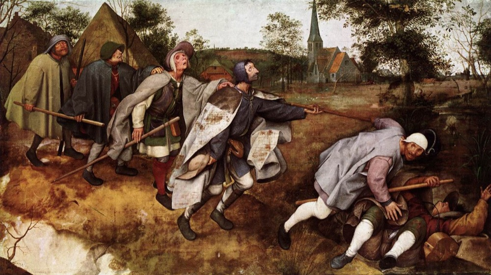{fig-alt="Pintura A parábola dos cegos, de Pieter Bruegel: uma fila de cegos, cada um apoiado no da frente, caminha atrás de um que já caiu numa vala. Legenda: eu na primeira aula de multivariada: não faço ideia do que estou fazendo." height="540px"}

[Eu na primeira aula de multivariada]{.meme-topo} [Não faço ideia do que estou fazendo]{.meme-base}
:::

::: {.ref}
Pieter Bruegel, o Velho, *A parábola dos cegos* (1568), domínio público, via
Wikimedia Commons.
:::

## Hoje

1. O curso: cronograma, avaliação e bibliografia
2. Tudo começa com uma boa pergunta
3. Estudos observacionais e experimentais
4. Por que precisamos de métodos multidimensionais
5. Um pouco de história
6. Como os métodos funcionam: matrizes e o espaço euclidiano
7. Rudimentos de álgebra de matrizes

::: {.nota}
As figuras foram geradas em R ou são imagens históricas em domínio público.
O código está em
[`R/aula01.R`](https://github.com/diogoprov/multidimensionais/tree/main/R).
:::

## O mapa da disciplina

```{r}
#| fig-alt: "Mapa dos métodos multidimensionais, com todas as famílias destacadas: da matriz de dados saem a associação (Aula 2), que leva à classificação (Aula 3), à ordenação irrestrita (Aula 4), à ordenação restrita (Aula 5) e aos testes (Aula 6), e os métodos baseados em modelos (Aula 7)."
#| fig-height: 5.6
#| out-height: 590px
mapa_plot()
```

# 1. O curso {.secao}

## Cronograma: segunda-feira

```{r}
#| fig-alt: "Dois cartões. Segunda de manhã: introdução às análises multidimensionais, correlação e covariância, espaço euclidiano e álgebra de matrizes. Segunda à tarde: coeficientes de distância, transformações e padronização, e prática de introdução ao R e cálculo de matrizes de distância."
#| fig-width: 11
#| fig-height: 4.6
#| out-height: 480px
fig_cartoes(tibble::tribble(~titulo, ~texto, ~cor,
  "Manhã (Aula 1)", "• Introdução às análises\n  multidimensionais: objetivos\n  e principais usos\n• Correlação e covariância\n• Espaço euclidiano\n• Álgebra de matrizes: autovetores,\n  autovalores, autoanálise", "#b5473f",
  "Tarde (Aula 2)", "• Coeficientes de distância\n  métricos, semimétricos e\n  não métricos\n• Transformações e padronização\n• Prática: introdução ao R,\n  importação de dados e\n  matrizes de distância", "#6b8e23"),
  larg = 5.2, alt = 4.6, tam = 7)
```

## Cronograma: o resto da semana

```{r}
#| fig-alt: "Quatro cartões, um por dia. Terça: agrupamento hierárquico e não hierárquico (k-means) e espécies indicadoras. Quarta: ordenações irrestritas, PCA, PCoA, nMDS e CA. Quinta: ordenações restritas, CCA, RDA, RDA parcial, db-RDA e LDA. Sexta: Mantel, Mantel parcial, MRM, Procrustes e PROTEST, PERMANOVA e betadisper. Prática à tarde em todos os dias."
#| fig-width: 11
#| fig-height: 5.4
#| out-height: 540px
fig_cartoes(tibble::tribble(~titulo, ~texto, ~cor,
  "Terça (Aula 3)", "• Agrupamento hierárquico e\n  não hierárquico (k-means)\n• Espécies indicadoras (IndVal)\n• Prática à tarde", "#b5473f",
  "Quarta (Aula 4)", "• Ordenações irrestritas:\n  PCA, PCoA, nMDS, CA\n• Prática à tarde", "#c0843d",
  "Quinta (Aula 5)", "• Ordenação restrita (canônica):\n  CCA, RDA, pRDA, db-RDA, LDA\n• Prática à tarde", "#9a9a3a",
  "Sexta (Aula 6)", "• Mantel, Mantel parcial, MRM,\n  Procrustes/PROTEST,\n  PERMANOVA, betadisper\n• Prática à tarde", "#6b8e23"),
  ncol = 2, larg = 5.4, alt = 2.5, tam = 6.6)
```

## Ao final do curso

```{r}
#| fig-alt: "Três cartões numerados. 1, avaliação: duas questões para resolver por escrito em uma semana, com análise de dados multivariados e interpretação. 2, resumos e mapas mentais fornecidos ao fim da disciplina no Moodle. 3, feedback sobre a disciplina."
#| fig-width: 11
#| fig-height: 4.4
#| out-height: 440px
fig_cartoes(tibble::tribble(~titulo, ~texto, ~cor,
  "1. Avaliação", "Duas questões para\nresolver por escrito,\nem uma semana:\nanálise de dados\nmultivariados e\ninterpretação", "#b5473f",
  "2. Resumos", "Resumos e mapas\nmentais fornecidos\nao fim da disciplina,\nno Moodle", "#c0843d",
  "3. Feedback", "Sua avaliação\nda disciplina", "#6b8e23"),
  larg = 3.5, alt = 4.2, tam = 7)
```

## Avisos

```{r}
#| fig-alt: "Três cartões de aviso. O curso está inteiramente no Moodle. Logo, não precisa copiar o slide: melhor acompanhar a aula e perguntar. Os scripts do R já serão fornecidos, e os alunos devem acompanhar junto."
#| fig-width: 11
#| fig-height: 4
#| out-height: 400px
fig_cartoes(tibble::tribble(~titulo, ~texto, ~cor,
  "Moodle", "O curso está\ninteiramente\nno Moodle", "#b5473f",
  "Pergunte!", "Não precisa copiar\no slide: melhor\nacompanhar a aula\ne PERGUNTAR", "#6b8e23",
  "Scripts", "Os scripts do R\njá serão fornecidos:\nacompanhe junto", "#6a4c93"),
  larg = 3.5, alt = 3.6, tam = 7.6)
```

## Bibliografia

:::: {.columns}
::: {.column width="50%"}
**Livros principais**

- Legendre & Legendre (2012) *Numerical Ecology*, 3ª ed. Elsevier.
- Borcard, Gillet & Legendre (2018) [*Numerical Ecology with R*](https://doi.org/10.1007/978-3-319-71404-2),
  2ª ed. Springer.
- Thioulouse et al. (2018) *Multivariate Analysis of Ecological Data with
  ade4*. Springer.
:::
::: {.column width="50%"}
**Complementares**

- McCune & Grace (2002) *Analysis of Ecological Communities*. MjM Software.
- Gotelli & Ellison (2011) *Princípios de estatística em ecologia*. Artmed:
  cap. 7 (desenhos amostrais) e cap. 12 (multivariada).
:::
::::

## Todos prontos?

::: {.meme}
{fig-alt="Pintura A Liberdade guiando o povo, de Eugène Delacroix: uma mulher com a bandeira francesa erguida avança sobre uma barricada, à frente de um povo armado, de trabalhadores e estudantes a um menino. Legenda: todos prontos? Então vamos lá." height="520px"}

[Todos prontos?]{.meme-topo} [Então vamos lá!]{.meme-base}
:::

::: {.ref}
Eugène Delacroix, *A Liberdade guiando o povo* (1830), Museu do Louvre, domínio
público, via Wikimedia Commons.
:::

# 2. Tudo começa com uma boa pergunta {.secao}

## Da pergunta à predição

```{r}
#| fig-width: 12
#| fig-height: 3.2
#| out-height: 320px
#| fig-alt: "Fluxograma da esquerda para a direita: pergunta clara, hipóteses, predições, as predições seguem da hipótese?, são testáveis?, planejar a coleta. Se as predições não seguem da hipótese, volta-se às hipóteses; se não são testáveis, volta-se às predições."
fig_fluxo_pergunta()
```

O caminho tem idas e voltas. Se uma predição não sai da hipótese, ou não dá
para testá-la, a gente volta um passo antes de ir a campo.

::: {.ref}
Adaptado do [cap. 2 de Ruxton & Colegrave (2016)](https://doi.org/10.1093/hesc/9780198717355.003.0002) *Experimental Design for the
Life Sciences*, 4ª ed. Oxford University Press. Mesmo esquema da Aula 2 de
Bioestatística.
:::

## Dicas para fazer uma boa pergunta

- Uma pergunta científica tem de ser **testável** por meio de observações,
  de experimentos ou dos dois.
- Para algo ser testável, tem de ser **mensurável**.
- Uma boa pergunta já nomeia a **variável resposta** (dependente) e a(s)
  **variável(is) preditora(s)** (independentes).
- Atente para o **verbo**: ele indica que tipo de análise vai responder à
  pergunta.

::: {.definicao}
Evite perguntas cuja resposta é "sim" ou "não". "Existe diferença?" quase
sempre tem resposta "sim, alguma", e isso não ensina nada. Pergunte
**quanto**, **em que direção** e **de que forma**.
:::

## O verbo guia a análise

::: {.tabela-grande}
| A pergunta | O que ela pede |
|---|---|
| Qual a **relação** entre X e Y? | como Y muda ao longo de X: correlação ou regressão |
| Qual o **efeito** do fator X em Y? | comparar Y entre níveis de X: teste t, ANOVA |
| Como X **influencia** Y? | o mecanismo e a direção do efeito |
| Como a mudança em X **afeta** Y? | a forma da resposta: linear, saturante... |
:::

Com várias respostas (Y é uma matriz de espécies), o verbo continua guiando a
escolha: relação → ordenação restrita (Aula 5); efeito de um fator →
PERMANOVA (Aula 6).

## Como melhorar uma pergunta

1. *Existe diferença entre as áreas?* Diferença em quê? Entre quais áreas?

::: {.fragment}
2. *Qual a influência do tipo de solo no crescimento de* Pinus? Já tem
   resposta e preditora, mas "influência" ainda é vago.
:::

::: {.fragment}
3. *Qual o efeito da quantidade de nitrogênio no solo na taxa de
   crescimento per capita de árvores adultas de* Pinus? Variáveis
   mensuráveis e população definida.
:::

::: {.fragment}
4. *A quantidade de nitrogênio no solo **aumenta** a taxa de crescimento
   per capita de* Pinus? Agora há uma **direção** esperada, que é uma
   predição.
:::

## Hipótese e predição

```{r}
#| fig-width: 8
#| fig-height: 2.4
#| out-height: 220px
#| fig-alt: "Diagrama com duas caixas: Nitrogênio no solo aponta para Taxa de crescimento per capita, com um sinal positivo na seta."
fig_hipotese_n()
```

::: {.definicao}
**Hipótese:** o nitrogênio faz parte de muitas moléculas envolvidas no
crescimento das plantas. **Logo**, espero que, quanto maior a quantidade de
nitrogênio disponível no solo, maior seja a taxa de crescimento per capita
de uma população de *Pinus*.
:::

A hipótese é a explicação biológica (o **porquê**). A predição é o que essa
explicação implica sobre os dados (o **que** devemos ver).

## Fluxograma com perguntas e predições

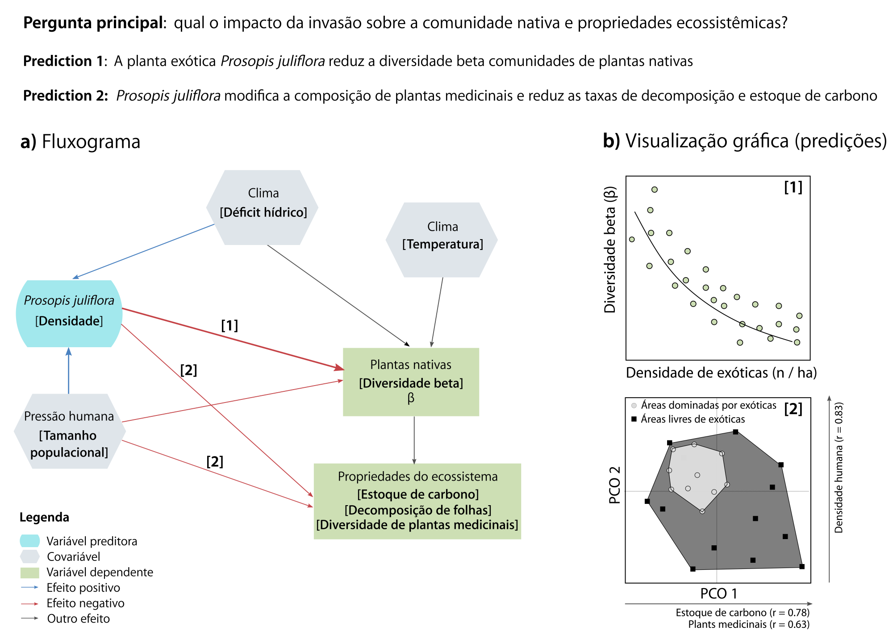{fig-alt="Fluxograma de pesquisa do capítulo 2 de Análises Ecológicas no R: a pergunta sobre o impacto da invasão de Prosopis juliflora na comunidade nativa e nas propriedades do ecossistema gera predições; as variáveis preditoras, respostas e covariáveis aparecem como caixas de formatos diferentes, ligadas por setas com o sinal esperado de cada efeito." fig-align="center" height="520px"}

::: {.ref}
Figura 2.3 de [Gonçalves-Souza, Provete et al., cap. 2 de *Análises ecológicas no R*](https://analises-ecologicas.com/cap2#fluxograma-conectando-variáveis-para-melhorar-o-desenho-experimental-e-as-análises-estatísticas)
(da Silva et al. 2022, Nupeea/Canal 6; versão online CC BY-NC 4.0).
:::

## Hipótese científica e hipótese estatística {.medio}

:::: {.columns}
::: {.column width="50%"}
- A **hipótese científica** é uma explicação sobre o mundo, em termos
  biológicos.
- A **hipótese estatística** a traduz numa afirmação sobre parâmetros que
  podemos estimar.
- A **hipótese nula** (H~0~) diz que a variação na resposta não está
  relacionada à da preditora.
:::
::: {.column width="50%"}
```{r}
#| fig-width: 6
#| fig-height: 4.4
#| out-height: 430px
#| fig-alt: "Gráfico conceitual com nitrogênio no eixo x e crescimento no eixo y. Os pontos se espalham em torno de uma linha horizontal: o crescimento não muda com o nitrogênio."
fig_hipotese("nula", "H0: nenhuma relação")
```
:::
::::

## Três hipóteses alternativas

```{r}
#| fig-width: 12
#| fig-height: 3.5
#| out-height: 340px
#| fig-alt: "Três gráficos conceituais. H1: o crescimento aumenta em linha reta com o nitrogênio. H2: o crescimento aumenta e depois se estabiliza. H3: o crescimento aumenta até um máximo e depois diminui."
fig_hipoteses_alternativas()
```

- **H1, linear:** cada miligrama a mais de N rende o mesmo ganho.
- **H2, saturante:** o ganho diminui até algum outro recurso limitar.
- **H3, unimodal:** N em excesso passa a ser prejudicial (como as respostas
  unimodais das espécies a gradientes, que voltam nas Aulas 4 e 5).

## Conceitos importantes

- **Unidade amostral**: um *plot* de floresta (uma população de árvores).
- **Réplica**: vários *plots* distribuídos na floresta.
  - Melhor replicar *plots* ou florestas? Depende da pergunta e de onde está a
    maior variabilidade dos dados (Ruxton & Colegrave, seção 11.2.1).
- **Tamanho do efeito**: diferença na média entre grupos ou tratamentos.
- **Poder do teste**: quantos *plots*? Quantas florestas?
  - "Regra dos 10": 10 unidades amostrais para cada variável preditora
    (Gotelli & Ellison, cap. 6).
  - A variabilidade natural dos dados se estima com estudos piloto ([Ruxton &
    Colegrave, seção 2.4](https://doi.org/10.1093/hesc/9780198717355.003.0002)).

# 3. Estudos observacionais e experimentais {.secao}

## Da observação ao modelo causal

:::: {.columns}
::: {.column width="55%"}
```{r}
#| fig-alt: "Fluxograma: das observações saem a análise exploratória de dados, que leva a um modelo descritivo, e a informação sobre causas; os dois levam a um modelo causal, que pode ser testado por um estudo observacional (quase experimental) ou por um experimento controlado de laboratório ou campo. A análise exploratória está destacada."
#| fig-width: 6.6
#| fig-height: 5.4
#| out-height: 560px
fig_observacao_experimento()
```
:::
::: {.column width="45%"}
Boa parte das análises multivariadas em ecologia está na **análise
exploratória**: descreve padrões e gera hipóteses, que depois precisam ser
testadas.

::: {.definicao}
Experimental ou correlativo? Não existe resposta única, e nem sempre é
possível fazer um experimento ([Ruxton & Colegrave 2016, cap. 3](https://doi.org/10.1093/hesc/9780198717355.003.0003)).
:::
:::
::::

::: {.ref}
Inspirado em [James & McCulloch (1990)](https://doi.org/10.1146/annurev.es.21.110190.001021)
*Annu. Rev. Ecol. Syst.* 21: 129–166.
:::

## Efeito de confundimento

```{r}
#| fig-width: 8
#| fig-height: 3.6
#| out-height: 340px
#| fig-alt: "Diagrama causal com três caixas. A água no solo aponta, com sinal positivo, para o nitrogênio no solo e para a taxa de crescimento. Do nitrogênio para a taxa de crescimento há uma seta com ponto de interrogação."
fig_confundimento_dag()
```

::: {.definicao}
**Variável confundidora** (ou terceira variável): afeta ao mesmo tempo a
preditora e a resposta. Aqui, solos mais úmidos retêm mais nitrogênio
**e** fazem as árvores crescerem mais.
:::

## Um estudo observacional, com dados simulados

```{r}
#| fig-width: 12
#| fig-height: 4.4
#| out-height: 420px
#| fig-alt: "À esquerda, 60 parcelas mostram o crescimento aumentando com o nitrogênio. À direita, as mesmas parcelas coloridas por classe de umidade: dentro de cada classe a relação com o nitrogênio é bem mais fraca, e as parcelas úmidas estão todas no alto."
fig_confundimento_dados()
```

Nesta simulação o nitrogênio **não tem efeito nenhum**: só a água afeta o
crescimento. Separando por umidade, a relação com o nitrogênio quase some.

## Observacional ou experimental? {.medio}

- **Estudos observacionais** medem as variáveis como elas estão na
  natureza. Não permitem inferir causalidade com segurança: não isolam as
  confundidoras, e as réplicas podem não ser independentes.
  - Dá para reduzir o problema: medir a confundidora e incluí-la no modelo
    como covariável (a RDA parcial da Aula 5), ou usar modelos de equações
    estruturais.
- **Estudos experimentais** permitem inferir causalidade, porque a
  **atribuição** das unidades amostrais aos tratamentos é **aleatória**.

::: {.ref}
Shipley (2016) *Cause and Correlation in Biology*, 2ª ed. Cambridge University
Press; Pearl (2009) *Causality*, 2ª ed. Cambridge University Press.
:::

## O sorteio distribui a confundidora

```{r}
#| fig-width: 12
#| fig-height: 4.2
#| out-height: 400px
#| fig-alt: "À esquerda, 30 parcelas sobre um gradiente de umidade, cada uma marcada com C, P ou M conforme o tratamento sorteado; os três tratamentos aparecem misturados ao longo de todo o gradiente. À direita, a água no solo de cada tratamento, com distribuições que se sobrepõem bastante."
fig_experimento_mapa()
```

A mesma pergunta como experimento: doses de nitrogênio **sorteadas** entre
as parcelas. Os três tratamentos aparecem em todo o gradiente de umidade.

## O resultado do experimento

:::: {.columns}
::: {.column width="58%"}
```{r}
#| fig-width: 7
#| fig-height: 4.6
#| out-height: 470px
#| fig-alt: "Crescimento per capita das 30 parcelas, separado em controle, pouco nitrogênio e muito nitrogênio. Cada grupo tem dez pontos e, ao lado, a média com intervalo de confiança de 95%. As médias aumentam do controle para muito nitrogênio."
fig_experimento_resultado()
```
:::
::: {.column width="42%"}
- A preditora agora é **categórica**: um fator com três níveis.
- **Desvantagens** dos experimentos: escala espacial restrita, inviáveis com
  organismos grandes ou processos lentos, custo e número limitado de
  tratamentos.
:::
::::

::: {.ref}
[Ruxton & Colegrave (2016), cap. 3](https://doi.org/10.1093/hesc/9780198717355.003.0003). Dados simulados, como na Aula 2 de
Bioestatística.
:::

# 4. Dois exemplos de estudos observacionais {.secao}

## Resposta de comunidades biológicas {.medio}

:::: {.columns}
::: {.column width="40%"}
**Principal questão**: as variáveis ambientais influenciam a composição de
espécies?

**Principal teoria**: nicho ecológico; *species sorting* e metacomunidades.

**Unidade amostral**: poças.
:::
::: {.column width="60%"}
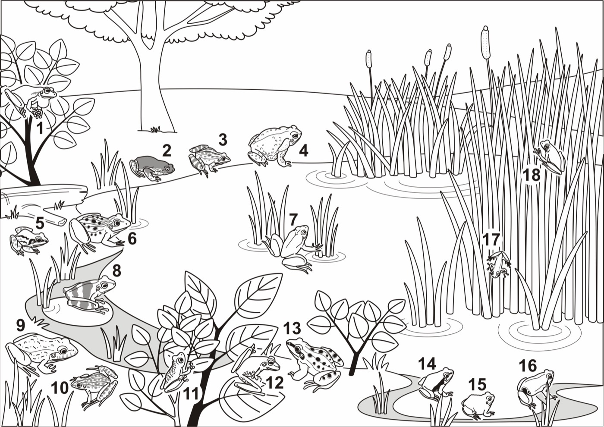{fig-align="center" height="500px" fig-alt="Ilustração de uma poça com 18 espécies de anuros numeradas, cada uma num micro-hábitat: árvores, arbustos, capim na margem, plantas emergentes, folhas flutuantes e água aberta."}
:::
::::

::: {.ref}
Ilustração de [Provete et al. (2011)](https://doi.org/10.1590/S1676-06032011000200036)
*Biota Neotrop.* 11(2): 377–391.
:::

## O que medir em cada poça

```{r}
#| fig-alt: "A ilustração da poça com o rótulo densidade de vegetação, com uma seta para o taboal."
#| fig-width: 10
#| fig-height: 7.6
#| out-height: 590px
fig_poca_camadas(1)
```

## O que medir em cada poça

```{r}
#| fig-alt: "A ilustração da poça com os rótulos densidade e tipos de vegetação, com setas para o taboal, os arbustos e as folhas flutuantes."
#| fig-width: 10
#| fig-height: 7.6
#| out-height: 590px
fig_poca_camadas(2)
```

## O que medir em cada poça

```{r}
#| fig-alt: "A ilustração da poça com os rótulos de vegetação e uma linha laranja sobre a água: porcentagem da superfície da poça exposta."
#| fig-width: 10
#| fig-height: 7.6
#| out-height: 590px
fig_poca_camadas(3)
```

## O que medir em cada poça

```{r}
#| fig-alt: "A ilustração da poça com as três variáveis ambientais e círculos vermelhos em quatro espécies de anuros: as espécies que ocorrem na poça."
#| fig-width: 10
#| fig-height: 7.6
#| out-height: 590px
fig_poca_camadas(4)
```

## Das poças às duas matrizes

```{r}
#| fig-alt: "Esquema das duas matrizes do exemplo. Em cima, três variáveis ambientais (tipos de vegetação, densidade da vegetação e porcentagem da superfície da poça exposta), unidas por uma chave, formam a matriz X, com uma linha por poça. Embaixo, silhuetas de três anuros, unidas por outra chave, formam a matriz Y, de presença e ausência das espécies nas mesmas poças."
#| fig-width: 10
#| fig-height: 7.4
#| out-height: 520px
fig_girinos_matrizes()
```

::: {.ref}
Valores ilustrativos. Silhuetas do [PhyloPic](https://www.phylopic.org): Luca Leicht (CC BY 4.0),
Dennis C. Murphy e plag665 (CC0 1.0). Mesmo esquema da Aula 5.
:::

## Morfologia: cladogênese e forma {.medio}

:::: {.columns}
::: {.column width="48%"}
- **Pergunta**: a cladogênese promoveu divergência morfológica em grupos de
  espécies?
- **Teoria**: evolução por seleção natural; modos de especiação.
- **Unidade amostral**: indivíduos de uma espécie ou de um grupo de
  espécies.
- **Morfometria tradicional**: distâncias lineares entre pontos do corpo,
  como o comprimento do corpo (L.), do fêmur (F.) e da tíbia (T.).
:::
::: {.column width="52%"}
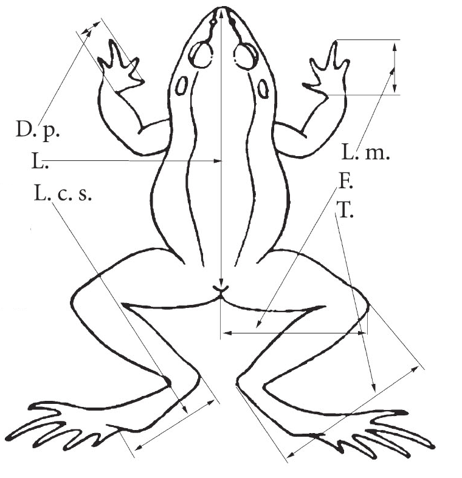{fig-align="center" height="540px" fig-alt="Desenho em traço de uma rã em vista dorsal com as medidas lineares indicadas por setas e abreviaturas: comprimento do corpo (L.), do fêmur (F.), da tíbia (T.), do pé e de partes das mãos e dos dedos."}
:::
::::

::: {.ref}
Desenho de Yevhen Pysanets, do livro *Земноводні України* (Anfíbios da
Ucrânia), via [Wikipédia em ucraniano](https://uk.wikipedia.org/wiki/Файл:Amphibian_measurements.jpg)
(CC BY 3.0), recortado.
:::

## Morfometria geométrica {.medio}

:::: {.columns}
::: {.column width="55%"}
```{r}
#| fig-alt: "A mesma silhueta dorsal de perereca com dez marcos anatômicos numerados em vermelho, do focinho à cloaca, dos dois lados do corpo."
#| fig-width: 6.6
#| fig-height: 5.4
#| out-height: 520px
fig_morfometria("geometrica")
```
:::
::: {.column width="45%"}
- Em vez de distâncias, as **coordenadas** de marcos anatômicos homólogos.
- Depois de alinhar as configurações (a superposição de Procrustes, Aula 6),
  cada indivíduo vira uma linha com $2k$ colunas.
- Nos dois casos, o resultado é um **conjunto de dados multivariado**.
:::
::::

::: {.ref}
Baseado em slide de Marcos Severgnini. Silhueta de Carlo De Rito,
[PhyloPic](https://www.phylopic.org) (CC0 1.0).
:::

## Um conjunto de dados multivariado {.medio}

:::: {.columns}
::: {.column width="60%"}
::: {.tabela-grande}
```{r}
knitr::kable(morfo_brutos(), align = "lrrrrrr")
```
:::
:::
::: {.column width="40%"}
- Cada **linha** é um indivíduo (objeto); cada **coluna**, uma medida
  (descritor), em mm.
- CRC: comprimento rostro-cloacal; LC: largura da cabeça; F: fêmur;
  T: tíbia.

::: {.definicao}
Muitas variáveis nos mesmos indivíduos: **logo, precisamos de métodos
multidimensionais**.
:::
:::
::::

::: {.ref}
Dados simulados.
:::

# 5. Por que métodos multidimensionais? {.secao}

## Objetivos principais

:::: {.columns}
::: {.column width="42%"}
- **Medir a (dis)similaridade** entre objetos e descritores (Aula 2).
- **Encontrar grupos** (Aula 3).
- **Reduzir a dimensionalidade** para encontrar as principais estruturas
  (Aula 4).
- **Modelar uma matriz** em função de variáveis explanatórias (Aula 5).
- **Testar hipóteses**, além de explorar (Aula 6).
:::
::: {.column width="58%"}
```{r}
#| fig-alt: "Mapa dos métodos multidimensionais, com cada objetivo associado a uma família de métodos e a uma aula."
#| fig-width: 7
#| fig-height: 4.6
#| out-height: 470px
mapa_plot(perguntas = FALSE)
```
:::
::::

## Objetos e atributos em ecologia {.medio}

::: {.tabela-grande}
| Estudo | Objetos | Atributos |
|---|---|---|
| Comunidades | parcelas, locais | espécies, fatores ambientais |
| Nicho | indivíduos, espécies | recursos, ótimos ambientais |
| Comportamento | indivíduos | atividades, respostas a estímulos |
| Taxonomia | espécimes, espécies | caracteres morfológicos, moleculares |
| Grupos funcionais | espécies | atributos de história de vida |
:::

::: {.ref}
Adaptado de McCune & Grace (2002), Tabela 2.1.
:::

## Problemas e soluções multivariadas {.medio}

::: {.tabela-grande style="font-size: 0.8em"}
| Problema | Adequada a dados de comunidades | Modelo linear (em geral inadequada) |
|---|---|---|
| Medir distâncias no espaço multidimensional | distância de Sørensen (Bray-Curtis) | euclidiana ou baseada em correlação |
| Diferença entre dois ou mais grupos (um fator) | MRPP ou Mantel, com Sørensen | MANOVA de um fator |
| Medidas repetidas, blocos ou pares | MRPP em blocos | ANOVA em blocos, MANOVA de medidas repetidas |
| Partição entre níveis de amostragem aninhada | PERMANOVA (NPMANOVA) | ANOVA aninhada univariada |
| Dois ou mais fatores, com interações | PERMANOVA (NPMANOVA) | MANOVA |
| Espécies que discriminam os grupos | espécies indicadoras (IndVal) | análise discriminante |
| Extrair um gradiente sintético (ordenação) | nMDS com Sørensen | PCA |
| Escores de novas amostras num gradiente | escores do nMDS | equações lineares da PCA |
:::

::: {.ref}
Adaptado da Tabela 5.1 de McCune & Grace (2002) *Analysis of Ecological
Communities*, MjM Software Design.
:::

## Que análise para cada estrutura de dados?

```{r}
#| fig-alt: "Cinco tipos de análise com esquemas das matrizes. Univariadas: um vetor y em função de um vetor x (regressão, ANOVA). Multivariadas exploratórias: uma matriz Y (ordenação e classificação). Testes multivariados com matrizes de distâncias: DY em função de DX (teste de Mantel). Testes multivariados com uma preditora: Y em função de x (MANOVA, PERMANOVA). Ordenações restritas: Y em função de uma matriz X (RDA, CCA, db-RDA)."
#| fig-height: 5.4
#| out-height: 540px
fig_tipos_analise()
```

::: {.ref}
Inspirado num slide de Adriano S. Melo.
:::

# 6. Um pouco de história {.secao}

## Um pouco de história

::: {.meme}
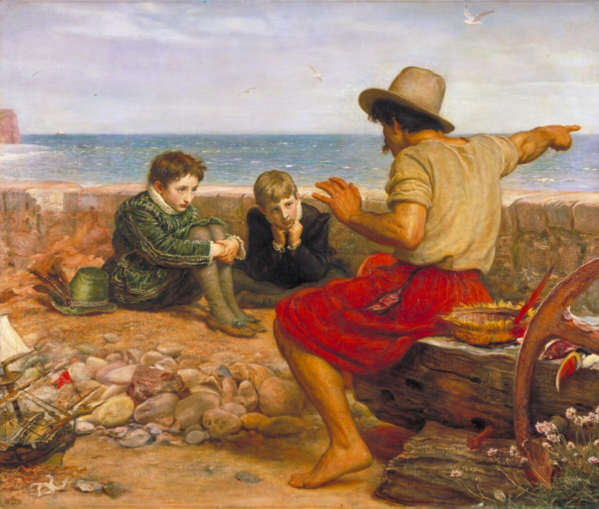{fig-alt="Pintura A infância de Raleigh, de John Everett Millais: um velho marinheiro sentado na praia aponta para o mar enquanto conta histórias a dois meninos atentos. Legenda: senta que lá vem a história." height="520px"}

[Senta, que lá vem]{.meme-topo} [a história!]{.meme-base}
:::

::: {.ref}
John Everett Millais, *A infância de Raleigh* (1870), Tate, domínio público, via Wikimedia Commons.
:::

## Introdução

- As análises multivariadas foram concebidas para análises **psicométricas e
  sociológicas**, na virada do século XIX para o XX.
- Só depois foram introduzidas na ecologia, inicialmente na **classificação
  de comunidades vegetais**.

::: {.definicao}
Conhecer essa história é parte da formação: parte dos métodos que usamos foi
criada num contexto que hoje reconhecemos como racista.
:::

## Um passado incômodo: a eugenia {.medio}

- Na partilha da África e da Ásia pelas potências europeias, o **movimento
  eugenista** ofereceu uma "justificativa científica" para a dominação: medir
  crânios e corpos para hierarquizar "raças".
- A mesma lógica alimentou o genocídio dos **Herero e Nama** na Namíbia
  (1904–1908), cujos crânios foram levados para a Alemanha e só começaram a ser
  devolvidos neste século ([BBC, 2018](https://www.bbc.com/news/world-africa-45342586)),
  e culminou no mito
  da "raça ariana" e no genocídio da Segunda Guerra Mundial, com a
  participação de cientistas ([Scientific American](https://www.scientificamerican.com/article/neurologists-role-in-nazi-racial-hygiene-only-now-comes-to-light/)).
- Francis Galton e Karl Pearson, que criaram ferramentas que usamos até hoje,
  foram defensores da eugenia.

::: {.ref}
[Goldstein (2012)](https://doi.org/10.1080/0969594X.2011.614220) *Assess. Educ.* 19: 147–158;
[Understanding Race: Measuring race, 1850–1880](https://understandingrace.org/history/science/measuring-race-1850-1880/)
(American Anthropological Association). Para ler mais: S. J. Gould, *A falsa medida do homem*; C. Zimmer, *She has her
mother's laugh*; D. Salsburg, *Uma senhora toma chá*.
:::

## Medir o crânio: frenologia e craniometria {.medio}

:::: {.columns}
::: {.column width="50%"}
- A **frenologia** (Gall e Spurzheim, início do século XIX) dizia que cada
  faculdade mental aparecia como uma saliência no crânio.
- A **craniometria** trocou as saliências por **medidas lineares e ângulos**:
  o ângulo facial (no alto) e o índice cefálico, largura / comprimento × 100
  (embaixo).
- **Samuel G. Morton** (1799–1851) encheu crânios de sementes e de chumbo
  para medir a capacidade craniana e, em *Crania Americana* (1839), ordenou
  "raças" pelo tamanho do cérebro. Já em 1836, Tiedemann, medindo cérebros,
  não encontrara essa diferença.
:::
::: {.column width="50%"}
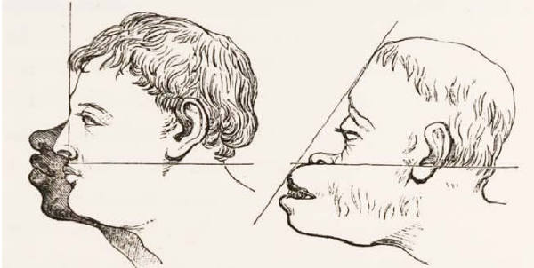{fig-align="center" height="215px" fig-alt="Gravura do século XIX com dois perfis humanos e as linhas usadas para medir o ângulo facial: uma linha horizontal da orelha à base do nariz e outra da testa aos lábios."}

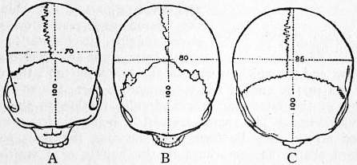{fig-align="center" height="200px" fig-alt="Três crânios vistos de cima, A, B e C, com linhas pontilhadas do comprimento máximo, marcado como 100, e da largura máxima, marcada como 70, 80 e 85: três valores do índice cefálico."}
:::
::::

::: {.ref}
Gravura do século XIX (legenda original recortada), via [*Measuring
Prejudice*](https://scalar.usc.edu/works/measuring-prejudice/media/profile-of-african-european-and-orang)
(USC Scalar), fonte original não identificada; Fig. 4 do verbete *Craniometry* da
*Encyclopædia Britannica* (1911), domínio público.
[Tiedemann (1836)](https://doi.org/10.1098/rstl.1836.0025) *Phil. Trans. R. Soc.* 126: 497–527;
sobre Morton, Gould (*A falsa medida do homem*) e [Lewis et al. (2011)](https://doi.org/10.1371/journal.pbio.1001071) *PLoS Biol.* 9: e1001071.
:::

## Francis Galton e a "regressão" {.medio}

:::: {.columns}
::: {.column width="25%"}
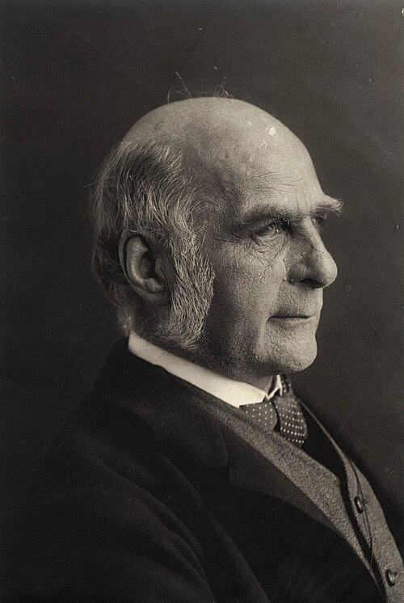{height="330px" fig-alt="Retrato de Francis Galton, idoso, de barba e bigode brancos."}
:::
::: {.column width="35%"}
{height="360px" fig-alt="Prancha de Galton de 1886 sobre a taxa de regressão na estatura hereditária, com as estaturas dos filhos e dos pais."}
:::
::: {.column width="40%"}
- Francis Galton (1822–1911), antropólogo inglês, primo de Charles Darwin,
  defensor da **eugenia**.
- Cunhou o termo "regressão" (1886), medindo a altura de filhos e pais para
  estudar a herdabilidade da estatura:

> "the average regression of the offspring is a constant fraction of their
> respective mid-parental deviations"
:::
::::

::: {.ref}
[Galton (1886)](https://doi.org/10.2307/2841583) *J. Anthropol. Inst.* 15: 246–263. Imagens em
domínio público.
:::

## Karl Pearson e o coeficiente de regressão

:::: {.columns}
::: {.column width="30%"}
{height="400px" fig-alt="Retrato de Karl Pearson."}
:::
::: {.column width="70%"}
- Karl Pearson (1857–1936), discípulo de Galton e também eugenista, definiu o
  **coeficiente de regressão** e o de **correlação** como os usamos hoje
  (1896).
- Fundou o primeiro departamento universitário de estatística, no University
  College London.
:::
::::

::: {.ref}
[Pearson (1896)](https://doi.org/10.1098/rspl.1895.0058) *Proc. R. Soc. Lond.* 59: 69–71. Imagem em domínio público.
:::

## Pearson (1901): retas e planos de melhor ajuste

:::: {.columns}
::: {.column width="55%"}
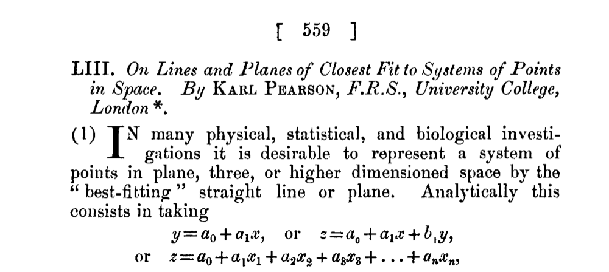{height="260px" fig-alt="Primeira página do artigo de Pearson de 1901, On lines and planes of closest fit to systems of points in space, que fala em representar um sistema de pontos em espaço de duas, três ou mais dimensões pela reta ou plano de melhor ajuste."}

A reta de **melhor ajuste** a uma nuvem de pontos é o eixo maior da elipse: a
origem da **PCA** (Aula 4).
:::
::: {.column width="45%"}
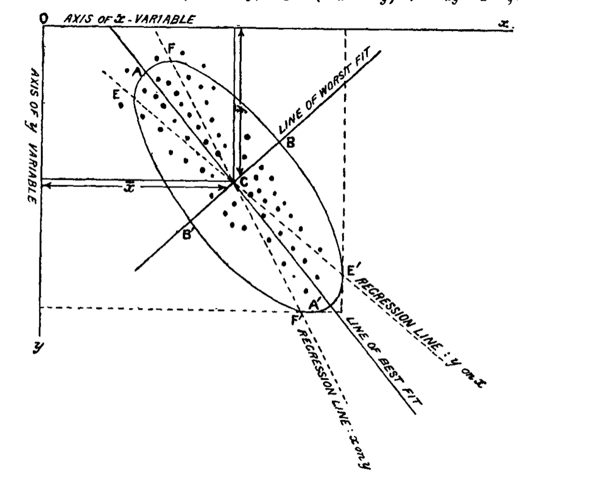{height="470px" fig-alt="Figura do artigo de Pearson de 1901: uma nuvem de pontos com uma elipse, as duas retas de regressão (y em x e x em y) e a reta de melhor ajuste, que passa pelo eixo maior da elipse, além da reta de pior ajuste, perpendicular a ela."}
:::
::::

::: {.ref}
[Pearson (1901)](https://doi.org/10.1080/14786440109462720) *Phil. Mag.* 2: 559–572. Domínio público.
:::

## Na ecologia: classificação da vegetação

- Os métodos chegaram à ecologia pela **classificação de comunidades vegetais**.
- David Goodall (1914–2018), pioneiro da ecologia quantitativa: métodos
  objetivos de classificação da vegetação (1953). Trabalhou até os 104 anos.
- Williams & Lambert (1959): análise de associação em comunidades vegetais.

::: {.ref}
[Goodall (1953)](https://doi.org/10.1071/BT9530434) *Aust. J. Bot.* 1: 39–63;
[Williams & Lambert (1959)](https://doi.org/10.2307/2257249) *J. Ecol.* 47: 83–101.
:::

## Bray & Curtis (1957): a ordenação polar {.medio}

```{r}
#| fig-alt: "Ordenação polar dos 20 locais dos prados de dunas. Os dois locais mais diferentes pela distância de Bray-Curtis, em vermelho, são os extremos de um eixo; os outros 18 locais ficam ao longo dele, conforme as suas distâncias até cada extremo."
#| fig-width: 11
#| fig-height: 3.6
#| out-height: 330px
fig_ordenacao_polar()
```

- O **primeiro método de ordenação** para dados de contagem, nas florestas de
  terras altas de Wisconsin.
- Escolhem-se os dois locais mais diferentes como **extremos**; cada local é
  posicionado pelas suas distâncias até eles.

::: {.ref}
[Bray & Curtis (1957)](https://doi.org/10.2307/1942268) *Ecol. Monogr.* 27: 325–349.
Aqui, com os prados de dunas de `vegan::dune`. Para brincar: [roteiro de ordenação do
EcoVirtual](http://ecovirtual.ib.usp.br/doku.php?id=ecovirt:roteiro:comuni:comuni_order).
:::

## Whittaker: a análise de gradientes {.medio}

:::: {.columns}
::: {.column width="58%"}
```{r}
#| fig-alt: "Curvas de resposta unimodais de sete espécies ao longo de um gradiente de altitude, de 500 a 2000 metros, cada uma com um ótimo e uma amplitude diferentes."
#| fig-width: 7
#| fig-height: 4.6
#| out-height: 470px
fig_gradiente_whittaker()
```
:::
::: {.column width="42%"}
- Nas Great Smoky Mountains, Whittaker descreveu a vegetação ao longo de
  gradientes de altitude e umidade.
- As espécies se distribuem **individualmente**, cada uma com um ótimo: a
  base das respostas unimodais que voltam nas Aulas 4 e 5.
:::
::::

::: {.ref}
[Whittaker (1956)](https://doi.org/10.2307/1943577) *Ecol. Monogr.* 26: 1–80;
[Whittaker (1967)](https://doi.org/10.1111/j.1469-185X.1967.tb01419.x) *Biol. Rev.* 42: 207–264.
Dados simulados.
:::

## Uma linha do tempo

```{r}
#| fig-alt: "Linha do tempo de 1901 a 2001 com a publicação dos métodos: PCA (Pearson 1901, Hotelling 1933), CA (Hirschfeld 1935), ordenação polar (Bray e Curtis 1957), análise de associação (Williams e Lambert 1959), nMDS (Kruskal 1964), PCoA (Gower 1966), DCA (Hill 1979), CCA (ter Braak 1986) e PERMANOVA (Anderson 2001)."
#| fig-width: 11
#| fig-height: 4.8
#| out-height: 500px
fig_linha_tempo()
```

::: {.ref}
Datas das publicações originais. Inspirado na figura de McCune & Grace (2002).
:::

## Chega de história!

::: {.meme}
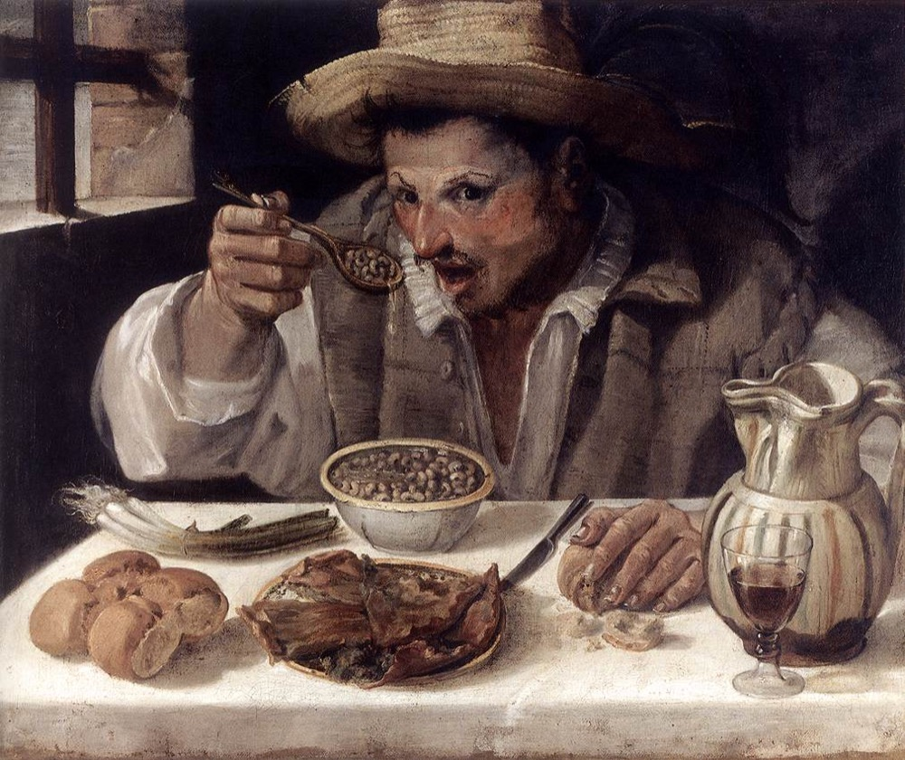{fig-alt="Pintura O comedor de feijão, de Annibale Carracci: um homem come uma tigela de feijão à mesa, olhando assustado para quem o observa. Legenda: deu por hoje de história; agora, matrizes." height="520px"}

[Deu por hoje de história!]{.meme-topo} [Agora, matrizes]{.meme-base}
:::

::: {.ref}
Annibale Carracci, *O comedor de feijão* (c. 1580–1590), domínio público, via
Wikimedia Commons.
:::

# 7. Como os métodos funcionam {.secao}

## Modos R e Q

:::: {.columns}
::: {.column width="55%"}
```{r}
#| fig-alt: "Diagrama de matrizes. A matriz de dados, de objetos por descritores, dá origem a duas matrizes quadradas: Q, de objetos por objetos, e R, de descritores por descritores."
#| fig-width: 6
#| fig-height: 5.4
#| out-height: 540px
fig_modos_rq()
```
:::
::: {.column width="45%"}
- **Modo Q**: associação entre **objetos** (por exemplo, locais).
- **Modo R**: associação entre **descritores** (por exemplo, espécies ou
  variáveis ambientais).

Na Aula 2 veremos os coeficientes para cada modo.
:::
::::

## As duas matrizes típicas {.medio}

:::: {.columns}
::: {.column width="55%"}
**Espécies**

::: {.tabela-grande}
```{r}
knitr::kable(mx$sp, align = "r")
```
:::
:::
::: {.column width="45%"}
**Variáveis ambientais**

::: {.tabela-grande}
```{r}
knitr::kable(mx$amb, align = "r", col.names = c("Temp", "pH", "O₂", "CO₂"))
```
:::
:::
::::

::: {.ref}
Dados ilustrativos do slide original.
:::

## Representação no espaço euclidiano {.medio}

:::: {.columns}
::: {.column width="45%"}
```{r}
#| fig-alt: "As oito áreas como pontos num plano cujos eixos são as abundâncias das espécies 1 e 2. A distância euclidiana entre as áreas 1 e 2, igual a 14,42, é a hipotenusa de um triângulo retângulo desenhado com linhas tracejadas."
#| fig-width: 6
#| fig-height: 5.6
#| out-height: 440px
fig_espaco()
```
:::
::: {.column width="55%"}
```{r}
#| fig-alt: "As oito áreas como pontos num espaço tridimensional, desenhado em perspectiva, cujos eixos são as abundâncias das espécies 1, 2 e 3; linhas tracejadas descem de cada ponto até o plano das espécies 1 e 3."
#| fig-width: 7
#| fig-height: 5.6
#| out-height: 440px
fig_espaco_3d()
```
:::
::::

Cada **objeto** (área) é um ponto num espaço cujos eixos são os **descritores**
(espécies): com 2 espécies, um plano; com 3, o espaço tridimensional; com $p$
espécies, $p$ dimensões, que não conseguimos desenhar.

::: {.ref}
[Legendre & Legendre (2012), cap. 2](`r LL2`). Dados da matriz de espécies do slide anterior.
:::

## Medidas de distância no espaço euclidiano

```{r}
#| fig-alt: "Dois painéis. À esquerda, dois pontos A e B num plano de duas espécies, ligados por um segmento vermelho D, com os catetos tracejados. À direita, os mesmos A e B num espaço de três espécies, desenhado em perspectiva, com o segmento D e os catetos tracejados."
#| fig-width: 11
#| fig-height: 4.6
#| out-height: 440px
fig_distancia_2d3d()
```

Com $p$ espécies, a mesma conta: $D(x_1, x_2) = \sqrt{\textstyle\sum_{j=1}^{p}(y_{1j} - y_{2j})^2}$.

## Um pequeno parêntese: o espaço pode ser curvo {.medio}

:::: {.columns}
::: {.column width="55%"}
```{r}
#| fig-alt: "Esquema: um semicírculo representa o espaço de formas, curvo; uma reta horizontal tangente no topo, na forma média, representa o espaço tangente, plano. Linhas tracejadas a partir do centro projetam cinco pontos do semicírculo na reta."
#| fig-width: 7
#| fig-height: 3.8
#| out-height: 380px
fig_espaco_tangente()
```
:::
::: {.column width="45%"}
- Em morfometria geométrica, as formas vivem num espaço **curvo** (o espaço de
  formas de Kendall).
- Para usar métodos euclidianos, elas são projetadas num **espaço tangente**,
  plano, que aproxima o curvo perto da forma média.
:::
::::

::: {.definicao}
Os métodos desta disciplina supõem, em geral, um espaço euclidiano; quando os
dados não estão nele, é preciso transformá-los ou projetá-los.
:::

::: {.ref}
Baseado em slides de Antigoni Kaliontzopoulou.
:::

# 8. Rudimentos de álgebra de matrizes {.secao}

## Combinações lineares

- Combinação de várias variáveis (vetores) multiplicadas por constantes e
  somadas:

$$a\,x + b\,y + c\,z$$

::: {.fragment}
**Por que isso é importante?**

- Os métodos de ordenação basicamente encontram **combinações lineares**,
  escolhendo as constantes que maximizam algum critério.
- Nas ordenações restritas (duas ou mais matrizes), restringem uma combinação
  linear por outra.
- Métodos diferentes maximizam critérios diferentes: a PCA, por exemplo, a
  variância, a partir da **correlação linear** entre as variáveis.
:::

::: {.ref}
[Legendre & Legendre (2012), cap. 2](`r LL2`).
:::

## Correlação de Pearson

Relação **linear** entre duas variáveis, sem supor dependência funcional entre
elas; $-1 \leq r \leq 1$.

$$r_{y_1y_2} = \frac{\overbrace{\color{#1c6e8c}{\textstyle\sum_{i=1}^{n} (y_{i1} - \bar{y}_1)(y_{i2} - \bar{y}_2)}}^{\text{soma dos produtos cruzados (covariância)}}}{\underbrace{\color{#2e6b4f}{\sqrt{\textstyle\sum_{i=1}^{n} (y_{i1} - \bar{y}_1)^2 \sum_{i=1}^{n} (y_{i2} - \bar{y}_2)^2}}}_{\text{desvios das duas variáveis}}}$$

::: {.fragment}
- O **numerador** pode ser positivo ou negativo: se for negativo, $r$ é
  negativo, e vice-versa.
- O **denominador** é sempre positivo: padroniza pela variação das duas
  variáveis, porque a soma dos produtos cruzados depende da escala.
:::

## Teste de hipótese do r de Pearson {.medio}

Um teste *t* para a hipótese nula $\rho = 0$:
$\;t = r / s_r$, com $s_r = \sqrt{(1 - r^2)/(n - 2)}$.

{fig-align="center" height="190px" fig-alt="Tirinha xkcd 552 em três quadros: alguém diz que achava que correlação implicava causalidade, até fazer uma aula de estatística; agora não acha mais. O outro responde que parece que a aula ajudou, e ele diz: bem, talvez."}

```{r}
#| fig-alt: "Quatro diagramas de dispersão simulados: correlação positiva (r = 0,82), negativa (r = −0,76), nenhuma (r = 0,08) e uma relação não linear em forma de arco, com r = 0,06 apesar da relação forte."
#| fig-width: 11
#| fig-height: 3
#| out-height: 250px
fig_correlacoes()
```

::: {.ref}
Dados simulados, inspirados na Fig. 5.2 de Quinn & Keough (2002). Tirinha:
[xkcd 552](https://xkcd.com/552/), de Randall Munroe (CC BY-NC 2.5).
:::


## Matrizes de correlação e de covariância

:::: {.columns}
::: {.column width="50%"}
**Correlação**

$$\mathbf{P} = \begin{bmatrix} 1 & \rho_{12} & \cdots & \rho_{1p}\\ \rho_{21} & 1 & \cdots & \rho_{2p}\\ \vdots & & \ddots & \vdots\\ \rho_{p1} & \rho_{p2} & \cdots & 1 \end{bmatrix}$$
:::
::: {.column width="50%"}
**Covariância**

$$\boldsymbol\Sigma = \begin{bmatrix} \text{Var}(X) & \text{Cov}(X,Y) & \text{Cov}(X,Z)\\ \text{Cov}(X,Y) & \text{Var}(Y) & \text{Cov}(Y,Z)\\ \text{Cov}(X,Z) & \text{Cov}(Y,Z) & \text{Var}(Z) \end{bmatrix}$$
:::
::::

Ambas são **simétricas**, com as variâncias (ou 1) na diagonal. A matriz de
correlação é a de covariância das variáveis padronizadas.

## Mais alguns conceitos {.medio}

- **Escalar**: um número (real) usado nas operações com matrizes, como a
  multiplicação. Multiplicar um vetor por um escalar aumenta ou diminui o seu
  tamanho.
- **Vetor**: uma coluna (ou linha) de uma matriz.
- **Autovetor** de uma matriz **A**: um vetor não nulo cuja direção não muda
  quando ele é multiplicado por **A**; só o seu tamanho muda.
- **Autovalor**: o escalar $\lambda$ que dá esse fator de mudança de tamanho.

```{r}
#| fig-alt: "Dois gráficos de vetores. À esquerda, um vetor v e o vetor 2v, na mesma direção e com o dobro do tamanho. À direita, a soma de dois vetores, u e v, pela regra do paralelogramo."
#| fig-width: 9
#| fig-height: 3.6
#| out-height: 250px
fig_vetores()
```

Para ver autovetores e autovalores em ação: [visualização interativa do Setosa](https://setosa.io/ev/eigenvectors-and-eigenvalues/).

::: {.ref}
[Legendre & Legendre (2012), cap. 2](`r LL2`).
:::

## O comprimento de um vetor {.medio}

:::: {.columns}
::: {.column width="45%"}
$$\mathbf{b} = \begin{pmatrix} b_1\\ b_2\\ \vdots\\ b_n \end{pmatrix} \qquad \lVert \mathbf{b} \rVert = \sqrt{b_1^2 + b_2^2 + \cdots + b_n^2}$$

Pelo teorema de Pitágoras: o vetor (4; 3) é a hipotenusa de um triângulo
retângulo de catetos 4 e 3.
:::
::: {.column width="55%"}
```{r}
#| fig-alt: "Um vetor da origem até o ponto (4; 3), como hipotenusa de um triângulo retângulo de catetos 4 e 3; o comprimento do vetor é a raiz de 4 ao quadrado mais 3 ao quadrado, igual a 5."
#| fig-width: 6.4
#| fig-height: 4.2
#| out-height: 400px
fig_comprimento_vetor()
```
:::
::::

::: {.ref}
[Legendre & Legendre (2012), cap. 2](`r LL2`).
:::

## Autovetores e autovalores

O autovetor de uma matriz é o vetor que, multiplicado pela matriz, dá ele
mesmo multiplicado por um escalar $\lambda$: esse escalar é o seu autovalor.

$$\Large \mathbf{A}\,\mathbf{u}_i = \lambda_i\,\mathbf{u}_i$$

::: {.ref}
[Legendre & Legendre (2012), cap. 2](`r LL2`).
:::

## Interessante?

::: {.meme}
{fig-alt="Pintura Tédio, de Walter Sickert: um homem fuma sentado à mesa de um bar, olhando para o nada, enquanto uma mulher, de costas para ele, se apoia na cômoda, entediada. Legenda: podia ser legal e interessante... mas não foi." height="520px"}

[Podia ser legal e interessante...]{.meme-topo} [...mas não foi]{.meme-base}
:::

::: {.ref}
Walter Sickert, *Tédio* (c. 1914), domínio público, via Wikimedia Commons.
:::

## Autovetores ortogonais

- A derivação de $\mathbf{A}\mathbf{u} = \lambda\mathbf{u}$ para uma matriz **simétrica**
  (como as de correlação ou covariância) garante que os autovetores são
  **ortogonais** entre si.
- Ortogonais (90°) = variam em **direções independentes**: por isso os eixos
  de uma PCA não são correlacionados.
- Para mais detalhes, veja [Legendre & Legendre (2012), p. 92–4](`r LL2`), e a
  [visualização interativa do Setosa](https://setosa.io/ev/eigenvectors-and-eigenvalues/).

## Entendeu?

::: {.meme}
{fig-alt="Pintura Filósofo em meditação, de Rembrandt: um velho sentado junto à janela, numa sala escura com uma escada em caracol, de olhar perdido. Legenda: autovetores ortogonais? Num intendi nada que você disse aí, fera." height="520px"}

[Autovetores ortogonais?]{.meme-topo} [Num intendi nada que você disse aí, fera]{.meme-base}
:::

::: {.ref}
Rembrandt, *Filósofo em meditação* (1632), domínio público, via Wikimedia Commons.
:::

## Multiplicação de matrizes {.medio}

Cada elemento do produto é a soma dos produtos de uma **linha** da primeira
matriz por uma **coluna** da segunda (o número de colunas de **A** tem de ser
igual ao de linhas de **b**):

$$\mathbf{A} = \begin{bmatrix} 1 & 2 & 3\\ 4 & 5 & 6 \end{bmatrix} \qquad \mathbf{b} = \begin{pmatrix} 7\\ 8\\ 9 \end{pmatrix}$$

::: {.fragment}
$$\mathbf{A}\mathbf{b} = \begin{bmatrix} \color{#1c6e8c}{1 \times 7 + 2 \times 8 + 3 \times 9}\\ \color{#c0392b}{4 \times 7 + 5 \times 8 + 6 \times 9} \end{bmatrix}$$
:::

::: {.fragment}
$$= \begin{bmatrix} 7 + 16 + 27\\ 28 + 40 + 54 \end{bmatrix} = \begin{pmatrix} 50\\ 122 \end{pmatrix}$$
:::

## Um exemplo ajuda? {.medio}

$$\Large \mathbf{A} = \begin{bmatrix} 1 & 4\\ 2 & 3 \end{bmatrix} \qquad \mathbf{v} = \begin{pmatrix} 2\\ 2 \end{pmatrix}$$

::: {.fragment}
$$\Large \mathbf{A}\mathbf{v} = \begin{bmatrix} \color{#1c6e8c}{1 \times 2 + 4 \times 2}\\ \color{#c0392b}{2 \times 2 + 3 \times 2} \end{bmatrix} = \begin{pmatrix} 10\\ 10 \end{pmatrix}$$
:::

::: {.fragment}
$$\Large \begin{pmatrix} 10\\ 10 \end{pmatrix} = \boxed{5} \begin{pmatrix} 2\\ 2 \end{pmatrix}$$

O vetor final é o inicial multiplicado por um escalar: 5 é um **autovalor**, e
(2; 2), um **autovetor** de **A**.
:::

## O autovetor no plano

```{r}
#| fig-alt: "Dois gráficos. À esquerda, o vetor v = (2; 2) e A·v = (10; 10), na mesma direção, cinco vezes maior: v é um autovetor, com autovalor 5. À direita, o vetor (2; −1) e A·v = (−2; 1), que aponta em outra direção: não é autovetor."
#| fig-width: 10
#| fig-height: 4.4
#| out-height: 470px
fig_autovetor()
```

O vetor (2; −1) não é autovetor de **A**: depois da multiplicação, aponta em outra direção.

## Autoanálise

- Calcular os autovetores e autovalores de uma matriz é fazer a sua
  **autoanálise** (*eigen-decomposition*).
- É o que a PCA faz com a matriz de covariância ou de correlação (Aula 4).

::: {.ref}
[Legendre & Legendre (2012), seção 2.9](`r LL2`).
:::

## Outra forma de decompor uma matriz: a SVD

```{r}
#| fig-alt: "Esquema da decomposição em valores singulares: a matriz Y, de n linhas por p colunas, é igual ao produto de V, de n por k, de W, uma matriz diagonal de k por k com os valores singulares w1 a w4 na diagonal e zeros fora dela, e de U transposta, de k por p."
#| fig-width: 11
#| fig-height: 4.6
#| out-height: 430px
fig_svd()
```

A **decomposição em valores singulares** (*singular value decomposition*, SVD)
vale para qualquer matriz retangular.

## Valores singulares e o posto da matriz

```{r}
#| fig-alt: "O mesmo esquema da SVD, com a diagonal de W destacada: os quatro valores singulares maiores que zero. O posto da matriz é o número de valores singulares maiores que zero, aqui 4."
#| fig-width: 11
#| fig-height: 4.6
#| out-height: 430px
fig_svd(destaca_posto = TRUE)
```

O **posto** (*rank*) de **Y** é o número de valores singulares maiores que zero.

::: {.ref}
[Legendre & Legendre (2012), seção 2.11](`r LL2`).
:::

## SVD

::: {.meme}
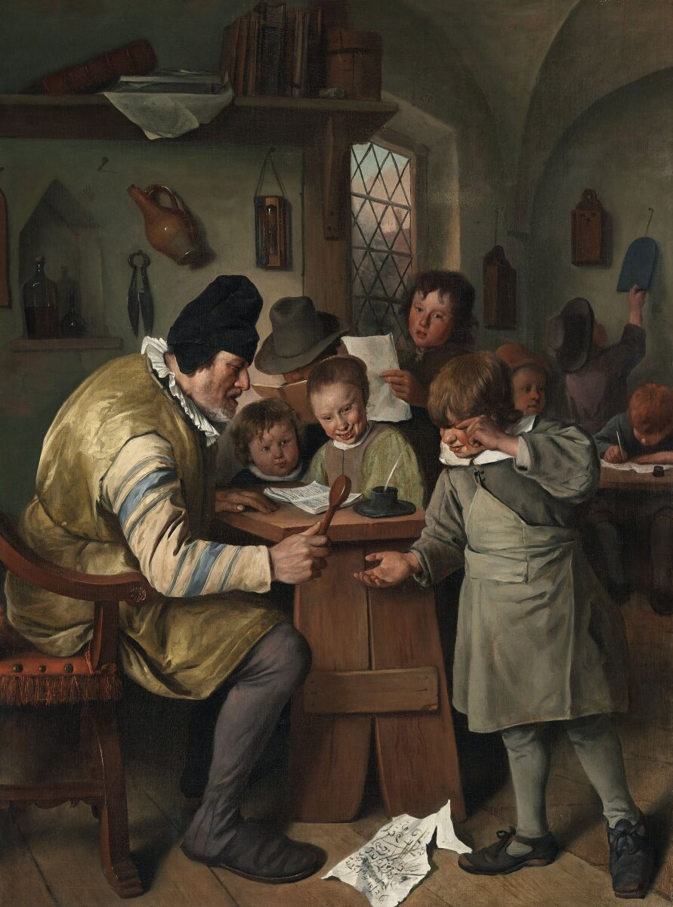{fig-alt="Pintura A escola da aldeia, de Jan Steen: um mestre-escola severo e alunos indisciplinados numa sala de aula, um deles chorando. Legenda: a professora está ensinando SVD. Me solta, que eu vou perguntar por que isso é importante." height="520px"}

[A professora está ensinando SVD]{.meme-topo} [Me solta, que eu vou perguntar por que isso é importante!]{.meme-base}
:::

::: {.ref}
Jan Steen, *A escola da aldeia* (c. 1665), National Gallery of Ireland, domínio público, via Wikimedia Commons.
:::

## Por que isso é importante?

- Vários métodos de ordenação usam a SVD: a análise de correspondência (Aula 4)
  e as análises canônicas (Aula 5).
- A PCA também pode ser calculada assim: no R, `prcomp()` usa a SVD da matriz
  de dados centrada, e `princomp()` usa a autoanálise da matriz de covariância.

## Por hoje é só

::: {.meme}
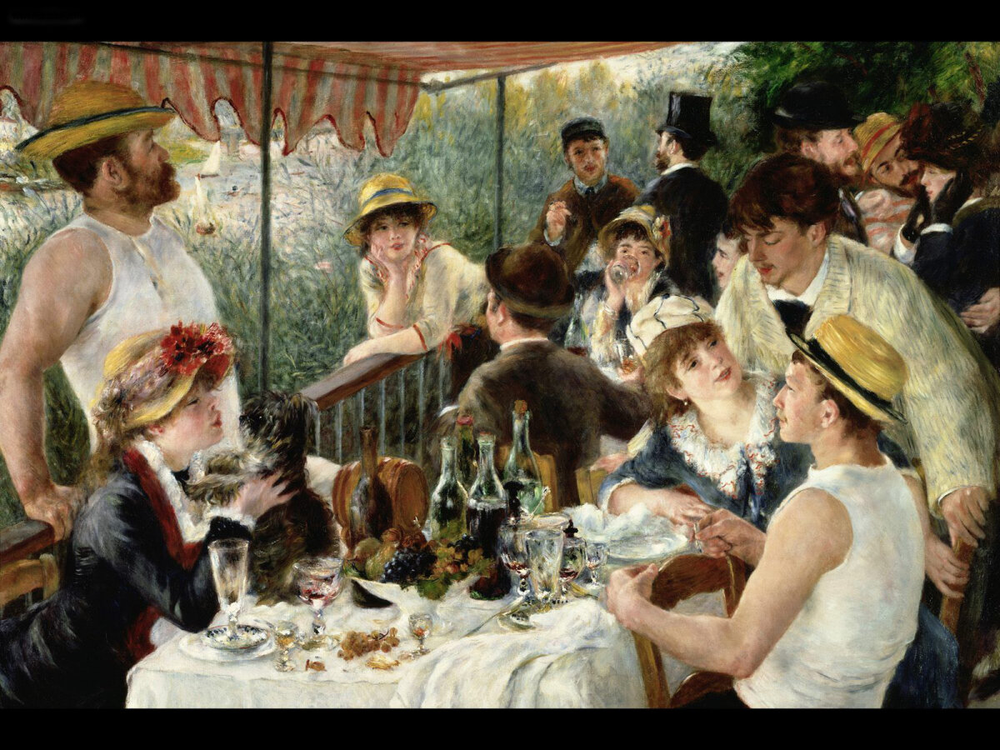{fig-alt="Pintura O almoço dos barqueiros, de Renoir: um grupo de amigos conversa e bebe à mesa, num terraço à beira do rio. Legenda: fiquem felizes: é hora do almoço!" height="520px"}

[Fiquem felizes:]{.meme-topo} [é hora do almoço!]{.meme-base}
:::

::: {.ref}
Pierre-Auguste Renoir, *O almoço dos barqueiros* (1880–1881), The Phillips Collection, domínio público, via Wikimedia Commons.
:::

