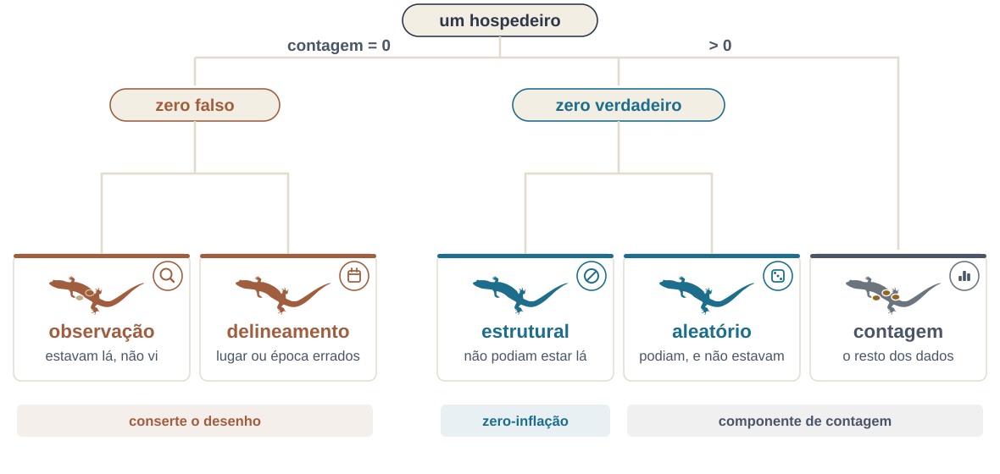

```{r}
#| label: setup
source(here::here("R/mapa.R"))
source(here::here("R/aula02_distancias.R"))
source(here::here("R/aula02_zeros.R"))
source(here::here("R/aula02_binarios.R"))
source(here::here("R/aula02_transf.R"))

num <- function(x, d = 1) format(round(x, d), nsmall = d, decimal.mark = ",")
# dentro de $...$ a vírgula vira pontuação (com espaço): {,} evita isso
numm <- function(x, d = 1) sub(",", "{,}", num(x, d), fixed = TRUE)

amb <- ambiente_ex()
j_ex <- jaccard_abc(parcelas_exemplo)
```

::: {.meme}
{fig-alt="Pintura O Grito, de Edvard Munch: uma figura com as mãos no rosto e a boca aberta, numa ponte, sob um céu alaranjado. Legenda: quando me perguntam se eu tô feliz pelas aulas terem voltado: ah, claro, tô amando, vou até pular daquela ponte de felicidade." height="560px"}

[Quando me perguntam se eu tô feliz pelas aulas terem voltado]{.meme-topo} [Ah, claro, tô amando! Vou até pular daquela ponte de felicidade]{.meme-base}
:::

::: {.ref}
Edvard Munch, *O Grito* (1893), domínio público, via Wikimedia Commons.
:::

## Hoje

Ao fim da aula, você deverá ter compreendido:

1. O que são e em que contexto são usados os coeficientes de distância
2. A diferença entre distância e similaridade
3. Os tipos de coeficientes: métricos, semimétricos e não métricos
4. Os coeficientes para descritores e para objetos
5. Como escolher o coeficiente de acordo com o tipo de dado

Leitura: [Legendre & Legendre (2012)](https://doi.org/10.1016/B978-0-444-53868-0.50007-1), cap. 7 (a escolha do coeficiente está
na seção 7.6).

::: {.nota}
Todas as figuras foram geradas em R, com dados simulados, com os exemplos
numéricos do original recalculados ou com as árvores do BCI (pacote
`vegan`). O código está em
[`R/`](https://github.com/diogoprov/multidimensionais/tree/main/R), nos
arquivos `aula02_*.R`.
:::

## Onde estamos

```{r}
#| fig-alt: "Mapa dos métodos multidimensionais. Da matriz de dados saem a associação, que leva à classificação, à ordenação irrestrita, à ordenação restrita e aos testes, e os métodos baseados em modelos. A associação, tema da Aula 2, está destacada."
#| fig-height: 5.6
#| out-height: 590px
mapa_plot("Associação")
```

# 1. O que são coeficientes de associação {.secao}

[Associação]{.familia .associacao}

## Modos R e Q

:::: {.columns}
::: {.column width="58%"}
```{r}
#| fig-alt: "Diagrama de matrizes. A matriz de dados, de objetos nas linhas e descritores nas colunas, dá origem a duas matrizes quadradas: Q, de objetos por objetos, e R, de descritores por descritores."
#| fig-width: 8
#| fig-height: 5.4
#| out-height: 560px
fig_modos_rq()
```
:::
::: {.column width="42%"}
**Modo Q**: associação entre **objetos** (por exemplo, locais), medida
por (dis)similaridades.

- No R, trabalhamos sempre com dissimilaridades.

**Modo R**: associação entre **descritores** (por exemplo, espécies ou
variáveis), medida por correlação ou covariância.
:::
::::

::: {.ref}
Baseado em slides de Thiago Gonçalves-Souza.
:::

## Similaridade e distância

- **Similaridades** são máximas ($S = 1$) quando dois objetos são idênticos.
- O comprimento da linha que separa dois objetos é a sua **distância**, que
  não tem limite superior.
- Distâncias são o contrário das similaridades: se $S$ varia de 0 a 1, a
  distância varia de 1 a 0.

::: {.definicao}
$$D = 1 - S$$
:::

- Existem outras transformações possíveis: $D = \sqrt{1 - S}$ ou
  $D = \sqrt{1 - S^2}$. Elas podem ser úteis, por exemplo, para tornar uma
  matriz de distâncias euclidiana antes de uma ordenação (`ade4::is.euclid`
  testa isso).

::: {.ref}
Baseado em slides de Thiago Gonçalves-Souza.
:::

## Principais características dos índices de similaridade

- Coeficientes de **similaridade** nunca são métricos.
  - Não podem ser usados para posicionar objetos num espaço métrico
    (euclidiano).
  - Têm de ser convertidos em distâncias (adiante nesta aula).
- **Simetria**: como lidam com os duplos zeros.
  - Assimétricos desconsideram os duplos zeros.
- **Tipos de dados**
  - Qualitativos ou quantitativos; binários ou contínuos.
  - Probabilísticos (por exemplo, Raup-Crick): não falaremos deles.

## As quatro propriedades métricas

:::: {.columns}
::: {.column width="60%"}
1. Mínimo 0: se $a = b$, então $D(a,b) = 0$
2. Positividade: se $a \neq b$, então $D(a,b) > 0$
3. Simetria: $D(a,b) = D(b,a)$
4. Desigualdade triangular: $D(a,b) + D(b,c) \geq D(a,c)$
:::
::: {.column width="40%"}
```{r}
#| fig-alt: "Um triângulo com vértices a, b e c e os lados rotulados D(a,b), D(b,c) e D(a,c)."
#| fig-width: 5
#| fig-height: 2.8
fig_triangulo()
```
:::
::::

::: {.fragment .definicao}
A soma de dois lados de um triângulo nunca é menor que o terceiro: ir de
*a* a *c* passando por *b* não pode ser mais curto que ir direto.
:::

## Três tipos de coeficientes de distância {.medio}

::: {.tabela-grande}
| Tipo | 1. Mín. 0 | 2. Posit. | 3. Simetria | 4. Triângulo | Exemplos |
|-----------|:----:|:----:|:----:|:----:|--------------------------|
| **Métricos** | ✓ | ✓ | ✓ | ✓ | euclidiana, Jaccard, chord, Hellinger |
| **Semimétricos** | ✓ | ✓ | ✓ | ✗ | diferença percentual (Bray-Curtis), Sørensen |
| **Não métricos** | ? | ? | ? | ✗ | $S_4$ e Kulczynski ($S_{12}$) |
:::

- Semimétricos violam a desigualdade triangular: não dá para representá-los
  exatamente num espaço euclidiano (voltaremos a isso na PCoA).
- Não métricos podem violar até as propriedades 1 a 3. Não são usados em
  ecologia.

::: {.ref}
Para uma comparação das propriedades dos coeficientes de dissimilaridade em
estudos de diversidade beta, veja [Legendre & De Cáceres (2013)](https://doi.org/10.1111/ele.12141) *Ecol. Lett.*
16: 951–963.
:::

# 2. Coeficientes métricos para dados quantitativos {.secao}

[Associação]{.familia .associacao}

Coeficientes para objetos (modo Q).

## Coeficientes métricos para dados quantitativos {.medio}

Para variáveis ambientais contínuas, medidas morfométricas, biomassa etc.

::: {.tabela-grande}
| Distância | Ideia | Em L&L |
|----------|-----------------------------------------|:----:|
| Euclidiana | Pitágoras em $p$ dimensões | $D_1$ |
| Manhattan | soma das diferenças em cada eixo | $D_7$ |
| Canberra | soma das diferenças relativas de cada descritor | $D_{10}$ |
| Chord | euclidiana depois de normalizar cada objeto para comprimento 1 | $D_3$ |
| Hellinger | chord sobre a raiz das abundâncias relativas; não dá peso excessivo às espécies raras | $D_{17}$ |
| Qui-quadrado | euclidiana ponderada pelos totais; dá muito peso às raras | $D_{16}$ |
| Mahalanobis | leva em conta a covariância entre os descritores | $D_5$ |
:::

## Distância euclidiana

:::: {.columns}
::: {.column width="45%"}
$$D_1(x_1, x_2) = \sqrt{\sum_{j=1}^{p} (y_{1j} - y_{2j})^2}$$

É o teorema de Pitágoras aplicado a $p$ dimensões, em vez das duas
habituais.
:::
::: {.column width="55%"}
```{r}
#| fig-alt: "Duas plantas, i e j, num gráfico de altura por envergadura do apêndice. Uma linha reta liga as duas: é a distância euclidiana entre elas."
#| fig-width: 6.2
#| fig-height: 4.8
#| out-height: 500px
fig_euclid_plantas()
```
:::
::::

::: {.ref}
[Legendre & Legendre (2012)](https://doi.org/10.1016/B978-0-444-53868-0.50007-1), eq. 7.34; McCune & Grace (2002). Figura com
dados simulados, inspirada na Fig. 12.2 de Gotelli & Ellison (2011).
:::

## Distância euclidiana: um exemplo

:::: {.columns}
::: {.column width="55%"}
```{r}
#| fig-alt: "Quatro objetos num gráfico da altura do tronco na mata (eixo x) por altura do tronco no campo (eixo y). Os objetos 1 e 2 estão no alto, os objetos 3 e 4 embaixo. Segmentos ligam 1 a 2 (d12), 1 a 3 (d13) e 3 a 4 (d34)."
#| fig-width: 6.4
#| fig-height: 5.4
#| out-height: 560px
fig_euclid_arvores()
```
:::
::: {.column width="45%"}
Quatro objetos descritos por duas variáveis: a altura do tronco na mata e
no campo.

Quanto vale $d_{13}$?
:::
::::

::: {.ref}
Baseado em slides de Thiago Gonçalves-Souza.
:::

## Calculando a distância euclidiana

:::: {.columns}
::: {.column width="55%"}
```{r}
#| fig-alt: "O mesmo gráfico, agora com o triângulo retângulo cujos catetos medem 9 − 2,7 na vertical e 7 − 5,6 na horizontal, e cuja hipotenusa é a distância d13."
#| fig-width: 6.4
#| fig-height: 5.4
#| out-height: 560px
fig_euclid_arvores(triangulo = TRUE)
```
:::
::: {.column width="45%"}
$$d_{13} = \sqrt{(9 - 2{,}7)^2 + (7 - 5{,}6)^2}$$

::: {.fragment}
$$d_{13} = \sqrt{6{,}3^2 + 1{,}4^2}$$
:::

::: {.fragment}
$$d_{13} = \sqrt{39{,}69 + 1{,}96} = \sqrt{41{,}65}$$
:::

::: {.fragment}
$$d_{13} = 6{,}454$$
:::
:::
::::

## Distância de Manhattan

:::: {.columns}
::: {.column width="45%"}
Também chamada de *city-block*: soma as diferenças em cada eixo, como
quem anda pelas quadras de uma cidade.

$$D_7(x_1, x_2) = \sum_{j=1}^{p} |y_{1j} - y_{2j}|$$
:::
::: {.column width="55%"}
```{r}
#| fig-alt: "Dois objetos, A e B, num plano de espécie 1 por espécie 2. A linha reta entre eles mede 5 (distância euclidiana); o caminho em L, pelos eixos, mede 4 + 3 = 7 (distância de Manhattan)."
#| fig-width: 6
#| fig-height: 5
#| out-height: 520px
fig_manhattan()
```
:::
::::

::: {.ref}
McCune & Grace (2002); [Legendre & Legendre (2012)](https://doi.org/10.1016/B978-0-444-53868-0.50007-1), eq. 7.45.
:::

## Distância de chord

:::: {.columns}
::: {.column width="45%"}
- É a distância euclidiana entre os objetos depois de normalizados para
  comprimento 1: os pontos ficam sobre o círculo (ou a hiperesfera) de raio 1.
- Elimina as diferenças de abundância total entre os locais.
- Varia de 0 a $\sqrt{2}$.
:::
::: {.column width="55%"}
```{r}
#| fig-alt: "Quarto de círculo de raio 1 num plano de espécie 1 por espécie 2, normalizadas. Dois objetos, i e h, estão sobre o círculo; a corda reta entre eles é a distância de chord, e o arco entre eles também está desenhado."
#| fig-width: 5.8
#| fig-height: 5.4
#| out-height: 540px
fig_chord()
```
:::
::::

::: {.ref}
Inspirado na Fig. 6.4 de McCune & Grace (2002).
:::

## Distância de Mahalanobis

:::: {.columns}
::: {.column width="45%"}
$$D_5^2(\mathbf{x}_1, \mathbf{x}_2) = \mathbf{d}_{12}\, \mathbf{V}^{-1} \mathbf{d}_{12}'$$

- Calcula a distância entre dois pontos num espaço não ortogonal: leva em
  conta a covariância entre os descritores.
- Útil para comparar grupos de objetos; por isso é a distância preservada
  na análise discriminante linear.
:::
::: {.column width="55%"}
```{r}
#| fig-alt: "Nuvem de pontos com dois descritores fortemente correlacionados e elipses de distância de Mahalanobis. Dois pontos, A e B, estão à mesma distância euclidiana do centro, 1,8, mas A fica ao longo da nuvem, com distância de Mahalanobis 1,4, e B atravessado a ela, com 5,2."
#| fig-width: 6.4
#| fig-height: 5.4
#| out-height: 540px
fig_mahalanobis()
```
:::
::::

::: {.ref}
Dados simulados.
:::

# 3. O problema do duplo zero {.secao}

[Associação]{.familia .associacao}

## Duas comunidades

:::: {.columns}
::: {.column width="58%"}
```{r}
#| fig-alt: "Diagrama de Venn com duas comunidades. Só na comunidade 1: perereca, roedor e sabiá. Nas duas: mosca, jacaré e gafanhoto. Só na comunidade 2: lambari, preguiça e queixada. Fora dos dois círculos, ausentes das duas: lontra e tamanduá."
#| fig-width: 7.2
#| fig-height: 5.2
#| out-height: 540px
fig_venn()
```
:::
::: {.column width="42%"}
A distância euclidiana trata uma ausência dupla (as espécies fora dos dois
círculos) como uma semelhança entre os locais.

::: {.fragment .definicao}
Resultado: locais sem nenhuma espécie em comum podem ter distância
**menor** do que locais que compartilham espécies.
:::
:::
::::

::: {.ref}
Baseado em slides de Thiago Gonçalves-Souza.
:::

## Exemplo com distância euclidiana

:::: {.columns}
::: {.column width="45%"}
::: {.tabela-grande}
| Locais | $y_1$ | $y_2$ | $y_3$ |
|---|---:|---:|---:|
| $x_1$ | 0 | 4 | 8 |
| $x_2$ | 0 | 1 | 1 |
| $x_3$ | 1 | 0 | 0 |
:::

- $x_1$ e $x_2$ compartilham **todas** as espécies.
- $x_2$ e $x_3$ **não compartilham nenhuma**.
:::
::: {.column width="55%"}
::: {.fragment}
Distâncias euclidianas:

::: {.tabela-grande}
```{r}
x <- rbind(x1 = c(0, 4, 8), x2 = c(0, 1, 1), x3 = c(1, 0, 0))
dd <- as.matrix(dist(x))
dd[] <- format(round(dd, 4), nsmall = 4, decimal.mark = ",")
knitr::kable(dd, align = "r")
```
:::
:::

::: {.fragment .definicao}
$D(x_2, x_3) = 1{,}7321 < D(x_1, x_2) = 7{,}6158$: os locais que não têm
nenhuma espécie em comum parecem os mais semelhantes.
:::
:::
::::

::: {.ref}
Exemplo numérico de [Legendre & Legendre (2012)](https://doi.org/10.1016/B978-0-444-53868-0.50007-1), recalculado em R.
:::

## Poderia ser legal e interessante...

::: {.meme}
{fig-alt="Pintura de Caravaggio: um rapaz recua assustado, com a mão mordida por um pequeno lagarto escondido entre frutas e flores. Legenda: poderia ser legal e interessante, mas não foi." height="540px"}

[Poderia ser legal e interessante...]{.meme-topo} [...mas não foi]{.meme-base}
:::

::: {.ref}
Caravaggio, *Menino mordido por um lagarto* (c. 1593–1594), domínio
público, via Wikimedia Commons.
:::

## Teoria de nicho ecológico

:::: {.columns}
::: {.column width="45%"}
- Amostramos indivíduos ao longo de gradientes ambientais.
- Alguns locais podem estar num extremo do gradiente, com condições fora
  do espaço de nicho de uma ou mais espécies.
- Isso resulta em muitos zeros na matriz de composição.
:::
::: {.column width="55%"}
```{r}
#| fig-alt: "Curvas de abundância de oito espécies ao longo de um gradiente de pH de 3,5 a 7, cada uma em forma de sino, com ótimos e amplitudes diferentes. Nos extremos do gradiente, a maioria das espécies tem abundância zero."
#| fig-width: 6.4
#| fig-height: 4.8
#| out-height: 500px
fig_nicho()
```
:::
::::

::: {.ref}
Dados simulados.
:::

## O problema do truncamento em zero

```{r}
#| fig-alt: "Curva de abundância de uma espécie em forma de sino ao longo de um gradiente ambiental. Além dos limites da curva, a abundância não pode ficar negativa: nas duas pontas há só zeros, e a continuação da curva abaixo de zero aparece tracejada."
#| fig-height: 4.6
#| out-height: 450px
fig_truncamento()
```

Além dos limites do nicho, todos os locais têm zero, por mais diferentes
que sejam as suas condições.

::: {.ref}
Inspirado na Fig. 5.3 de McCune & Grace (2002).
:::

## O que significa um zero?

{fig-align="center" width="82%" fig-alt="Esquema das quatro origens de uma contagem igual a zero. Um zero pode ser falso, por erro de observação (estavam lá e não foram vistos) ou de delineamento (lugar ou época errados), e aí a solução é consertar o desenho; ou verdadeiro, estrutural (não podiam estar lá) ou aleatório (podiam estar e não estavam), o que gera a inflação de zeros. Contagens maiores que zero formam o componente de contagem."}

::: {.ref}
Esquema próprio (do curso de Análise de Dados Univariados), a partir da
classificação de [Blasco-Moreno et al. (2019)](https://doi.org/10.1111/2041-210X.13185)
*Methods Ecol. Evol.* 10: 949–959. Silhuetas: PhyloPic, CC0.
:::

## Duplos zeros não têm interpretação única {.medio}

```{r}
#| fig-alt: "Curva de distribuição de uma espécie ao longo de um gradiente ambiental, com setas coloridas marcando oito locais: dois verdes sob a curva, um vermelho sob a curva e outro fora dela, dois marrons fora da curva do mesmo lado e dois azuis fora da curva em lados opostos."
#| fig-height: 3
#| out-height: 300px
fig_pares_zeros()
```

::: {.tabela-grande}
| Par de locais | Presença ou ausência | Indica similaridade? | Indica diferença? |
|---|:-:|:-:|:-:|
| [Setas verdes]{style="color:#527238"} | 1, 1 | ✓ | |
| [Setas vermelhas]{style="color:#c0392b"} | 1, 0 | | ✓ |
| [Setas marrons]{style="color:#8b5a2b"} | 0, 0 | talvez | |
| [Setas azuis]{style="color:#1c6e8c"} | 0, 0 | | talvez |
:::

::: {.ref}
Redesenhado de um slide de P. Legendre (material do curso de Ecologia
Numérica).
:::

## O problema dos duplos zeros {.medio}

- Se uma espécie está presente em dois locais, isso indica **similaridade**
  entre eles.
- A presença no local 1 e a ausência no local 2 indicam **diferença** nas
  condições ecológicas, apesar dos erros de amostragem.
- Mas, se uma espécie está ausente em dois locais, isso pode ser devido a:
  - condições fora do nicho da espécie, sem que se saiba se essas condições
    são parecidas ou muito diferentes entre os locais;
  - erro de amostragem;
  - dinâmicas estocásticas (por exemplo, *core-satellite*) causando extinção
    local transitória.
- Então, **não podemos dizer que dois locais são parecidos porque
  compartilham ausências de espécies**.

::: {.fragment .definicao}
Logo, precisamos de coeficientes que desconsiderem as duplas ausências:
os coeficientes **assimétricos**.
:::

## Ah, entendi...

::: {.meme}
{fig-alt="Pintura Autorretrato, de Ismael Nery: duas figuras modernistas fundidas, uma de perfil e outra de frente, diante de uma cidade com prédios e a Torre Eiffel. Legenda: ah, entendi... mas não compreendi." height="480px"}

[Ah, entendi...]{.meme-topo} [...mas não compreendi]{.meme-base}
:::

::: {.ref}
Ismael Nery, *Autorretrato* (1927), domínio público, via Wikimedia Commons.
:::

# 4. Coeficientes binários {.secao}

[Associação]{.familia .associacao}

Coeficientes para objetos (modo Q).

## Coeficientes assimétricos para dados binários

- Usados com dados de **presença e ausência**.
- Não levam em conta os duplos zeros (duplas ausências).
- Exemplos:
  - Jaccard
  - Sørensen
  - Ochiai

::: {.fragment .definicao}
Eles respondem a uma das perguntas centrais da diversidade beta: o que faz
com que as comunidades de espécies sejam mais ou menos semelhantes umas às
outras em diferentes locais e tempos?
:::

::: {.ref}
[Anderson et al. (2011)](https://doi.org/10.1111/j.1461-0248.2010.01552.x) *Ecol. Lett.* 14: 19–28.
:::

## A notação a, b, c e d

:::: {.columns}
::: {.column width="55%"}
```{r}
#| fig-alt: "Diagrama de Venn de duas comunidades com as letras da notação: a na interseção (espécies compartilhadas), b só na comunidade 1, c só na comunidade 2 e d fora dos dois círculos (espécies ausentes das duas)."
#| fig-width: 7
#| fig-height: 5
#| out-height: 500px
fig_venn(letras = TRUE)
```
:::
::: {.column width="45%"}
::: {.tabela-grande}
| | Comunidade 2: 1 | Comunidade 2: 0 |
|---|:-:|:-:|
| **Comunidade 1: 1** | *a* | *b* |
| **Comunidade 1: 0** | *c* | *d* |
:::

- *a*: espécies nas duas
- *b* e *c*: exclusivas de cada uma
- *d*: ausentes das duas (o duplo zero)
:::
::::

::: {.ref}
Baseado em slides de Thiago Gonçalves-Souza.
:::

## Índice de Jaccard

```{r}
#| fig-alt: "Duas parcelas com árvores de espécies diferentes, cada espécie com uma forma e uma cor. Duas espécies, o círculo azul e o triângulo verde, estão nas duas parcelas e levam a letra a; quatro estão só na parcela 1 (letra b); três estão só na parcela 2 (letra c)."
#| fig-height: 4
#| out-height: 330px
fig_parcelas(parcelas_exemplo$p1, parcelas_exemplo$p2)
```

$$\beta_j = \frac{a}{a + b + c}$$

::: {.fragment}
$$\beta_j = \frac{`r j_ex[["a"]]`}{`r j_ex[["a"]]` + `r j_ex[["b"]]` + `r j_ex[["c"]]`} = \frac{2}{9} = `r numm(j_ex[["J"]], 3)`$$
:::

::: {.ref}
Baseado em slides de Thiago Gonçalves-Souza.
:::

## Comunidades sem espécies compartilhadas

```{r}
#| fig-alt: "Duas parcelas sem nenhuma espécie em comum: cinco espécies na parcela 1 e seis na parcela 2."
#| fig-height: 4
#| out-height: 400px
fig_parcelas(parcelas_nenhuma$p1, parcelas_nenhuma$p2, letras = FALSE)
```

$$\beta_j = \frac{0}{0 + 5 + 6} = \frac{0}{11} = 0$$

::: {.ref}
Baseado em slides de Thiago Gonçalves-Souza.
:::

## Comunidades que compartilham todas as espécies

```{r}
#| fig-alt: "Duas parcelas com as mesmas cinco espécies, em quantidades e posições diferentes."
#| fig-height: 4
#| out-height: 400px
fig_parcelas(parcelas_todas$p1, parcelas_todas$p2, letras = FALSE)
```

$$\beta_j = \frac{5}{5 + 0 + 0} = \frac{5}{5} = 1$$

::: {.ref}
Baseado em slides de Thiago Gonçalves-Souza.
:::

## Sørensen e Bray-Curtis

:::: {.columns}
::: {.column width="50%"}
**Sørensen**

$$S_8(x_1, x_2) = \frac{2a}{2a + b + c}$$
:::
::: {.column width="50%"}
**Bray-Curtis** (Steinhaus)

$$S_{17}(x_1, x_2) = \frac{W}{(A + B)/2} = \frac{2W}{A + B}$$

$W$: soma das abundâncias mínimas de cada espécie nos dois locais; $A$ e
$B$: abundâncias totais dos locais.
:::
::::

::: {.definicao}
Bray-Curtis é a versão quantitativa do Sørensen. A distância
correspondente, $D_{14} = 1 - S_{17}$, é a **diferença percentual**.
:::

::: {.ref}
[Legendre & Legendre (2012)](https://doi.org/10.1016/B978-0-444-53868-0.50007-1), eqs. 7.11 e 7.24.
:::

## Dados binários de descritores (modo R)

- Presença e ausência de características físicas em locais.
- Geralmente, o coeficiente de Sokal & Michener (*simple matching*, $S_1$
  de L&L) é a melhor escolha:

$$S_1 = \frac{a + d}{a + b + c + d}$$

::: {.fragment .definicao}
Aqui o duplo zero conta: duas características ausentes em dois locais são,
de fato, uma semelhança entre eles.
:::

# 5. Coeficientes quantitativos assimétricos {.secao}

[Associação]{.familia .associacao}

Coeficientes para objetos (modo Q).

## Coeficientes assimétricos para dados quantitativos

- Usados para **abundância**, porcentagem de cobertura, biomassa etc.
- Não contam os duplos zeros como semelhança.

::: {.tabela-grande}
| Coeficiente | Propriedade |
|---|---|
| Diferença percentual (Bray-Curtis), $D_{14}$ | semimétrico |
| Chord, $D_3$ (e log-chord) | métrico |
| Hellinger, $D_{17}$ | métrico |
| Qui-quadrado, $D_{16}$ | métrico |
| Morisita-Horn | |
:::

::: {.ref}
[Legendre & Legendre (2012)](https://doi.org/10.1016/B978-0-444-53868-0.50007-1), Tabelas 7.2 e 7.4.
:::

## Domínios e amplitudes das distâncias (1/2) {.medio}

::: {.tabela-grande}
| Nome (sinônimos) | Dados | Amplitude de *d* | Comentário |
|---|---|---|---|
| Sørensen (Bray-Curtis; Czekanowski) | $x \geq 0$ | $0 \leq d \leq 1$ | coeficiente de proporção no espaço *city-block*; semimétrico |
| Sørensen relativo (Kulczynski) | $x \geq 0$ | $0 \leq d \leq 1$ | como o Sørensen, com os dados relativizados pelos totais das unidades amostrais; semimétrico |
| Jaccard | $x \geq 0$ | $0 \leq d \leq 1$ | coeficiente de proporção no espaço *city-block*; métrico |
:::

::: {.ref}
Adaptado de McCune & Grace (2002), Tabela 6.2.
:::

## Domínios e amplitudes das distâncias (2/2) {.medio}

::: {.tabela-grande}
| Nome (sinônimos) | Dados | Amplitude de *d* | Comentário |
|---|---|---|---|
| Euclidiana (pitagórica) | todos | não negativa | métrico |
| Euclidiana relativa (chord) | todos | $0 \leq d \leq \sqrt{2}$ (quarto de hiperesfera) | distância euclidiana entre pontos na hiperesfera unitária; métrico |
| Qui-quadrado | $x \geq 0$ | $d \geq 0$ | euclidiana ponderada pelos totais das variáveis e das unidades; métrico |
| Mahalanobis | todos | $d \geq 0$ | distância entre grupos ponderada pela dispersão dentro dos grupos; métrico |
:::

::: {.ref}
Adaptado de McCune & Grace (2002), Tabela 6.2.
:::

## Nem todo coeficiente é métrico {.medio}

:::: {.columns}
::: {.column width="42%"}
Três locais com abundâncias diferentes:

::: {.tabela-grande}
| | $y_1$ | $y_2$ | $y_3$ | $y_4$ | $y_5$ |
|---|---:|---:|---:|---:|---:|
| $x_1$ | 2 | 5 | 2 | 5 | 3 |
| $x_2$ | 3 | 5 | 2 | 4 | 3 |
| $x_3$ | 9 | 1 | 1 | 1 | 1 |
:::
:::
::: {.column width="58%"}
Diferença percentual ($D_{14}$):

$$D_{14}(x_1, x_2) = \frac{1 + 0 + 0 + 1 + 0}{17 + 17} = `r numm(vegan::vegdist(orloci(), "bray")[1], 3)`$$

$$D_{14}(x_1, x_3) = \frac{7 + 4 + 1 + 4 + 2}{17 + 13} = `r numm(vegan::vegdist(orloci(), "bray")[2], 3)`$$

$$D_{14}(x_2, x_3) = \frac{6 + 4 + 1 + 3 + 2}{17 + 13} = `r numm(vegan::vegdist(orloci(), "bray")[3], 3)`$$
:::
::::

::: {.fragment .definicao}
0,059 + 0,533 < 0,600: a desigualdade triangular é violada. A diferença
percentual é **semimétrica**.
:::

::: {.ref}
Exemplo de Orlóci (1978), em [Legendre & Legendre (2012)](https://doi.org/10.1016/B978-0-444-53868-0.50007-1), cap. 7; recalculado
em R.
:::

## No R

Todos estão implementados em `vegan::vegdist`, `ade4::dist.ktab` ou
`adespatial::dist.ldc`.

::: {.codigo-compacto}
```{r}
#| echo: true
library(vegan)
x <- rbind(x1 = c(2, 5, 2, 5, 3), x2 = c(3, 5, 2, 4, 3), x3 = c(9, 1, 1, 1, 1))
vegdist(x, method = "bray")                       # diferença percentual
dist(decostand(x, method = "hellinger"))          # Hellinger
```
:::

## Coeficiente de Gower (1971) {.medio}

Para **misturas de tipos de dados**:

- descritores com diferentes unidades de medida;
- contínuos, binários, multiestado etc.;
- e até dados faltantes.

$$D_{\text{Gower}}(x_1, x_2) = 1 - \frac{1}{p} \sum_{j=1}^{p} s_j(x_1, x_2)$$

- Descritores quantitativos: $s_j(x_1, x_2) = 1 - \dfrac{|y_{1j} - y_{2j}|}{R_j}$,
  com $R_j$ a amplitude do descritor $j$.
- Descritores qualitativos ou binários: $s_j = 1$ se os dois objetos têm o
  mesmo estado; senão, 0.

[Pavoine et al. (2009)](https://doi.org/10.1111/j.1600-0706.2008.16668.x) o expandiram para mais tipos de dados: circulares
(fenológicos), *fuzzy* (pertencimento difuso) e ordinais.

::: {.ref}
[Gower (1971)](https://doi.org/10.2307/2528823) *Biometrics* 27: 857–871; [Pavoine et al. (2009)](https://doi.org/10.1111/j.1600-0706.2008.16668.x) *Oikos* 118:
391–402. Fórmula de um slide de P. Legendre.
:::

# 6. Padronizações e transformações {.secao}

[Associação]{.familia .associacao}

## Padronização

- Quando temos de usar? Quando os descritores são medidos em **escalas
  diferentes**.
- Exemplo: temperatura (°C), distância da margem (m), área (m²).
- Escore *z*:

$$z_i = \frac{y_i - \bar{y}}{s_y}$$

::: {.definicao}
Todas as variáveis passam a ter média 0 e desvio-padrão 1. A forma da
distribuição de cada variável **não muda**: padronizar não torna os dados
normais.
:::

::: {.ref}
[Legendre & Legendre (2012)](https://doi.org/10.1016/B978-0-444-53868-0.50001-0), cap. 1.
:::

## Padronização das variáveis ambientais {.medio}

:::: {.columns}
::: {.column width="50%"}
**Matriz não padronizada**

::: {.tabela-grande}
```{r}
knitr::kable(tab_ambiente(), align = "r")
```
:::
:::
::: {.column width="50%"}
As variáveis estão em escalas muito diferentes:

- pH: 0–14
- T: 0–42 °C
- Umidade: 0–100%

Numa distância euclidiana, a umidade e a temperatura dominariam o pH.
:::
::::

::: {.ref}
Baseado em slides de Thiago Gonçalves-Souza.
:::

## Padronização das variáveis ambientais: escores *z* {.medio}

:::: {.columns}
::: {.column width="50%"}
**Matriz padronizada**

::: {.tabela-grande}
```{r}
knitr::kable(tab_ambiente(z = TRUE), align = "r")
```
:::
:::
::: {.column width="50%"}
Local 1, pH:

$$z = \frac{8{,}2 - `r numm(mean(amb$pH), 2)`}{`r numm(sd(amb$pH), 2)`} = `r numm((8.2 - mean(amb$pH)) / sd(amb$pH), 2)`$$

::: {.fragment .definicao}
Agora todas as variáveis têm média 0 e desvio-padrão 1 e pesam igualmente na
distância.
:::
:::
::::

::: {.ref}
Baseado em slides de Thiago Gonçalves-Souza. [Legendre & Gallagher (2001)](https://doi.org/10.1007/s004420100716): "menor
probabilidade de cometer erro do tipo I utilizando matrizes padronizadas".
:::

## Transformações para a matriz de espécies

:::: {.columns}
::: {.column width="45%"}
- Transformação de **Hellinger** ou de **chord** para abundâncias de
  espécies.
- O problema das ordenações com dados de abundância: muitos zeros e
  diferenças muito grandes de abundância entre as espécies.
:::
::: {.column width="55%"}
```{r}
#| fig-alt: "Curva de dominância das 225 espécies de árvores do BCI: a abundância relativa, em escala logarítmica, cai da espécie mais abundante, com valor 1, até as mais raras, abaixo de 0,001."
#| fig-width: 6.4
#| fig-height: 4.8
#| out-height: 500px
fig_dominancia()
```
:::
::::

::: {.ref}
Árvores de 50 parcelas de 1 ha da ilha de Barro Colorado ([Condit et al.
2002](https://doi.org/10.1126/science.1066854), *Science* 295: 666–669), via `vegan::BCI`.
:::

## Transformar antes de ordenar

```{r}
#| fig-alt: "Diagrama. Os dados brutos de locais por espécies passam pela transformação de chord ou de Hellinger e viram dados transformados. A distância de chord entre os locais, calculada dos dados brutos, é a mesma distância euclidiana calculada dos dados transformados, que entram numa PCA ou numa RDA."
#| fig-height: 4
#| out-height: 430px
fig_tb_pca()
```

A ideia é transformar os dados (chord ou Hellinger) e depois fazer uma
ordenação (PCA, PCoA, RDA) que satisfaça os critérios de metricidade.
Voltaremos a isso na aula de ordenações restritas.

::: {.ref}
[Legendre & Gallagher (2001)](https://doi.org/10.1007/s004420100716) *Oecologia* 129: 271–280.
:::

## Transformações de Box-Cox-chord

- As distâncias de chord, Hellinger e log-chord são parte de uma série de
  transformações normalizantes equivalentes à de Box-Cox:
  - $\lambda = 1$: chord
  - $\lambda = 0{,}5$: Hellinger
  - $\lambda = 0$: log-chord
- Permitem normalizar distribuições de frequência cada vez mais assimétricas
  num único arcabouço matemático.
- Os autores fornecem o código em R.

::: {.ref}
[Legendre & Borcard (2018)](https://doi.org/10.1111/ecog.03498) *Ecography* 41: 1820–1824.
:::

## Tudo confuso?

::: {.meme}
{fig-alt="Gravura Melencolia I, de Albrecht Dürer: uma figura alada sentada, com a cabeça apoiada na mão, cercada de instrumentos de medida. Legenda: tudo confuso, não entendo nada." height="540px"}

[Tudo confuso]{.meme-topo} [Não entendo nada!]{.meme-base}
:::

::: {.ref}
Albrecht Dürer, *Melencolia I* (1514), domínio público, via Wikimedia Commons.
:::

# 7. Como escolher o coeficiente {.secao}

[Associação]{.familia .associacao}

## O coeficiente muda a ordenação

```{r}
#| fig-alt: "Seis PCoAs dos três locais do exemplo do duplo zero, cada uma com um coeficiente. Na euclidiana, x2 e x3, que não têm nenhuma espécie em comum, ficam próximos, e x1 fica longe. Na chord, nos perfis de espécies, na Hellinger, na qui-quadrado e na diferença percentual, x1 e x2, que compartilham todas as espécies, ficam próximos, e x3 fica longe."
#| fig-height: 5.2
#| out-height: 470px
fig_coef_pcoa()
```

Os mesmos três locais do exemplo do duplo zero: só a distância euclidiana
põe juntos $x_2$ e $x_3$, que não têm nenhuma espécie em comum.

::: {.ref}
Inspirado na Fig. 7.9 de [Legendre & Legendre (2012)](https://doi.org/10.1016/B978-0-444-53868-0.50007-1).
:::

## Uma chave dicotômica? Sim, ela existe!

```{r}
#| fig-alt: "Chave para escolher o coeficiente entre objetos com dados de espécies. Com presença e ausência: Jaccard (métrico) ou Sørensen e Ochiai (semimétricos). Com abundâncias: sem padronizar os locais, diferença percentual (Bray-Curtis); padronizando os locais, chord, Hellinger ou qui-quadrado."
#| fig-height: 4.4
#| out-height: 470px
fig_chave_especies()
```

::: {.ref}
Resumo da Tabela 7.4 de [Legendre & Legendre (2012)](https://doi.org/10.1016/B978-0-444-53868-0.50007-1), que traz a chave
completa (veja também a seção 7.6).
:::

## E para as variáveis ambientais

```{r}
#| fig-alt: "Chave para escolher o coeficiente entre objetos com variáveis ambientais. Binárias ou multiestado: simple matching (Sokal e Michener). Quantitativas na mesma unidade: euclidiana ou Manhattan. De tipos ou unidades diferentes: Gower, ou padronizar e usar a euclidiana."
#| fig-height: 4.4
#| out-height: 450px
fig_chave_ambiente()
```

Entre descritores (modo R): covariância ou correlação de Pearson para
relações lineares; Spearman ou Kendall para relações monotônicas.

::: {.ref}
Resumo das Tabelas 7.5 e 7.6 de [Legendre & Legendre (2012)](https://doi.org/10.1016/B978-0-444-53868-0.50007-1).
:::

# Para saber mais {.secao}

## Propriedades das distâncias derivadas das similaridades (1/4) {.medio}

::: {.tabela-grande}
| Similaridade | $1-S$ | $1-S$ euclidiana? | $\sqrt{1-S}$ métrica? | $\sqrt{1-S}$ euclidiana? |
|---|---|:-:|:-:|:-:|
| $S_1$: (a + d)/(a + b + c + d), *simple matching* | métrica | não | sim | sim |
| $S_2$: (a + d)/(a + 2b + 2c + d), Rogers & Tanimoto | métrica | não | sim | sim |
| $S_3$: (2a + 2d)/(2a + b + c + 2d) | semimétrica | não | sim | não |
| $S_4$: (a + d)/(b + c) | não métrica | não | não | não |
| $S_5$ (eq. 7.5) | semimétrica | não | não | não |
| $S_6$ (eq. 7.6) | semimétrica | não | sim | sim |
:::

::: {.ref}
Adaptado de [Legendre & Legendre (2012)](https://doi.org/10.1016/B978-0-444-53868-0.50007-1), Tabela 7.2.
:::

## Propriedades das distâncias derivadas das similaridades (2/4) {.medio}

::: {.tabela-grande}
| Similaridade | $1-S$ | $1-S$ euclidiana? | $\sqrt{1-S}$ métrica? | $\sqrt{1-S}$ euclidiana? |
|---|---|:-:|:-:|:-:|
| $S_7$: a/(a + b + c), Jaccard | métrica | não | sim | sim |
| $S_8$: 2a/(2a + b + c), Sørensen | semimétrica | não | sim | sim |
| $S_9$: 3a/(3a + b + c) | semimétrica | não | não | não |
| $S_{10}$: a/(a + 2b + 2c) | métrica | não | sim | sim |
| $S_{11}$: a/(a + b + c + d), Russell & Rao | métrica | não | sim | sim |
| $S_{12}$: a/(b + c), Kulczynski | não métrica | não | não | não |
:::

::: {.ref}
Adaptado de [Legendre & Legendre (2012)](https://doi.org/10.1016/B978-0-444-53868-0.50007-1), Tabela 7.2.
:::

## Propriedades das distâncias derivadas das similaridades (3/4) {.medio}

::: {.tabela-grande}
| Similaridade | $1-S$ | $1-S$ euclidiana? | $\sqrt{1-S}$ métrica? | $\sqrt{1-S}$ euclidiana? |
|---|---|:-:|:-:|:-:|
| $S_{13}$ (eq. 7.16) | semimétrica | não | não | não |
| $S_{14}$ (Ochiai) | semimétrica | não | sim | sim |
| $S_{15}$ (Gower) | métrica | não | sim | provável |
| $S_{16}$ (Estabrook & Rogers) | métrica | não | sim | provável |
| $S_{17}$: 2W/(A + B), Steinhaus | semimétrica | não | provável | provável |
| $S_{18}$ (Kulczynski quantitativo) | semimétrica | não | não | não |
:::

::: {.ref}
Adaptado de [Legendre & Legendre (2012)](https://doi.org/10.1016/B978-0-444-53868-0.50007-1), Tabela 7.2.
:::

## Propriedades das distâncias derivadas das similaridades (4/4) {.medio}

::: {.tabela-grande}
| Similaridade | $1-S$ | $1-S$ euclidiana? | $\sqrt{1-S}$ métrica? | $\sqrt{1-S}$ euclidiana? |
|---|---|:-:|:-:|:-:|
| $S_{19}$ (Gower assimétrico) | métrica | não | sim | provável |
| $S_{20}$ (Legendre & Chodorowski) | métrica | não | sim | provável |
| $S_{21} = 1 - \chi^2$ métrica | métrica | sim | sim | sim |
| $S_{22}$, $S_{23}$ (Goodall) | semimétrica | não | – | – |
| $S_{26}$ (Faith 1983) | métrica | não | sim | sim |
:::

::: {.ref}
Adaptado de [Legendre & Legendre (2012)](https://doi.org/10.1016/B978-0-444-53868-0.50007-1), Tabela 7.2 ("provável" = *likely*).
:::

## Ajustes nos dados de espécies (para consulta) {.medio}

::: {.tabela-grande}
| Passo | Critério |
|---|---|
| 1. Estatísticas descritivas (repetir depois de cada passo) | Sempre: diversidade beta, assimetria média das colunas, coeficiente de variação dos totais de linhas e de colunas |
| 2. Remover espécies raras (< 5% das unidades amostrais) | Em geral, salvo se contrário aos objetivos |
| 3. Transformação monotônica | Assimetria das colunas; amplitude de várias ordens de grandeza; diversidade beta alta (considere presença e ausência) |
| 4. Relativizar linhas ou colunas | Qual é a pergunta? As unidades são as mesmas? CV dos totais; que distância será usada? Justifique a decisão |
| 5. Outliers (distância média a todos os pontos) | DP < 2: sem problema; 2–2,3: fraco; 2,3–3: moderado; > 3: forte |
:::

::: {.ref}
Resumido de McCune & Grace (2002), Tabela 9.3.
:::

## Ajustes nos dados ambientais (para consulta) {.medio}

::: {.tabela-grande}
| Passo | Critério |
|---|---|
| 1. Estatísticas descritivas (repetir depois de cada passo) | Sempre: assimetria e amplitude de cada variável |
| 2. Transformação monotônica | Log ou raiz quadrada se a assimetria passa de 1 ou se a amplitude abrange várias ordens de grandeza; arco-seno da raiz para proporções |
| 3. Relativizar colunas | Se as variáveis entram numa análise de distâncias que não as relativiza; desnecessário quando a análise já padroniza (como a PCA da matriz de correlação) |
| 4. Outliers univariados | Gráficos de dispersão ou de frequência; relativizar por desvio-padrão (escores *z*) e procurar valores absolutos altos |
:::

::: {.ref}
Resumido de McCune & Grace (2002), Tabela 9.4.
:::
