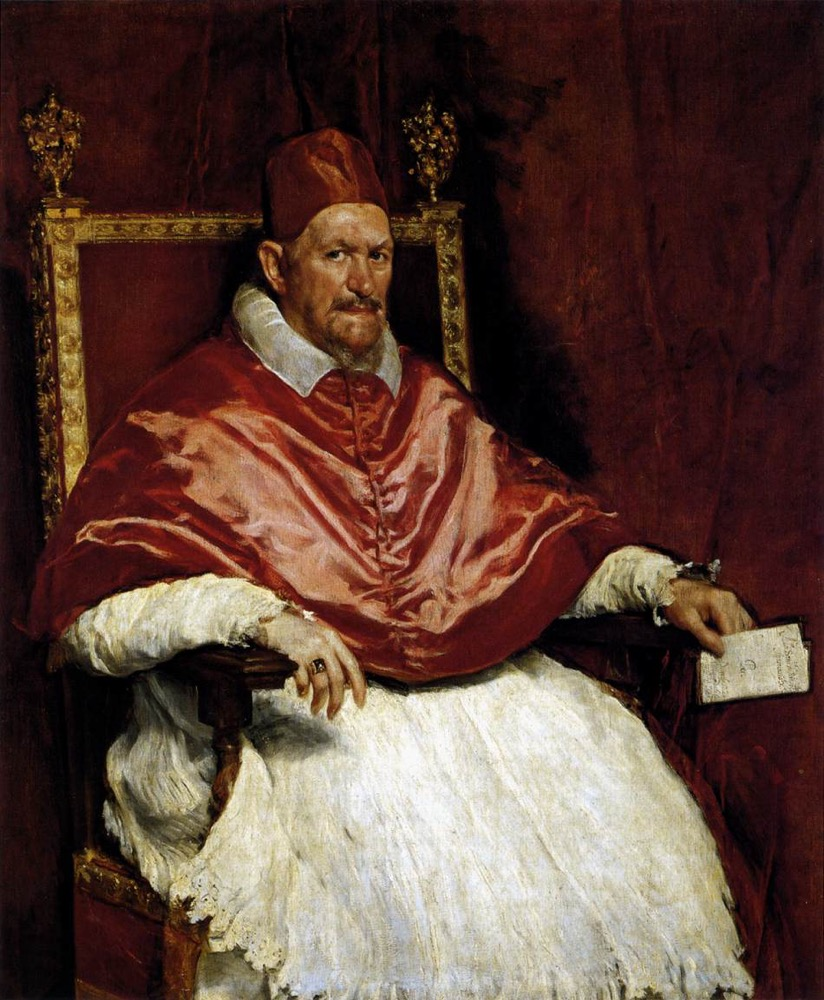
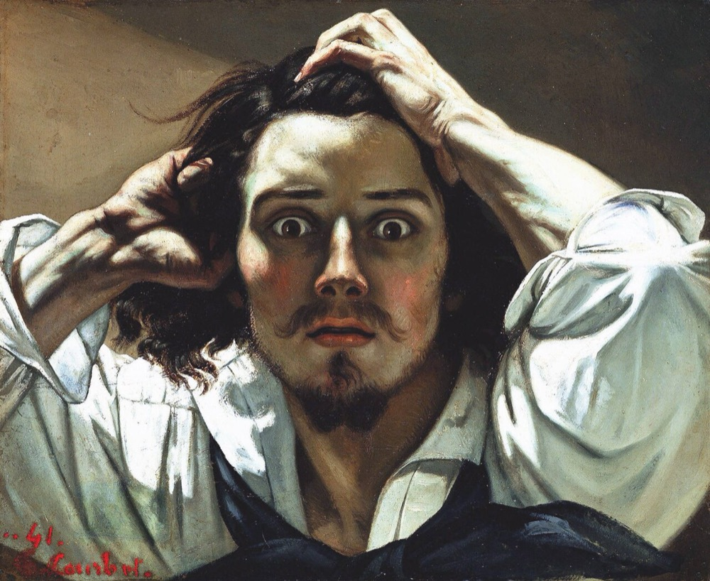
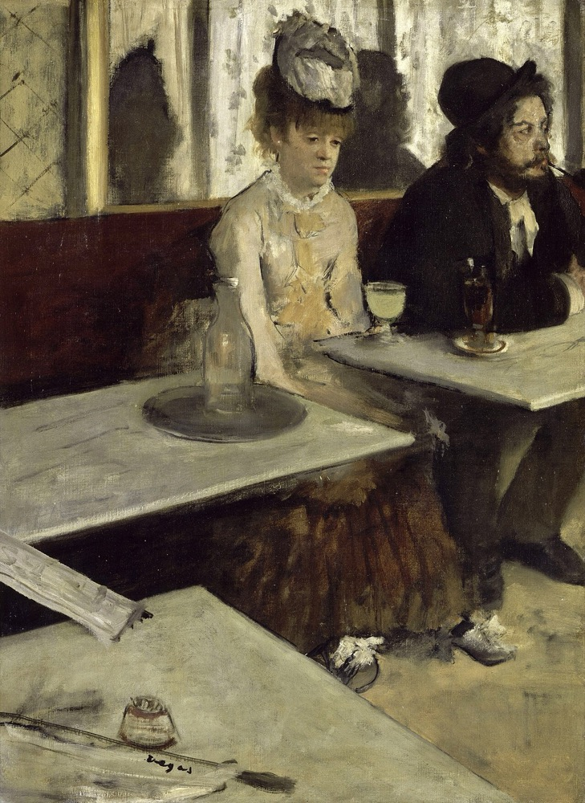

```{r}
#| label: setup
source(here::here("R/mapa.R"))
source(here::here("R/aula03_hierarquico.R"))
source(here::here("R/aula03_kmeans.R"))

num <- function(x, d = 1) format(round(x, d), nsmall = d, decimal.mark = ",")
numm <- function(x, d = 1) sub(",", "{,}", num(x, d), fixed = TRUE)

LL8 <- "https://doi.org/10.1016/B978-0-444-53868-0.50008-3"
cof <- cofenetica_r()
iv  <- indval_doubs()
```

::: {.meme}
{fig-alt="Retrato do papa Inocêncio X, de Velázquez: um homem de vestes vermelhas, sentado, com o rosto sério e o olhar desconfiado. Legenda: minha cara de felicidade com a volta às aulas." height="560px"}

[Minha cara de felicidade]{.meme-topo} [com a volta às aulas]{.meme-base}
:::

::: {.ref}
Diego Velázquez, *Retrato de Inocêncio X* (1649–1650), domínio público, via
Wikimedia Commons.
:::

## Hoje

Ao final da aula, você deverá ter compreendido:

1. O agrupamento hierárquico e o dendrograma: single linkage, UPGMA e Ward
2. Como escolher o nível de corte para encontrar grupos
3. Como validar o agrupamento
4. O agrupamento não hierárquico: k-means
5. As espécies indicadoras: IndVal

Leitura: [Legendre & Legendre (2012), cap. 8](`r LL8`).

::: {.nota}
Todas as figuras foram geradas em R, com o exemplo das lagoas de Legendre &
Legendre (recalculado), os peixes do rio Doubs (pacote `ade4`) ou dados
simulados. O código está em
[`R/`](https://github.com/diogoprov/multidimensionais/tree/main/R), nos
arquivos `aula03_*.R` e `dendro.R`.
:::

## Onde estamos

```{r}
#| fig-alt: "Mapa dos métodos multidimensionais. Da matriz de dados saem a associação, que leva à classificação, à ordenação irrestrita, à ordenação restrita e aos testes, e os métodos baseados em modelos. A classificação, tema da Aula 3, está destacada."
#| fig-height: 5.6
#| out-height: 590px
mapa_plot("Classificação")
```

# 1. Análise de agrupamento {.secao}

[Classificação]{.familia .classificacao}

## Análise de agrupamento

:::: {.columns}
::: {.column width="45%"}
- Resume um grande volume de informação.
- Agrupa objetos pelo grau de similaridade.
- **Busca descontinuidades no conjunto de dados para formar grupos.**

::: {.definicao}
Descontinuidade × gradiente: o agrupamento procura grupos; a ordenação
(Aula 4), gradientes contínuos. Os dados nem sempre têm grupos.
:::
:::
::: {.column width="55%"}
```{r}
#| fig-alt: "Diagrama dos tipos de análise de agrupamento. A análise de agrupamento pode ser particional (não hierárquica), como o k-means, ou hierárquica aglomerativa, como single linkage, complete linkage, UPGMA e Ward."
#| fig-width: 6.6
#| fig-height: 4.4
#| out-height: 460px
fig_tipos_agrupamento()
```
:::
::::

## Como os métodos funcionam?

```{r}
#| fig-alt: "Fluxograma. Da matriz de dados de locais por espécies, um coeficiente gera a matriz de dissimilaridades, e um algoritmo de agrupamento gera o dendrograma. Alternativamente, o k-means parte direto da matriz de dados e forma grupos ao redor de centroides."
#| fig-height: 4.2
#| out-height: 370px
fig_fluxo()
```

- Os **coeficientes de (dis)similaridade** foram o tema da aula passada: devem
  ser escolhidos de acordo com o tipo de dado e o objetivo da análise.
- Os **algoritmos aglomerativos** que veremos: single linkage, complete
  linkage, UPGMA e Ward.

# 2. Single linkage, passo a passo {.secao}

[Classificação]{.familia .classificacao}

## Comecemos pela matriz de composição de espécies

:::: {.columns}
::: {.column width="62%"}
::: {.tabela-grande}
```{r}
m <- t(lagoas_especies()); colnames(m) <- paste("Lagoa", colnames(m))
knitr::kable(data.frame(Espécie = rownames(m), m, check.names = FALSE), row.names = FALSE)
```
:::
:::
::: {.column width="38%"}
Abundância de 8 espécies em 5 lagoas.

Entre as lagoas, calculamos a similaridade $S_{20}$ (Legendre &
Chodorowski), já convertida em distância: $D = 1 - S_{20}$.
:::
::::

::: {.ref}
Exemplo de [Legendre & Legendre (2012), seção 8.2](`r LL8`).
:::

## A matriz de distâncias {.medio}

:::: {.columns}
::: {.column width="55%"}
::: {.tabela-grande}
```{r}
knitr::kable(tab_lagoas(0), align = "c")
```
:::
:::
::: {.column width="45%"}
O primeiro passo é ordenar os pares de lagoas da menor para a maior
distância:

::: {.tabela-grande}
```{r}
tp <- tab_pares()
knitr::kable(data.frame(`D = 1 − S20` = tp$D[1:5], Par = tp$par[1:5],
                        ` ` = "", `D = 1 − S20 ` = tp$D[6:10], `Par ` = tp$par[6:10],
                        check.names = FALSE), align = "c")
```
:::
:::
::::

## Passo 1: o par mais próximo {.medio}

:::: {.columns}
::: {.column width="45%"}
::: {.tabela-grande}
```{r}
knitr::kable(tab_lagoas(1), align = "c")
```
:::
:::
::: {.column width="55%"}
```{r}
#| fig-alt: "Dendrograma parcial das lagoas: só 212 e 214 estão unidas, na distância 0,4. As demais fusões aparecem em cinza claro."
#| fig-width: 6.6
#| fig-height: 4.4
#| out-height: 450px
fig_single_passo(.4)
```
:::
::::

As lagoas 212 e 214 se unem em $D = 0{,}4$.

## Passo 2 {.medio}

:::: {.columns}
::: {.column width="45%"}
::: {.tabela-grande}
```{r}
knitr::kable(tab_lagoas(2), align = "c")
```
:::
:::
::: {.column width="55%"}
```{r}
#| fig-alt: "Dendrograma parcial: 212 e 214 unidas em 0,4 e 431 e 432 unidas em 0,5."
#| fig-width: 6.6
#| fig-height: 4.4
#| out-height: 450px
fig_single_passo(.5)
```
:::
::::

431 e 432 se unem em $D = 0{,}5$.

## Passo 3 {.medio}

:::: {.columns}
::: {.column width="45%"}
::: {.tabela-grande}
```{r}
knitr::kable(tab_lagoas(3), align = "c")
```
:::
:::
::: {.column width="55%"}
```{r}
#| fig-alt: "Dendrograma parcial: a lagoa 233 se une ao grupo 431–432 em 0,7."
#| fig-width: 6.6
#| fig-height: 4.4
#| out-height: 450px
fig_single_passo(.7)
```
:::
::::

233 se une ao grupo (431, 432) em $D = 0{,}7$: basta **um** elo, o par
233–431.

## Passo 4: tudo conectado {.medio}

:::: {.columns}
::: {.column width="45%"}
::: {.tabela-grande}
```{r}
knitr::kable(tab_lagoas(4), align = "c")
```
:::
:::
::: {.column width="55%"}
```{r}
#| fig-alt: "Dendrograma completo do single linkage: os dois grupos se unem em 0,786, pelo elo entre 214 e 432."
#| fig-width: 6.6
#| fig-height: 4.4
#| out-height: 450px
fig_single_passo(.786)
```
:::
::::

O elo 214–432 ($D = 0{,}786$) une os dois grupos. Os pares restantes (0,800,
0,929...) já ligam objetos do mesmo grupo e não mudam nada.

::: {.ref}
[Legendre & Legendre (2012), Fig. 8.2](`r LL8`), redesenhado.
:::

# 3. UPGMA, Ward e outros {.secao}

[Classificação]{.familia .classificacao}

## UPGMA: a média das distâncias {.medio}

*Unweighted Pair-Group Method using Arithmetic averages*: a distância entre
dois grupos é a **média** das distâncias entre os seus objetos.

:::: {.columns}
::: {.column width="50%"}
Depois de unir 212 e 214:

$$D(212\text{–}214,\ 233) = \frac{1{,}000 + 0{,}929}{2} = 0{,}9645$$

::: {.fragment}
Depois de unir 431 e 432 e de juntar 233 a eles:

$$D(233,\ 431\text{–}432) = \frac{0{,}700 + 0{,}800}{2} = 0{,}750$$
:::
:::
::: {.column width="50%"}
::: {.fragment}
Última fusão, ponderada pelo tamanho dos grupos:

$$D = \frac{0{,}9645 \times 1 + 0{,}93075 \times 2}{3} = 0{,}942$$

com $0{,}93075 = (0{,}9685 + 0{,}893)/2$, a distância entre (212, 214) e
(431, 432).
:::
:::
::::

::: {.ref}
Recalcula a Tabela 8.3 de [Legendre & Legendre (2012)](`r LL8`).
:::

## Single linkage × UPGMA

```{r}
#| fig-alt: "Dois dendrogramas das cinco lagoas. No single linkage, a última fusão acontece em 0,786; no UPGMA, em 0,942. A topologia é a mesma, mas o UPGMA separa mais os dois grupos."
#| fig-height: 4.6
#| out-height: 500px
fig_single_upgma()
```

O ponto de parada (a distância que liga todos os objetos) muda: o single
linkage **contrai** o espaço; o UPGMA **conserva** as distâncias médias.

## Variações da UPGMA {.medio}

::: {.tabela-grande}
| | Média aritmética | Centroide |
|---|---|---|
| **Pesos iguais** | UPGMA (`"average"`) | UPGMC (`"centroid"`) |
| **Pesos desiguais** | WPGMA (`"mcquitty"`) | WPGMC (`"median"`) |
:::

- Entre aspas, o argumento `method` da função `hclust()`.
- Os métodos de centroide podem produzir **reversões** no dendrograma (uma
  fusão abaixo da anterior).

```{r}
#| fig-alt: "Quatro dendrogramas dos peixes do Doubs: UPGMA, WPGMA, UPGMC e WPGMC. Nos dois métodos de centroide há reversões, fusões que acontecem abaixo da fusão anterior."
#| fig-height: 2.6
#| out-height: 240px
fig_variacoes_upgma()
```

::: {.ref}
Adaptado de [Borcard et al. (2018), Tabela 4.1](https://doi.org/10.1007/978-3-319-71404-2_4).
:::

## Método de Ward

:::: {.columns}
::: {.column width="45%"}
Minimiza a soma dos quadrados dos desvios em torno da média dos grupos,
como numa ANOVA: a cada passo, une os dois grupos que menos aumentam a soma
de quadrados **dentro** dos grupos.

::: {.tabela-grande}
```{r}
knitr::kable(tab_ward(), align = "c")
```
:::
:::
::: {.column width="55%"}
```{r}
#| fig-alt: "Dendrograma de Ward das cinco lagoas, com o eixo em distância ao quadrado. As fusões ocorrem em 0,16, 0,25, 0,67 e 1,68."
#| fig-width: 6.2
#| fig-height: 4.6
#| out-height: 480px
fig_ward_lagoas()
```
:::
::::

::: {.ref}
Recalcula a Tabela 8.8 de [Legendre & Legendre (2012)](`r LL8`).
:::

## Existe uma maneira de combinar vários algoritmos? {.medio}

:::: {.columns}
::: {.column width="38%"}
**Agrupamento flexível** (Lance & Williams 1967): um parâmetro $\beta$
controla quanto o algoritmo contrai, conserva ou dilata o espaço.

- $\beta \approx 1$: contrai (como o single linkage)
- $\beta \approx -0{,}25$: conserva
- $\beta \approx -1$: dilata

Implementado em `cluster::agnes(method = "flexible")`. Ao lado, os peixes
do Doubs (distância de chord).
:::
::: {.column width="62%"}
```{r}
#| fig-alt: "Seis dendrogramas dos peixes do Doubs com agrupamento flexível. Com beta igual a 0,98, os locais entram um a um, em escada; à medida que beta diminui até −1, os grupos ficam mais compactos e mais separados."
#| fig-width: 7
#| fig-height: 5
#| out-height: 430px
fig_flexivel()
```
:::
::::

::: {.ref}
[Lance & Williams (1967)](https://doi.org/10.1093/comjnl/9.4.373) *Comput. J.* 9: 373–380.
:::

## Um modelo geral para os algoritmos {.medio}

$$D_{hi,g} = \alpha_h D_{hg} + \alpha_i D_{ig} + \beta D_{hi} + \gamma\,|D_{hg} - D_{ig}|$$

::: {.tabela-grande}
| Método | $\alpha_h$ | $\alpha_i$ | $\beta$ | $\gamma$ | Efeito no espaço |
|---|:-:|:-:|:-:|:-:|---|
| Single linkage | 1/2 | 1/2 | 0 | −1/2 | contrai |
| Complete linkage | 1/2 | 1/2 | 0 | 1/2 | dilata |
| UPGMA | $\frac{n_h}{n_h+n_i}$ | $\frac{n_i}{n_h+n_i}$ | 0 | 0 | conserva |
| WPGMA | 1/2 | 1/2 | 0 | 0 | conserva |
| Ward | $\frac{n_h+n_g}{n_h+n_i+n_g}$ | $\frac{n_i+n_g}{n_h+n_i+n_g}$ | $\frac{-n_g}{n_h+n_i+n_g}$ | 0 | conserva |
| Flexível | $\frac{1-\beta}{2}$ | $\frac{1-\beta}{2}$ | $-1 \leq \beta < 1$ | 0 | depende de $\beta$ |
:::

::: {.ref}
Adaptado de [Legendre & Legendre (2012), Tabela 8.9](`r LL8`).
:::

# 4. Quantos grupos? {.secao}

[Classificação]{.familia .classificacao}

## Como determinar os grupos?

:::: {.columns}
::: {.column width="45%"}
- **Escolher o nível de corte**: o valor de distância que estabelece os
  grupos.
- Vários critérios: 50% de similaridade, inspeção visual, níveis de fusão
  etc.
- **Reamostragem por bootstrap multiescala**: um valor de *p* aproximadamente
  não viesado para cada grupo (pacote `pvclust`).
:::
::: {.column width="55%"}
```{r}
#| fig-alt: "Dendrograma de Ward dos 29 locais do Doubs, com distância de chord. Uma linha vertical vermelha corta o dendrograma em quatro grupos, e os números dos locais estão coloridos pelo grupo."
#| fig-width: 6.2
#| fig-height: 5.8
#| out-height: 580px
fig_corte_doubs()
```
:::
::::

## Bootstrap multiescala: pvclust {.medio}

- Reamostra os descritores com bootstrap em várias escalas (tamanhos de
  amostra).
- Dois valores de suporte para cada grupo: **AU** (*approximately unbiased*) e
  **BP** (*bootstrap probability*).
- Verifica se os grupos se manteriam se o tamanho amostral aumentasse.
- `pvrect()` destaca os grupos com AU > 0,95: forte suporte.
- Desvantagem: só aceita alguns coeficientes de distância. Alternativa:
  transformar os dados (por exemplo, chord) e usar a distância euclidiana.

::: {.codigo-compacto}
```{r}
#| echo: true
#| eval: false
library(pvclust)
spe.ch <- vegan::decostand(spe, "normalize")        # transformação de chord
fit <- pvclust(t(spe.ch), method.hclust = "ward.D2",
               method.dist = "euclidean", nboot = 1000)
plot(fit); pvrect(fit, alpha = 0.95)
```
:::

::: {.ref}
[Shimodaira (2004)](https://doi.org/10.1214/009053604000000823) *Ann. Stat.* 32:
2616–2641; [Suzuki & Shimodaira (2006)](https://doi.org/10.1093/bioinformatics/btl117)
*Bioinformatics* 22: 1540–1542.
:::

## Níveis de fusão

:::: {.columns}
::: {.column width="40%"}
Outra forma de escolher o nível de corte: a altura de cada fusão contra o
número de grupos.

Um salto grande entre duas fusões indica que se está unindo grupos bem
distintos: um bom lugar para cortar.
:::
::: {.column width="60%"}
```{r}
#| fig-alt: "Níveis de fusão do agrupamento de Ward dos peixes do Doubs. O número de grupos cai de 15 a 1 à medida que a distância de fusão aumenta; os saltos maiores acontecem nas últimas fusões, de 4 para 3, de 3 para 2 e de 2 para 1 grupo."
#| fig-width: 6.8
#| fig-height: 5
#| out-height: 520px
fig_fusao()
```
:::
::::

::: {.ref}
[Borcard et al. (2018), seção 4.7.3](https://doi.org/10.1007/978-3-319-71404-2_4).
:::

# 5. O dendrograma representa bem os dados? {.secao}

[Classificação]{.familia .classificacao}

## Correlação cofenética {.medio}

- **Distância cofenética**: a distância entre dois objetos lida no
  dendrograma (o nível em que eles se unem).
- **Correlação cofenética**: correlação de Pearson entre a matriz de
  distâncias original e a matriz cofenética.
  - Escolha os métodos com a maior correlação possível.
  - Mostra que o dendrograma não distorceu muito as distâncias originais.
  - Regra prática: acima de 0,8.

```{r}
#| fig-alt: "Esquema: da matriz de distâncias original, o algoritmo gera o dendrograma; do dendrograma, o nível em que cada par se une dá a matriz de distâncias cofenéticas; a correlação de Pearson compara as duas matrizes."
#| fig-height: 3.2
#| out-height: 270px
fig_cofenetica_esquema()
```

## Correlação cofenética: quatro métodos

```{r}
#| fig-alt: "Quatro diagramas de Shepard dos peixes do Doubs, um por método: distância de chord original no eixo x e distância cofenética no eixo y. As correlações são 0,599 no single linkage, 0,766 no complete linkage, 0,861 no UPGMA e 0,8 no Ward."
#| fig-height: 4.4
#| out-height: 470px
fig_cofenetica()
```

O UPGMA tem a maior correlação (`r num(cof[["UPGMA"]], 3)`). O Ward distorce
as distâncias, mas forma grupos compactos.

::: {.ref}
Peixes do Doubs, distância de chord. Mesma análise de
[Borcard et al. (2018), cap. 4](https://doi.org/10.1007/978-3-319-71404-2_4).
:::

## Me explica isso...

::: {.meme}
{fig-alt="Autorretrato de Gustave Courbet, O desesperado: um jovem com os olhos arregalados e as mãos nos cabelos. Legenda: o quê? Me explica isso porque eu não entendi nada." height="520px"}

[O quê?]{.meme-topo} [Me explica isso, porque eu não entendi nada]{.meme-base}
:::

::: {.ref}
Gustave Courbet, *O desesperado* (1843–1845), domínio público, via
Wikimedia Commons.
:::

# 6. K-means {.secao}

[Classificação]{.familia .classificacao}

## K-means

- Técnica de agrupamento **não hierárquica**.
- Útil para encontrar grupos que não são subgrupos de outros.
- Agrupa os objetos ao redor de **centroides** (o objeto que representa o
  grupo).
- O número de grupos ($k$) é definido pelo usuário.

A função objetivo que o algoritmo minimiza:

$$J = \sum_{j=1}^{k} \sum_{i=1}^{n} \left\| x_i^{(j)} - c_j \right\|^2$$

a distância de cada objeto $x_i$ ao centroide $c_j$ do seu grupo.

## Como funciona o algoritmo?

```{r}
#| fig-alt: "Quatro quadros com três nuvens de pontos simuladas. No primeiro, três centroides iniciais mal posicionados. No segundo, cada ponto recebe a cor do centroide mais próximo. No terceiro, setas mostram os centroides indo para a média dos seus grupos. No quarto, depois de repetir, cada centroide está no centro de uma nuvem."
#| fig-width: 11
#| fig-height: 3.8
#| out-height: 330px
fig_kmeans_passos()
```

```{r}
#| fig-alt: "Fluxograma do k-means: dados e número de grupos k, centroides iniciais, atribuição de cada objeto ao centroide mais próximo, recálculo dos centroides e a pergunta se os centroides mudaram; se sim, volta à atribuição; se não, os grupos são finais."
#| fig-height: 2.6
#| out-height: 230px
fig_kmeans_fluxo()
```

## Detalhes do algoritmo

- Os grupos podem ser calculados a partir da matriz bruta ou da matriz de
  distâncias.
  - A soma de quadrados dentro dos grupos (TESS) é a mesma usando $D^2$ ou os
    dados brutos.
  - Se o conjunto de dados é muito grande, é melhor calcular direto na matriz
    bruta (com distância euclidiana).
- Minimiza a TESS da mesma forma que o método de Ward.
- O resultado depende dos centroides iniciais: rode com vários pontos de
  partida (`kmeans(..., nstart = 100)`).

## Quantos grupos? Scree plot

:::: {.columns}
::: {.column width="40%"}
- Rode o k-means para vários valores de $k$.
- A TESS sempre diminui com mais grupos.
- Procure o "cotovelo": a partir dele, mais grupos quase não reduzem a TESS.

`vegan::cascadeKM()` automatiza isso, com critérios como o de
Calinski-Harabasz.
:::
::: {.column width="60%"}
```{r}
#| fig-alt: "Soma de quadrados dentro dos grupos do k-means contra o número de grupos, de 1 a 10, para os peixes do Doubs com transformação de chord. A curva cai rápido até 2 a 4 grupos e depois se achata."
#| fig-width: 6.8
#| fig-height: 4.8
#| out-height: 500px
fig_kmeans_scree()
```
:::
::::

::: {.ref}
Peixes do Doubs, transformação de chord.
:::

# 7. Espécies indicadoras: IndVal {.secao}

[Classificação]{.familia .classificacao}

## IndVal {.medio}

- Técnica que permite encontrar **espécies indicadoras** de hábitats (ou de
  grupos de locais).
  - Melhor que o TWINSPAN.
- Útil em monitoramento ambiental, para encontrar espécies substitutas
  (*surrogates*).
  - Essas espécies seriam priorizadas na amostragem, por indicarem uma dada
    condição ambiental.
- Funciona com qualquer classificação dos locais, hierárquica ou não.

```{r}
#| fig-alt: "Mapa de calor da abundância de espécies indicadoras nos 29 locais do Doubs, com os locais separados pelos quatro grupos do Ward. Cada espécie indicadora é abundante nos locais do seu grupo e rara ou ausente nos demais."
#| fig-height: 2.6
#| out-height: 230px
fig_indicadoras()
```

::: {.ref}
[Dufrêne & Legendre (1997)](https://doi.org/10.2307/2963459) *Ecol. Monogr.* 67:
345–366; [Legendre & Legendre (2012), p. 397–403](`r LL8`). Veja também
[De Cáceres & Legendre (2009)](https://doi.org/10.1890/08-1823.1) e
[De Cáceres et al. (2012)](https://doi.org/10.1111/j.2041-210X.2012.00246.x).
:::

## Especificidade e fidelidade

:::: {.columns}
::: {.column width="50%"}
**Especificidade** ($A_{kj}$): a espécie $j$ ocorre **só** no grupo $k$?

$$A_{kj} = \frac{\bar{N}_{kj}}{\sum_k \bar{N}_{kj}}$$

(abundância média no grupo $k$ sobre a soma das médias dos grupos)
:::
::: {.column width="50%"}
**Fidelidade** ($B_{kj}$): a espécie está em **todos** os locais do grupo
$k$?

$$B_{kj} = \frac{\text{locais}_{kj}}{\text{locais}_{k}}$$

(proporção dos locais do grupo onde a espécie ocorre)
:::
::::

::: {.definicao}
$$\text{IndVal}_{kj} = A_{kj} \times B_{kj} \qquad \text{IndVal}_j = \max_k\,[\text{IndVal}_{kj}]$$

A significância vem de um teste de permutação dos locais entre os grupos.
:::

## Especificidade: quatro casos

```{r}
#| fig-alt: "Quatro gráficos de barras da abundância de uma espécie em cinco grupos de locais, com o grupo j em destaque, por último. (a) 4 em todos os grupos: A = 0,2. (b) 20 só no grupo j: A = 1. (c) 20 só no primeiro grupo e 0 no grupo j: A = 0. (d) 5 nos quatro primeiros grupos e 0 no grupo j: A = 0."
#| fig-height: 4.2
#| out-height: 450px
fig_especificidade()
```

A especificidade é máxima (b) quando a espécie ocorre só no grupo $j$, e nula
quando ela falta no grupo (c, d).

::: {.ref}
Inspirado em [Podani & Csányi (2010)](https://doi.org/10.1016/j.ecolind.2010.03.010)
*Ecol. Indic.* 10: 1119–1124.
:::

## Um exemplo numérico {.medio}

Três espécies em 25 locais, divididos em 5 grupos de 5 locais.

::: {.tabela-grande}
```{r}
knitr::kable(tab_indval_ll(), align = "c")
```
:::

::: {.ref}
Recalcula a Tabela 8.10 de [Legendre & Legendre (2012)](`r LL8`), modificada
de Dufrêne & Legendre (1997). Em negrito, o maior IndVal de cada espécie.
:::

## IndVal dos peixes do Doubs

:::: {.columns}
::: {.column width="40%"}
Os quatro grupos do corte do Ward (slide "Como determinar os grupos?") e as
espécies com maior IndVal:

- Grupo 1 (cabeceiras): só a truta (Satr) indica.
- Grupo 3 (trecho baixo): muitas indicadoras, como Abbr, Blbj e Anan.

`r sum(iv$p <= 0.05)` das `r nrow(iv)` espécies têm $p \leq 0{,}05$
(`r 999` permutações).
:::
::: {.column width="60%"}
::: {.tabela-grande}
```{r}
t10 <- iv |> dplyr::arrange(p, dplyr::desc(IndVal)) |> head(9)
t10 <- dplyr::mutate(t10, dplyr::across(c(A, B, IndVal), \(v) num(v, 2)),
                     p = format(p, decimal.mark = ","))
knitr::kable(t10, col.names = c("Espécie", "Grupo", "A", "B", "IndVal", "p"),
             align = "lccccc")
```
:::
:::
::::

::: {.ref}
Peixes do Doubs, grupos do Ward com distância de chord. IndVal calculado com
a função `indval()` em `R/aula03_kmeans.R`.
:::

## Minha cara depois desta aula

::: {.meme}
{fig-alt="Pintura de Edgar Degas, No café: uma mulher e um homem sentados lado a lado num café, com olhar vazio e cansado, diante de copos. Legenda: minha cara depois de assistir a essa aula." height="560px"}

[Minha cara depois de]{.meme-topo} [assistir a essa aula]{.meme-base}
:::

::: {.ref}
Edgar Degas, *No café* (1875–1876), domínio público, via Wikimedia Commons.
:::

# Para saber mais {.secao}

## Prós, contras e usos dos métodos de agrupamento (1/2) {.medio}

::: {.tabela-grande}
| Método | Prós e contras | Uso em ecologia |
|---|---|---|
| Single linkage | cálculo simples; contrai o espaço (encadeamento) | bom complemento à ordenação |
| Complete linkage | núcleos densos; dilata o espaço | aumentar o contraste entre grupos |
| UPGMA | une grupos pela distância média; conserva o espaço | amostras aleatórias ou sistemáticas |
| WPGMA | como a UPGMA, com ajuste para o tamanho dos grupos | as demais situações de amostragem |
:::

::: {.ref}
Resumido de [Legendre & Legendre (2012), cap. 8](`r LL8`).
:::

## Prós, contras e usos dos métodos de agrupamento (2/2) {.medio}

::: {.tabela-grande}
| Método | Prós e contras | Uso em ecologia |
|---|---|---|
| UPGMC, WPGMC | centroides mais próximos; podem gerar reversões | idem, com centroides |
| Ward | minimiza a soma de quadrados dentro dos grupos | grupos hiperesféricos |
| Flexível | contrai, conserva ou dilata, conforme $\beta$ | todos os métodos combinatórios |
| K-means | minimiza a soma de quadrados dentro dos grupos | partição em $k$ grupos definidos pelo usuário |
| IndVal | qualquer classificação dos locais | valores indicadores testados por permutação |
:::

::: {.ref}
Resumido de [Legendre & Legendre (2012), cap. 8](`r LL8`).
:::
