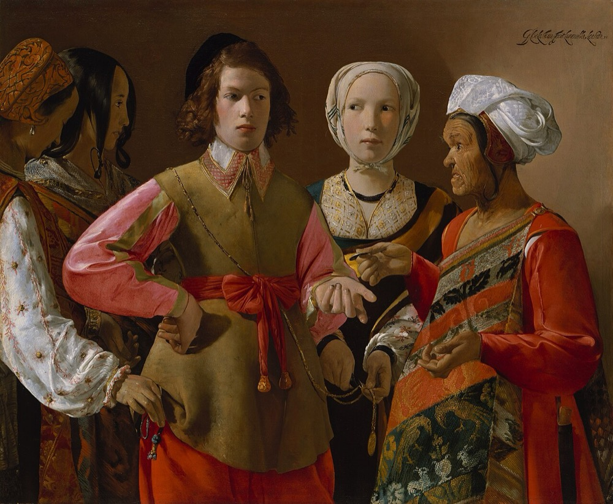
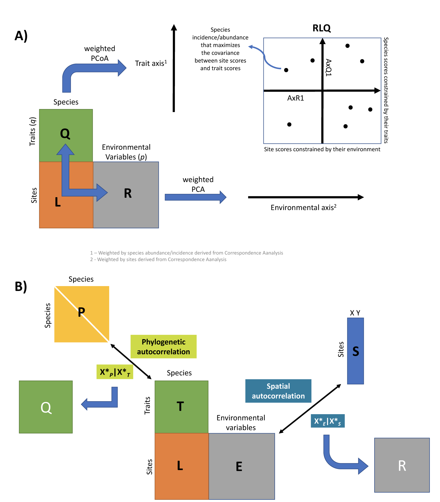
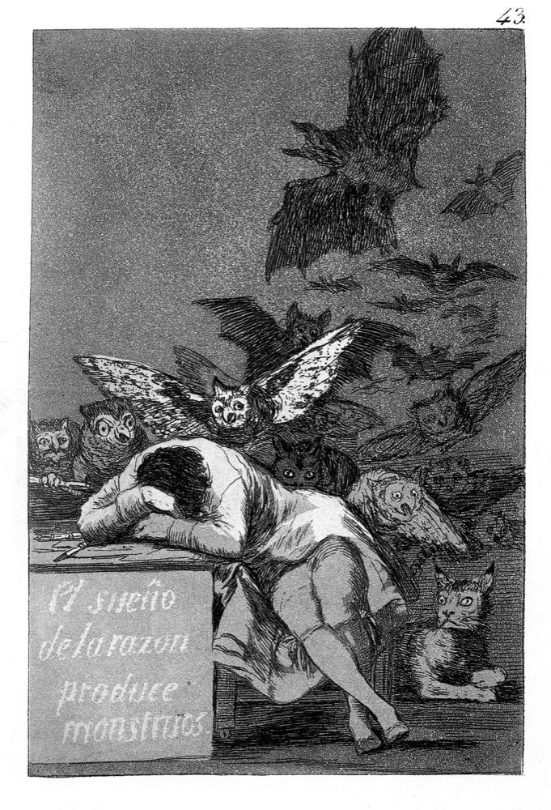

```{r}
#| label: setup
source(here::here("R/mapa.R"))
source(here::here("R/aula05_rda.R"))
source(here::here("R/aula05_parcial.R"))
source(here::here("R/aula05_lda.R"))

num <- function(x, d = 1) format(round(x, d), nsmall = d, decimal.mark = ",")
numm <- function(x, d = 1) sub(",", "{,}", num(x, d), fixed = TRUE)
pct <- function(x) paste0(num(100 * x, 1), "%")

LL11 <- "https://doi.org/10.1016/B978-0-444-53868-0.50011-3"
LL10 <- "https://doi.org/10.1016/B978-0-444-53868-0.50010-1"
LL9  <- "https://doi.org/10.1016/B978-0-444-53868-0.50009-5"
LL7  <- "https://doi.org/10.1016/B978-0-444-53868-0.50007-1"
LL14 <- "https://doi.org/10.1016/B978-0-444-53868-0.50014-9"
LL13 <- "https://doi.org/10.1016/B978-0-444-53868-0.50013-7"
BOR6 <- "https://doi.org/10.1007/978-3-319-71404-2_6"

dd   <- doubs_rda_dados()
rda1 <- doubs_rda()
r2   <- vegan::RsquareAdj(rda1)
set.seed(1); av_glob <- vegan::anova.cca(rda1, permutations = 999)
set.seed(1); av_eixo <- vegan::anova.cca(rda1, by = "axis", permutations = 999)
cca1 <- doubs_cca()
r2c  <- vegan::RsquareAdj(cca1)
rda_dune <- dune_rda()
mh   <- mahal_ex()
dca_comp <- diff(range(vegan::scores(vegan::decorana(dd$spe), display = "sites", choices = 1)))
vif  <- vegan::vif.cca(rda1)
set.seed(1)
fs   <- vegan::ordiR2step(vegan::rda(dd$spe.h ~ 1, dd$env), rda1, permutations = 999, trace = FALSE)
vp   <- mite_varpart()
ld   <- doubs_lda()
```

::: {.meme}
{fig-alt="Pintura Caipira picando fumo, de Almeida Júnior: um homem descalço, sentado no degrau de uma casa de pau a pique, pica fumo com calma. Legenda: é proibido desistir! Respira fundo e continua." height="560px"}

[É proibido desistir!]{.meme-topo} [Respira fundo e continua]{.meme-base}
:::

::: {.ref}
Almeida Júnior, *Caipira picando fumo* (1893), Pinacoteca de São Paulo, domínio público, via Wikimedia Commons.
:::

## Hoje

Ao final desta aula, você deverá ter compreendido:

1. O que as análises canônicas fazem
2. A análise de redundância (RDA) e a de correspondência canônica (CCA)
3. A seleção de variáveis e a db-RDA
4. As análises parciais e a partição de variância, com filtros espaciais
5. A análise discriminante linear (LDA)
6. Um breve comentário sobre métodos alternativos

Leitura: [Legendre & Legendre (2012), cap. 11](`r LL11`).

::: {.nota}
As figuras foram geradas em R, com os peixes do rio Doubs (`ade4`), os ácaros
de `vegan::mite` ou dados simulados. O código está em
[`R/`](https://github.com/diogoprov/multidimensionais/tree/main/R), nos
arquivos `aula05_*.R`.
:::

## Onde estamos

```{r}
#| fig-alt: "Mapa dos métodos multidimensionais, com a ordenação restrita, tema da Aula 5, destacada."
#| fig-height: 5.6
#| out-height: 590px
mapa_plot("Ordenação restrita")
```

# 1. Análises canônicas {.secao}

[Ordenação restrita]{.familia .restrita}

## Análise indireta × direta de gradientes

```{r}
#| fig-alt: "Dois esquemas. Na análise indireta, a matriz Y gera eixos de ordenação, que depois são comparados com a matriz X por correlação ou regressão. Na análise direta, Y e X são comparadas diretamente numa análise canônica."
#| fig-height: 4.4
#| out-height: 450px
fig_indireta_direta()
```

Usadas principalmente para avaliar a relação das espécies com o ambiente:
são as **análises diretas de gradiente**.

::: {.ref}
Inspirado na Fig. 10.4 de [Legendre & Legendre (2012)](`r LL10`). Baseado em
slides de Michel V. Garey.
:::

## Quando usar?

```{r}
#| fig-alt: "Dois esquemas. Nas análises assimétricas, X explica Y: RDA e CCA quando Y contém todas as variáveis, LDA quando Y contém uma classificação dos objetos. Nas simétricas, X e Y têm o mesmo papel e se busca o que há em comum: correlação canônica, co-inércia, Procrustes."
#| fig-height: 4
#| out-height: 420px
fig_assim_sim()
```

Nas simétricas, analisar Y por X ou X por Y dá o mesmo resultado; nas
assimétricas, não.

::: {.ref}
Baseado em slides de Michel V. Garey.
:::

## O que as análises assimétricas fazem?

- Diferentemente da análise indireta de gradiente, usam uma matriz de
  **variáveis preditoras** (os gradientes) para explicar a distribuição dos
  dados de uma **matriz resposta**.
- Combinam os conceitos de **ordenação e regressão**.
- Na ordenação, os eixos são **combinações lineares das variáveis ambientais**
  (o gradiente), e as espécies são a resposta a esse gradiente.

::: {.definicao}
"Assimétrica" quer dizer que as duas matrizes não têm o mesmo papel: há uma
matriz resposta Y, em geral de composição de comunidades, e uma matriz
explicativa X, como na regressão.
:::

::: {.ref}
[Legendre, Oksanen & ter Braak (2011)](https://doi.org/10.1111/j.2041-210X.2010.00078.x)
*Methods Ecol. Evol.* 2: 269–277.
:::

## Vantagens e o que é necessário {.medio}

:::: {.columns}
::: {.column width="50%"}
**Vantagens**

- Tratam X como explicativa e Y como resposta, como numa regressão.
- Permitem tanto a exploração dos dados quanto o teste de hipóteses
  definidas *a priori*.
:::
::: {.column width="50%"}
**O que é necessário**

1. Matriz resposta (Y): em geral, composição de espécies (binária ou
   quantitativa).
2. Matriz explicativa (X): em geral, variáveis ambientais.

::: {.definicao}
As duas matrizes têm de ter o mesmo número de linhas, na mesma ordem.
:::
:::
::::

::: {.fragment}
Uma relação explicativa não é uma relação causal: a RDA mostra associação,
e a causa depende do delineamento.
:::

## RDA e CCA {.medio}

:::: {.columns}
::: {.column width="50%"}
**Redundancy Analysis (RDA)**

- Supõe relação **linear** entre a resposta e as preditoras.
- Redundância = variância explicada.
:::
::: {.column width="50%"}
**Canonical Correspondence Analysis (CCA)**

- Supõe relação **unimodal** entre a resposta (a abundância das espécies) e
  as preditoras (as variáveis ambientais).
:::
::::

**Pressupostos**

- Dados dimensionalmente homogêneos: as variáveis ambientais devem estar
  **padronizadas**.
- As preditoras podem ser quantitativas ou qualitativas (multiestado ou
  binárias, *dummy*).
- Ausência de **multicolinearidade** entre as preditoras.
- Bem menos preditoras do que objetos: com $m$ preditoras próximas de
  $n - 1$, o $R^2$ tende a 1 mesmo sem relação real.

## Um exemplo: girinos e poças

{fig-align="center" height="390px" fig-alt="Ilustração em preto e branco de uma poça cercada de vegetação, com 18 espécies de anuros numeradas, cada uma num micro-hábitat: árvores, arbustos, capim na margem, plantas emergentes, folhas flutuantes e trechos de água aberta."}

:::: {.columns}
::: {.column width="50%"}
**X**: densidade da vegetação, tipos de vegetação, porcentagem da superfície
da poça exposta
:::
::: {.column width="50%"}
**Y**: as espécies que ocorrem em cada poça. A variação ambiental influencia
a composição de espécies?
:::
::::

::: {.ref}
Ilustração de [Provete et al. (2011)](https://doi.org/10.1590/S1676-06032011000200036)
*Biota Neotrop.* 11(2): 377–391. Baseado em slides de Thiago Gonçalves-Souza.
:::

## Girinos e poças: as duas matrizes

```{r}
#| fig-alt: "Esquema das duas matrizes do exemplo. Em cima, três variáveis ambientais (tipos de vegetação, densidade da vegetação e porcentagem da superfície da poça exposta), unidas por uma chave, formam a matriz X, com uma linha por poça. Embaixo, silhuetas de três anuros, unidas por outra chave, formam a matriz Y, de presença e ausência das espécies nas mesmas poças."
#| fig-width: 10
#| fig-height: 7.4
#| out-height: 540px
fig_girinos_matrizes()
```

::: {.ref}
Valores ilustrativos. Redesenhado de slide de Thiago Gonçalves-Souza.
Silhuetas do [PhyloPic](https://www.phylopic.org): Luca Leicht (CC BY 4.0),
Dennis C. Murphy e plag665 (CC0 1.0).
:::

# 2. RDA passo a passo {.secao}

[Ordenação restrita]{.familia .restrita}

## Da regressão múltipla à RDA

```{r}
#| fig-alt: "Dois esquemas. Na regressão múltipla, um vetor y é modelado por uma matriz X. Na RDA, uma matriz Y inteira é modelada por X."
#| fig-height: 4
#| out-height: 440px
fig_regressao_rda()
```

Lembre-se de padronizar as variáveis preditoras e de eliminar a
multicolinearidade.

## A RDA em dois passos

```{r}
#| fig-alt: "Fluxograma da RDA. Passo 1: cada coluna de Y é regredida em X, gerando os valores ajustados Ŷ e os resíduos. Passo 2: a PCA de Ŷ gera os autovetores U; com eles se calculam os escores dos locais no espaço de Y (F = YU) e os escores ajustados no espaço de X (Z = ŶU). Os resíduos também podem passar por uma PCA."
#| fig-height: 5
#| out-height: 540px
fig_rda_passos()
```

::: {.ref}
Inspirado na Fig. 11.2 de [Legendre & Legendre (2012)](`r LL11`). Baseado em
slides de Thiago Gonçalves-Souza.
:::

## Passo 1: regressão de cada variável de Y em X {.medio}

:::: {.columns}
::: {.column width="45%"}
O modelo linear em forma de matriz:

$$\mathbf{Y} = \mathbf{X}\boldsymbol\beta + \mathbf{E}$$

$$\hat{\boldsymbol\beta} = (\mathbf{X}'\mathbf{X})^{-1}\mathbf{X}'\mathbf{Y}$$

$$\hat{\mathbf{Y}} = \mathbf{X}\,[\mathbf{X}'\mathbf{X}]^{-1}\,\mathbf{X}'\mathbf{Y}$$

Como X e Y estão centradas, não há intercepto.
:::
::: {.column width="55%"}
```{r}
#| fig-alt: "Regressão simulada de Y1 em X1: pontos azuis observados, a reta ajustada em vermelho e, sobre ela, os valores ajustados em vermelho, ligados aos observados por segmentos tracejados."
#| fig-width: 6.4
#| fig-height: 4.8
#| out-height: 480px
fig_ajustados()
```
:::
::::

::: {.ref}
Dados simulados. Baseado em slides de M. Collyer.
:::

## Passo 2: a PCA dos valores ajustados

```{r}
#| fig-alt: "Esquema do passo 2. A matriz Ŷ passa por uma PCA, que gera os autovalores (a variação de cada eixo canônico), os autovetores U (os pesos das espécies) e os escores de locais, espécies e preditoras. Uma seta vermelha indica a redução do espaço multidimensional aos poucos eixos que concentram a variação explicada por X."
#| fig-width: 10
#| fig-height: 4.6
#| out-height: 470px
fig_rda_passo2_pca()
```

A PCA do passo 2 só faz sentido se a relação entre X e Y for significativa
(seção 3).

::: {.ref}
Redesenhado de slides de Thiago Gonçalves-Souza.
:::

## Passo 2: dois tipos de escores dos locais

```{r}
#| fig-alt: "Esquema com duas linhas. Em cima, a matriz Y multiplicada pelos autovetores U dá F = YU, a combinação linear dos dados observados, chamada no vegan de site scores (wa). Embaixo, a matriz Ŷ multiplicada pelos mesmos autovetores dá Z = ŶU, a combinação linear dos valores ajustados, chamada de site constraints (lc); uma chave sob Ŷ e U indica a distribuição das espécies predita pelo ambiente."
#| fig-width: 10.5
#| fig-height: 5.6
#| out-height: 540px
fig_rda_escores()
```

::: {.ref}
Redesenhado de slides de Thiago Gonçalves-Souza;
[Legendre & Legendre (2012), seção 11.1](`r LL11`).
:::

## Os dois escores nos peixes do Doubs {.medio}

:::: {.columns}
::: {.column width="58%"}
```{r}
#| fig-alt: "Locais da RDA dos peixes do Doubs nos dois primeiros eixos, cada um em duas posições: o escore wa (F = YU), em azul, e o escore lc (Z = ŶU), em verde, ligados por um segmento. Os escores lc ficam menos dispersos que os wa."
#| fig-width: 6.6
#| fig-height: 6
#| out-height: 515px
fig_wa_lc(rda1)
```
:::
::: {.column width="42%"}
- Cada segmento liga a composição **observada** de um local (wa) à
  composição **predita pelas variáveis ambientais** (lc).
- Segmentos longos: locais que o ambiente medido explica mal.
- O `plot()` do `vegan` usa wa por padrão; `display = "lc"` mostra os
  escores restritos.
:::
::::

::: {.definicao}
RDA: combinações lineares entre Y e X. CCA: as mesmas operações, mas
ponderadas.
:::

## Diferença entre RDA e CCA {.medio}

- A CCA é a forma **ponderada** da RDA:
  - regressão múltipla ponderada;
  - as combinações lineares são ponderadas pelos totais das linhas.

$$\hat{\mathbf{Y}} = \mathbf{D}(p_{i+})^{1/2}\, \mathbf{X}_{st}\, [\mathbf{X}_{st}'\, \mathbf{D}(p_{i+})\, \mathbf{X}_{st}]^{-1}\, \mathbf{X}_{st}'\, \mathbf{D}(p_{i+})^{1/2}\, \bar{\mathbf{Q}}$$

- Preserva a distância de **qui-quadrado** entre as linhas da matriz resposta.

::: {.tabela-grande}
| | RDA | CCA |
|---|---|---|
| Relação com as preditoras | linear | unimodal |
| Distância preservada | euclidiana | qui-quadrado |
| No `vegan` | `rda()` | `cca()` |
:::

::: {.ref}
[Legendre & Legendre (2012), seção 11.2](`r LL11`).
:::

# 3. O modelo é adequado? {.secao}

[Ordenação restrita]{.familia .restrita}

## Quanta variação é explicada? {.medio}

A PCA do passo 2 só faz sentido se houver uma relação significativa entre X
e Y.

:::: {.columns}
::: {.column width="50%"}
$R^2$ canônico:

$$R^2_{Y|X} = \frac{SS(\hat{\mathbf{Y}})}{SS(\mathbf{Y})}$$

$R^2$ canônico ajustado:

$$R^2_a = 1 - (1 - R^2_{Y|X})\,\frac{n - 1}{n - m - 1}$$
:::
::: {.column width="50%"}
- O $R^2$ não ajustado tem valor esperado $E(R^2) = m / (n - 1)$ mesmo sem
  relação nenhuma: depende do número de preditoras e de objetos.
- O $R^2_a$, com o teste dos eixos, também ajuda a escolher entre CCA e RDA
  (gradiente curto ou longo): prefira o modelo que explica mais.
:::
::::

::: {.fragment .definicao}
Peixes do Doubs (Hellinger), 10 variáveis ambientais: $R^2 = `r numm(r2$r.squared, 3)`$ e
$R^2_a = `r numm(r2$adj.r.squared, 3)`$.
:::

## Testes de significância {.medio}

:::: {.columns}
::: {.column width="45%"}
**Teste F global**, por permutação:

$$F = \frac{R^2_{Y|X} / mp}{(1 - R^2_{Y|X}) / (n - m - 1)p}$$

**Testes dos eixos**: a variação capturada no eixo é maior do que o
esperado ao acaso? Quantos eixos interpretar?

- `anova.cca(..., by = "axis")`
- `anova.cca(..., by = "margin")`: um *p* para cada preditora
:::
::: {.column width="55%"}
::: {.tabela-grande}
```{r}
ax <- as.data.frame(av_eixo)[1:5, ]
knitr::kable(data.frame(Eixo = rownames(ax), Variância = num(ax$Variance, 3),
                        F = num(ax$F, 2), p = format(ax$`Pr(>F)`, decimal.mark = ",")),
             align = "lccc")
```
:::

Modelo global: F = `r num(av_glob$F[1], 2)`, p = `r format(av_glob[["Pr(>F)"]][1], decimal.mark = ",")`.
Três eixos significativos.
:::
::::

::: {.ref}
[Legendre, Oksanen & ter Braak (2011)](https://doi.org/10.1111/j.2041-210X.2010.00078.x);
[Legendre & Legendre (2012), p. 634–5](`r LL11`). Peixes do Doubs, 999 permutações.
:::

# 4. Como interpretar um triplot {.secao}

[Ordenação restrita]{.familia .restrita}

## Três informações num só gráfico

- **Locais** (pontos), **variáveis preditoras** (setas) e **respostas**, como
  as espécies.
- As distâncias no diagrama aproximam a distância euclidiana na RDA e a de
  qui-quadrado na CCA.
- Dois tipos de *scaling*:
  1. foca nos **objetos**: útil quando há muitas preditoras categóricas;
  2. foca nas **variáveis**: útil com preditoras quantitativas.

::: {.tabela-grande}
| | Scaling 1 | Scaling 2 |
|---|---|---|
| Distâncias entre locais | aproximam as originais | não |
| Ângulos entre as setas | não | refletem correlações |
:::

## Montando um triplot {.medio}

:::: {.columns}
::: {.column width="38%"}
**O segundo passo gera:**

- os escores dos **locais**
:::
::: {.column width="62%"}
```{r}
#| fig-alt: "Triplot esquemático de uma RDA, etapa 1 de 6: só os oito locais."
#| fig-width: 6.4
#| fig-height: 6.2
#| out-height: 580px
fig_triplot_camadas(1)
```
:::
::::

## Montando um triplot {.medio}

:::: {.columns}
::: {.column width="38%"}
**O segundo passo gera:**

- os escores dos **locais**
- os escores das **espécies**
:::
::: {.column width="62%"}
```{r}
#| fig-alt: "Triplot esquemático de uma RDA, etapa 2 de 6: os locais e seis espécies."
#| fig-width: 6.4
#| fig-height: 6.2
#| out-height: 580px
fig_triplot_camadas(2)
```
:::
::::

## Montando um triplot {.medio}

:::: {.columns}
::: {.column width="38%"}
**O segundo passo gera:**

- os escores dos **locais**
- os escores das **espécies**
- os escores das **preditoras** (setas)
:::
::: {.column width="62%"}
```{r}
#| fig-alt: "Triplot esquemático de uma RDA, etapa 3 de 6: os locais, as espécies e quatro setas de variáveis ambientais (Temp, Umidade, Luminosidade e pH)."
#| fig-width: 6.4
#| fig-height: 6.2
#| out-height: 580px
fig_triplot_camadas(3)
```
:::
::::

## Montando um triplot {.medio}

:::: {.columns}
::: {.column width="38%"}
**Scaling 2**


O **ângulo** entre as setas reflete a **correlação** entre as variáveis: Luminosidade e pH, quase em ângulo reto, são pouco correlacionadas.
:::
::: {.column width="62%"}
```{r}
#| fig-alt: "Triplot esquemático de uma RDA, etapa 4 de 6: o triplot completo, com um arco verde marcando o ângulo entre as setas de Luminosidade e de pH."
#| fig-width: 6.4
#| fig-height: 6.2
#| out-height: 580px
fig_triplot_camadas(4)
```
:::
::::

## Montando um triplot {.medio}

:::: {.columns}
::: {.column width="38%"}
**Scaling 1**


A **distância** entre os objetos aproxima a sua **distância euclidiana**: local 1 e local 8 têm composições bem diferentes.
:::
::: {.column width="62%"}
```{r}
#| fig-alt: "Triplot esquemático de uma RDA, etapa 5 de 6: o triplot completo, com uma seta verde ligando o local 1 ao local 8."
#| fig-width: 6.4
#| fig-height: 6.2
#| out-height: 580px
fig_triplot_camadas(5)
```
:::
::::

## Montando um triplot {.medio}

:::: {.columns}
::: {.column width="38%"}
**Scaling 1**


**Projetar** uma espécie em ângulo reto sobre uma seta aproxima a **abundância** dela ao longo da variável: sp4 é mais abundante onde o pH é mais alto.
:::
::: {.column width="62%"}
```{r}
#| fig-alt: "Triplot esquemático de uma RDA, etapa 6 de 6: o triplot completo, com a projeção perpendicular da espécie sp4 sobre a seta do pH marcada em verde."
#| fig-width: 6.4
#| fig-height: 6.2
#| out-height: 580px
fig_triplot_camadas(6)
```
:::
::::

::: {.ref}
Esquema; redesenhado de slides de Thiago Gonçalves-Souza.
:::

## Triplot da RDA: scaling 2 {.medio}

:::: {.columns}
::: {.column width="60%"}
```{r}
#| fig-alt: "Triplot da RDA dos peixes do Doubs em scaling 2. Os locais em cinza, as variáveis ambientais como setas verdes e as espécies em vermelho. O eixo 1 opõe altitude e declividade, à direita, a nitrato, fosfato, amônio e DBO, à esquerda; a truta (Satr) fica do lado da altitude e do oxigênio."
#| fig-width: 7
#| fig-height: 6
#| out-height: 550px
fig_triplot(rda1, 2)
```
:::
::: {.column width="40%"}
- O ângulo entre as setas reflete a **correlação** entre as variáveis.
- Projetar uma espécie em ângulo reto sobre uma seta aproxima a posição dela
  ao longo da variável.
- RDA1 explica `r pct(rda1$CCA$eig[1] / rda1$tot.chi)` da variação total.
:::
::::

::: {.ref}
Peixes do Doubs (Hellinger) e variáveis ambientais padronizadas, como em
[Borcard et al. (2018), cap. 6](`r BOR6`). Baseado em slides de Thiago
Gonçalves-Souza.
:::

## Triplot da RDA: scaling 1 {.medio}

:::: {.columns}
::: {.column width="60%"}
```{r}
#| fig-alt: "Triplot da RDA dos peixes do Doubs em scaling 1. Os locais se espalham mais; as setas das variáveis ficam mais curtas."
#| fig-width: 7
#| fig-height: 6
#| out-height: 600px
fig_triplot(rda1, 1)
```
:::
::: {.column width="40%"}
- A distância entre os objetos aproxima a sua **distância euclidiana**.
- Projetar um local sobre uma seta indica o valor aproximado da variável
  naquele local.
- Projetar uma variável sobre um eixo indica a correlação dela com o eixo.
:::
::::

## Preditoras categóricas no triplot {.medio}

:::: {.columns}
::: {.column width="62%"}
```{r}
#| fig-alt: "Triplot da RDA dos prados de dunas em scaling 1, com uma preditora quantitativa (A1, espessura do horizonte A, como seta verde) e uma categórica (o manejo, com quatro classes). Cada classe de manejo aparece como um losango no centroide dos locais daquela classe, ligado aos seus locais por segmentos da mesma cor; as espécies estão em vermelho."
#| fig-width: 7
#| fig-height: 6.2
#| out-height: 580px
fig_triplot_categorica(rda_dune, 1)
```
:::
::: {.column width="38%"}
- Uma preditora categórica entra como **variáveis indicadoras** (0/1).
- No triplot, cada classe vira um **ponto**: o **centroide** dos locais
  daquela classe, e não uma seta.
- Quantitativas continuam como **setas**.
- Com muitas categóricas, prefira o **scaling 1**, que preserva as
  distâncias entre os objetos.
:::
::::

::: {.ref}
Dados `dune` e `dune.env` do `vegan`. Inspirado na Fig. 11.3 de
[Legendre & Legendre (2012)](`r LL11`).
:::

## Triplot da CCA {.medio}

:::: {.columns}
::: {.column width="60%"}
```{r}
#| fig-alt: "Triplot da CCA dos peixes do Doubs em scaling 2. A projeção perpendicular da truta (Satr) sobre a seta do oxigênio está marcada com uma linha tracejada."
#| fig-width: 7
#| fig-height: 6
#| out-height: 560px
fig_triplot(cca1, 2, projecao = "Satr", variavel = "oxy")
```
:::
::: {.column width="40%"}
No scaling 2, projetar uma **espécie** perpendicularmente à seta de uma
variável quantitativa dá o seu **ótimo** (o centro do nicho) ao longo daquela
variável.

Aqui, a truta (Satr) e o oxigênio dissolvido.
:::
::::

::: {.ref}
[Legendre & Legendre (2012), seção 11.2](`r LL11`).
:::

## Abundância de espécies na RDA {.medio}

:::: {.columns}
::: {.column width="42%"}
- Matrizes de abundância costumam ter **muitos zeros**.
- A RDA preserva a **distância euclidiana**, que trata os duplos zeros como
  semelhança (Aula 2).
- **Solução**: transformar a matriz por **Hellinger** ou **chord** antes da
  RDA (a **tb-RDA**).
:::
::: {.column width="58%"}
```{r}
#| fig-alt: "Duas PCoAs dos três locais do exemplo do duplo zero. Com a distância euclidiana nos dados brutos, x2 e x3, que não têm nenhuma espécie em comum, ficam próximos, e x1 fica longe. Com a Hellinger, x1 e x2, que compartilham todas as espécies, ficam juntos, e x3 fica longe."
#| fig-width: 7.4
#| fig-height: 4
#| out-height: 390px
fig_rda_hellinger()
```

x1 e x2 têm as mesmas espécies; x2 e x3, nenhuma em comum.
:::
::::

::: {.ref}
Exemplo de [Legendre & Legendre (2012), cap. 7](`r LL7`), visto na Aula 2.
:::

## Num intendi nada...

::: {.meme}
{fig-alt="Pintura A lição de anatomia do Dr. Tulp, de Rembrandt: um médico disseca o braço de um cadáver enquanto sete homens olham, alguns com expressão confusa. Legenda: simples assim? Num intendi nada que você disse aí, fera." height="500px"}

[Simples assim?]{.meme-topo} [Num intendi nada que você disse aí, fera]{.meme-base}
:::

::: {.ref}
Rembrandt, *A lição de anatomia do Dr. Tulp* (1632), domínio público, via
Wikimedia Commons.
:::

# 5. RDA ou CCA? {.secao}

[Ordenação restrita]{.familia .restrita}

## Quando usar uma CCA ou uma RDA?

```{r}
#| fig-alt: "Chave de decisão. Se o interesse é só a parte da estrutura da comunidade ligada às variáveis medidas, pergunta-se que relação as espécies têm com as variáveis: unimodal, CCA; linear, RDA. Se não, use uma ordenação irrestrita."
#| fig-height: 3.4
#| out-height: 290px
fig_escolha_cca()
```

```{r}
#| fig-alt: "Dois gráficos da mesma curva de resposta unimodal. Num trecho curto do gradiente, uma reta descreve bem a resposta (RDA). No gradiente longo, a reta fica achatada e não descreve a curva (CCA)."
#| fig-height: 3.2
#| out-height: 235px
fig_gradiente()
```

::: {.ref}
Inspirado na Fig. 21.1 de McCune & Grace (2002) e em D. Zelený,
[*Analysis of community ecology data in R*](https://www.davidzeleny.net/anadat-r/doku.php/en:ordination).
:::

## Gradiente longo ou curto? {.medio}

- Faça uma **DCA** (Aula 4) e veja o comprimento do DCA1, em desvios-padrão (DP).
  - Unimodal (CCA): mais de 4 DP; as espécies se substituem totalmente.
  - Linear (RDA): de 1 a 3 DP; metade da composição muda em 1 a 1,4 DP.
- No Doubs, o DCA1 tem `r num(dca_comp)` DP.
- O $R^2_a$ ajuda a escolher: RDA (Hellinger) = `r num(r2$adj.r.squared, 3)`;
  CCA = `r num(r2c$adj.r.squared, 3)`.

::: {.ref}
[Legendre & Legendre (2012), p. 486](`r LL9`).
:::

# 6. Quais e quantas variáveis incluir? {.secao}

[Ordenação restrita]{.familia .restrita}

## Seleção progressiva (forward selection) {.medio}

1. Calcule a contribuição de cada uma das $m$ preditoras, uma por vez.
2. Teste a significância da melhor.
3. Se for significativa, inclua-a no modelo.
4. Calcule a contribuição **parcial** das $m - 1$ restantes, controlando pelas
   que já estão no modelo.
5. Repita até não haver contribuição parcial significativa.

::: {.definicao}
A seleção progressiva é liberal demais. Por isso:

- só a faça se o **teste global** (com todas as preditoras) for significativo;
- use um **segundo critério de parada**: o modelo não pode ter $R^2_a$ maior que
  o do modelo global.
:::

::: {.ref}
[Blanchet, Legendre & Borcard (2008)](https://doi.org/10.1890/07-0986.1) *Ecology*
89: 2623–2632. Baseado em slides de P. Legendre.
:::

## Seleção de variáveis no R {.medio}

::: {.tabela-grande}
| Função | Progressiva | Regressiva | $R^2_a$ | Fatores |
|---|:-:|:-:|:-:|:-:|
| `adespatial::forward.sel()` | ✓ | | ✓ | |
| `vegan::ordistep()` | ✓ | ✓ | | ✓ |
| `vegan::ordiR2step()` | ✓ | | ✓ | ✓ |
:::

:::: {.columns}
::: {.column width="50%"}
Com preditoras muito correlacionadas, elimine uma delas por razões
ecológicas; sem razão *a priori*, examine os **fatores de inflação da
variância** (VIF > 10 indica problema). Maiores VIF no Doubs:
`r paste(paste0(names(sort(vif, TRUE))[1:3], " (", num(sort(vif, TRUE)[1:3], 0), ")"), collapse = ", ")`.
:::
::: {.column width="50%"}
`ordiR2step()` no Doubs:

::: {.tabela-grande}
```{r}
fa <- as.data.frame(fs$anova)
fa <- fa[!grepl("All", rownames(fa)), ]
knitr::kable(data.frame(Variável = sub("\\+ ", "", rownames(fa)),
                        `R² aj.` = num(fa$R2.adj, 3), p = format(fa$`Pr(>F)`, decimal.mark = ","),
                        check.names = FALSE), align = "lcc")
```
:::
:::
::::

::: {.ref}
Baseado em slides de P. Legendre.
:::

# 7. db-RDA {.secao}

[Ordenação restrita]{.familia .restrita}

## RDA baseada em distâncias (db-RDA) {.medio}

- Permite usar **qualquer** matriz de distâncias para relacionar a composição
  com variáveis ambientais ou espaciais.
- Particiona a soma de quadrados de uma matriz de distâncias (analisada por
  PCoA) entre fatores; também serve para preditoras contínuas.

```{r}
#| fig-alt: "Três caminhos para a ordenação restrita. Clássico: Y bruto e X numa RDA ou CCA. tb-RDA: Y transformado por Hellinger ou chord e X numa RDA. db-RDA: Y bruto vira uma matriz de distâncias, a PCoA dá as coordenadas principais, que entram numa RDA com X."
#| fig-height: 4.2
#| out-height: 390px
fig_tb_db()
```

::: {.ref}
[Legendre & Anderson (1999)](https://doi.org/10.1890/0012-9615(1999)069[0001:DBRATM]2.0.CO;2)
*Ecol. Monogr.* 69: 1–24. Inspirado na Fig. 11.6 de [Legendre & Legendre (2012)](`r LL11`).
:::

## tb-RDA ou db-RDA?

:::: {.columns}
::: {.column width="55%"}
- As duas dão resultados equivalentes quando a distância pode ser obtida por
  uma transformação; com a distância euclidiana, a db-RDA é uma RDA simples.
- Use a db-RDA só com distâncias que **não** podem ser obtidas por
  transformação (veja a Aula 2), como as de dados binários.
- A análise canônica de coordenadas principais (CAP) é uma variante:
  PCoA seguida de análise discriminante canônica.
:::
::: {.column width="45%"}
::: {.definicao}
Distâncias que pedem db-RDA:

- Jaccard, Sørensen
- distância geodésica
- diferença percentual (Bray-Curtis)
- Whittaker, Canberra
- Mahalanobis, Gower
:::
:::
::::

::: {.ref}
[Legendre & Legendre (2012), p. 648–9](`r LL11`);
[Anderson & Willis (2003)](https://doi.org/10.1890/0012-9658(2003)084[0511:CAOPCA]2.0.CO;2)
*Ecology* 84: 511–525.
:::

# 8. Análises parciais e espaço {.secao}

[Ordenação restrita]{.familia .restrita}

## A primeira lei da geografia

:::: {.columns}
::: {.column width="52%"}
> "Tudo está relacionado com tudo, mas coisas próximas são mais parecidas
> do que coisas distantes."

- A **autocorrelação espacial** é um problema para os testes estatísticos:
  dados autocorrelacionados violam o pressuposto de independência.
- Mas também é informação: a estrutura espacial pode ser modelada e incluída
  nas análises.
:::
::: {.column width="48%"}
```{r}
#| fig-alt: "Mapa das 70 parcelas de musgo do conjunto mite, com círculos proporcionais à abundância do ácaro LRUG. A espécie é abundante numa parte da área e rara ou ausente em outra: a abundância tem estrutura espacial."
#| fig-width: 4.4
#| fig-height: 6
#| out-height: 560px
fig_mite_mapa()
```
:::
::::

::: {.ref}
[Tobler (1970)](https://doi.org/10.2307/143141) *Econ. Geogr.* 46: 234–240;
[Legendre (1993)](https://doi.org/10.2307/1939924) *Ecology* 74: 1659–1673.
Ácaros de `vegan::mite`.
:::

## Mapas de autovetores: PCNM = dbMEM {.medio}

:::: {.columns}
::: {.column width="45%"}
- *Principal coordinates of neighbour matrices* (PCNM), hoje chamados de
  **dbMEM** (*distance-based Moran's eigenvector maps*).
- Cada autovetor é uma **variável espacial**: um padrão em uma escala, das
  mais amplas (PCNM 1) às mais finas.
- Entram como preditoras (W) numa RDA.
:::
::: {.column width="55%"}
```{r}
#| fig-alt: "Dois mapas das 70 parcelas dos ácaros. Cada parcela é um quadrado preto (valor positivo) ou branco (negativo), com área proporcional ao valor do autovetor. O PCNM 1 separa a metade de cima da de baixo, um padrão amplo; o PCNM 8 alterna manchas menores."
#| fig-width: 5.6
#| fig-height: 6.6
#| out-height: 580px
fig_pcnm_mite()
```
:::
::::

::: {.ref}
[Borcard & Legendre (2002)](https://doi.org/10.1016/S0304-3800(01)00501-4);
[Borcard et al. (2004)](https://doi.org/10.1890/03-3111); [L&L (2012), cap. 14](`r LL14`).
Parcelas de `vegan::mite.xy`.
:::

## dbMEM passo a passo: as distâncias

```{r}
#| fig-alt: "Um transecto de 10 pontos igualmente espaçados e, abaixo, o triângulo inferior da matriz de distâncias euclidianas entre eles, com valores de 1 a 9."
#| fig-width: 8
#| fig-height: 6.2
#| out-height: 560px
fig_dbmem_dist()
```

**1º passo**: calcular a distância entre os pontos.

## dbMEM passo a passo: o truncamento

```{r}
#| fig-alt: "Duas matrizes de distância do transecto lado a lado. Na primeira, as distâncias iguais a 1, na diagonal, estão em vermelho (pequenas) e as demais em azul (grandes). Uma seta leva à matriz truncada, em que todas as distâncias grandes viraram 4."
#| fig-width: 11
#| fig-height: 6.2
#| out-height: 510px
fig_dbmem_trunca()
```

**2º passo**: o limiar (*thresh*), tirado da árvore geradora mínima, separa as
distâncias em pequenas e grandes.

## dbMEM passo a passo: a PCoA {.medio}

:::: {.columns}
::: {.column width="42%"}
**3º passo**: PCoA da matriz truncada.

**4º passo**: os autovetores com autovalor **positivo** são os dbMEMs.

```{r}
#| fig-alt: "Autovalores da PCoA da matriz truncada do transecto de 10 pontos: seis positivos, em verde, um zero e três negativos, em vermelho."
#| fig-width: 5.4
#| fig-height: 4.4
#| out-height: 380px
fig_dbmem_pcoa()
```
:::
::: {.column width="58%"}
```{r}
#| fig-alt: "Quatro dbMEMs num transecto de 35 pontos. O dbMEM 1 e o dbMEM 2 são ondas longas, de escala ampla; o dbMEM 15 e o dbMEM 16 oscilam rapidamente, em escala fina."
#| fig-width: 6.6
#| fig-height: 5.6
#| out-height: 540px
fig_pcnm_transecto()
```
:::
::::

::: {.ref}
[Legendre & Legendre (2012), cap. 14](`r LL14`).
:::

## Generalização: os MEMs {.medio}

- Generalização dos dbMEMs para **qualquer rede de conexões** entre os pontos
  (Griffith & Peres-Neto 2006; Dray et al. 2006, que unificam os filtros
  espaciais de Griffith 2000 e a abordagem de Borcard & Legendre 2002).
- Passam a se chamar **MEMs**, *Moran's eigenvector maps*. A rede é escolhida
  pelo contexto da paisagem:

```{r}
#| fig-alt: "Quatro redes de conexão entre as 70 parcelas dos ácaros, da mais conectada à menos: triangulação de Delaunay, grafo de Gabriel, vizinhança relativa e árvore geradora mínima."
#| fig-width: 12
#| fig-height: 6
#| out-height: 400px
fig_redes_mem()
```

::: {.ref}
[Griffith & Peres-Neto (2006)](https://doi.org/10.1890/0012-9658(2006)87[2603:SMIETF]2.0.CO;2);
[Dray, Legendre & Peres-Neto (2006)](https://doi.org/10.1016/j.ecolmodel.2006.02.015);
[Dray et al. (2012)](https://doi.org/10.1890/11-1183.1) *Ecol. Monogr.* 82: 257–275.
:::

## Não sei...

::: {.meme}
{fig-alt="Pintura A cartomante, de Georges de La Tour: um jovem tem a sorte lida por uma velha, enquanto outras mulheres lhe roubam a bolsa. Legenda: qual método relaciona a variação ambiental e a espacial na composição de espécies? Não sei, melhor perguntar à cartomante." height="500px"}

[Como separar o efeito do ambiente e o do espaço?]{.meme-topo} [Não sei, melhor perguntar à cartomante]{.meme-base}
:::

::: {.ref}
Georges de La Tour, *A cartomante* (c. 1630), domínio público, via Wikimedia
Commons.
:::

## RDA parcial

- Permite **controlar covariáveis** ao analisar o efeito de X em Y: tempo,
  espaço, filogenia.
- Mostra o efeito **isolado** de um conjunto de variáveis.
- Controla desenhos aninhados, medidas repetidas e blocos.
- RDA parcial (relação linear) ou CCA parcial (unimodal).

$$\mathbf{Y} \sim \mathbf{X} \;|\; \mathbf{W} \qquad \text{(W: covariáveis)}$$

::: {.definicao}
Exemplo: o efeito do ambiente (X) na composição (Y), controlando o espaço
(W). Assim se separa o efeito do ambiente do da proximidade entre os locais.
:::

## RDA parcial, passo a passo

```{r}
#| fig-alt: "Dois gráficos de dispersão simulados. No primeiro, Y contra a covariável W, com a reta ajustada e os resíduos em vermelho. No segundo, X contra W, também com os resíduos."
#| fig-height: 3.8
#| out-height: 340px
fig_parcial_passos()
```

```{r}
#| fig-alt: "Esquema do terceiro passo: RDA dos resíduos de Y em W contra os resíduos de X em W, ou, alternativamente, RDA de Y contra os resíduos de X em W. Os resíduos de X em W são a variação ambiental não explicada pelo espaço."
#| fig-height: 3
#| out-height: 240px
fig_parcial_esquema()
```

## RDA parcial no R {.medio}

::: {.codigo-compacto}
```{r}
#| echo: true
#| eval: false
library(vegan)
mite.h <- decostand(mite, "hellinger")
mite.pcnm <- as.data.frame(scores(pcnm(dist(mite.xy))))
# forma matricial: Y, X, W
rda(mite.h, mite.env[, c("SubsDens", "WatrCont")], mite.pcnm[, 1:3])
# fórmula: Condition() indica as covariáveis
rda(mite.h ~ SubsDens + WatrCont + Condition(PCNM1 + PCNM2 + PCNM3),
    data = cbind(mite.env, mite.pcnm))
```
:::

Na saída, *Conditional* é a variância explicada pelas covariáveis (W) e
*Constrained*, a explicada **somente** por X:

::: {.tabela-grande}
```{r}
knitr::kable(tab_rda_parcial(vp), align = "lrr")
```
:::

# 9. Partição de variância {.secao}

[Ordenação restrita]{.familia .restrita}

## Partição de variância {.medio}

:::: {.columns}
::: {.column width="48%"}
```{r}
#| fig-alt: "Esquema: a matriz Y recebe setas de duas matrizes explicativas, X, ambiental, e W, espacial."
#| fig-width: 5.4
#| fig-height: 4
#| out-height: 380px
fig_varpart_ideia()
```
:::
::: {.column width="52%"}
- Testa se dois conjuntos de preditoras (X e W) são **redundantes** ou se
  cada um explica aspectos **únicos** da composição.
- Cada fração é um $R^2$ canônico **parcial**:

$$R^2_{\mathbf{Y}_{res|W}\,|\,\mathbf{X}_{res|W}} = \frac{SS(\hat{\mathbf{Y}})}{SS(\mathbf{Y}_{res|W})}$$
:::
::::

::: {.ref}
[Borcard, Legendre & Drapeau (1992)](https://doi.org/10.2307/1940179) *Ecology* 73: 1045–1055;
[Peres-Neto et al. (2006)](https://doi.org/10.1890/0012-9658(2006)87[2614:VPOSDM]2.0.CO;2)
*Ecology* 87: 2614–2625.
:::

## Passos 1 a 3: três regressões

```{r}
#| fig-alt: "Três linhas de matrizes. Passo 1: Y regredida em X dá o R² de Y em X, igual às frações a mais b. Passo 2: Y regredida em W dá b mais c. Passo 3: Y regredida em X mais W dá a mais b mais c. Os valores são os R² ajustados dos ácaros."
#| fig-width: 11
#| fig-height: 4.4
#| out-height: 450px
fig_varpart_regressoes(vp)
```

Valores: $R^2$ ajustados dos ácaros de `vegan::mite` (Hellinger); X = densidade do
substrato e conteúdo de água; W = `r length(vp$sel)` PCNMs selecionados.

## Passos 4 e 5: as frações

```{r}
#| fig-alt: "As frações individuais por diferença entre as regressões, desenhadas como pequenas matrizes. [a] é o R² de Y em X mais W menos o de Y em W; [b] é o de Y em X mais o de Y em W menos o de Y em X mais W; [c] é o de Y em X mais W menos o de Y em X. Passo 5: [d] é 1 menos a soma das três frações."
#| fig-width: 10
#| fig-height: 5
#| out-height: 470px
fig_varpart_fracoes(vp)
```

::: {.definicao}
Use os $R^2$ **ajustados**. As frações [a] e [c] podem ser testadas com RDAs
parciais; a [b] não tem teste.
:::

## A partição nos ácaros

```{r}
#| fig-alt: "Barra da partição de variância dos ácaros: [a] só ambiente, 6%; [b] compartilhada, 25%; [c] só espaço, 20%; [d] não explicada, 50%. Uma linha acima marca a fração explicada pelo ambiente, [a] mais [b]; uma linha abaixo, a explicada pelo espaço, [b] mais [c]."
#| fig-height: 3.2
#| out-height: 330px
fig_varpart(vp)
```

[b] é a **variação ambiental espacialmente estruturada**: o ambiente e o
espaço explicam a mesma parte da composição.

## Partição de variância no R

::: {.codigo-compacto}
```{r}
#| echo: true
#| eval: false
vp <- varpart(mite, mite.env[, c("SubsDens", "WatrCont")], mite.pcnm[, sel],
              transfo = "hellinger")
plot(vp)
anova(rda(mite.h ~ SubsDens + WatrCont + Condition(as.matrix(mite.pcnm[, sel])),
          data = mite.env))       # testa a fração [a]
```
:::

::: {.tabela-grande}
| Fração | $R^2_a$ |
|---|---:|
| [a] só ambiente | `r num(vp$a, 3)` |
| [b] ambiente espacialmente estruturado | `r num(vp$b, 3)` |
| [c] só espaço | `r num(vp$c, 3)` |
| [d] não explicada | `r num(vp$d, 3)` |
:::

# 10. Análise discriminante linear (LDA) {.secao}

[Ordenação restrita]{.familia .restrita}

## Quando usar? E os pressupostos

- Testar o pertencimento de objetos a grupos.
- Encontrar os descritores (por exemplo, variáveis ambientais) que melhor
  discriminam grupos de locais.
- Testar se indivíduos pertencem a OTUs ou grupos de espécies.
- Também muito usada em aprendizado de máquina para classificar e prever
  (alô, Netflix).

**Pressupostos**

- A distribuição dentro dos grupos é **normal** (multinormal).
- **Homogeneidade** das matrizes de covariância dentro dos grupos: teste com
  `vegan::betadisper()` (Aula 6).

## Como funciona? {.medio}

:::: {.columns}
::: {.column width="45%"}
- Sinônimo de análise de variáveis canônicas (CVA).
- Os objetos são divididos em $k$ grupos, descritos por uma variável
  qualitativa.
- Procura combinações lineares das variáveis de X que **maximizem a
  dispersão entre os centroides** dos grupos, em relação à dispersão dentro
  dos grupos.
- Preserva a **distância de Mahalanobis** (Aula 2).
:::
::: {.column width="55%"}
```{r}
#| fig-alt: "Dois grupos simulados, A e B. No plano de x1 por x2, as nuvens se sobrepõem e as densidades em x1 também. No eixo discriminante LD1, as densidades dos dois grupos ficam quase separadas."
#| fig-width: 6.6
#| fig-height: 4.8
#| out-height: 480px
fig_lda_ideia()
```
:::
::::

::: {.ref}
Dados simulados, inspirados na Fig. 11.11 de [Legendre & Legendre (2012)](`r LL11`), p. 673–90.
:::

## Distância de Mahalanobis {.medio}

:::: {.columns}
::: {.column width="48%"}
$$D^2(\mathbf{x}_1, \mathbf{x}_2) = \mathbf{d}_{12}\,\mathbf{V}^{-1}\,\mathbf{d}_{12}'$$

- $\mathbf{d}_{12}$: o vetor das diferenças entre as **médias** das variáveis
  nos grupos 1 e 2.
- $\mathbf{V}$: a matriz de **covariância conjunta** dentro dos dois grupos.
- $\mathbf{V}^{-1}$ desconta a correlação entre as variáveis e as suas escalas.

No exemplo: euclidiana entre as médias = `r num(mh$euc, 2)`; Mahalanobis
$D$ = `r num(sqrt(mh$D2), 2)`.
:::
::: {.column width="52%"}
```{r}
#| fig-alt: "Os dois grupos simulados, A e B, com os losangos nas médias ligados por uma seta, d12, e elipses da covariância conjunta. As elipses são alongadas na diagonal, e a seta entre as médias é perpendicular a esse alongamento."
#| fig-width: 6
#| fig-height: 6
#| out-height: 560px
fig_mahal_grupos()
```
:::
::::

::: {.ref}
[Legendre & Legendre (2012), seção 7.4](`r LL7`); Aula 2.
:::

## O algoritmo

1. Calcula a separação entre os grupos (a variância **entre** grupos, $\mathbf{B}$).
2. Calcula a variância **dentro** dos grupos ($\mathbf{W}$: a distância de cada
   objeto ao seu centroide).
3. Constrói o espaço canônico que maximiza o passo 1 em relação ao passo 2:
   os autovetores de $\mathbf{W}^{-1}\mathbf{B}$.
4. Calcula a posição dos objetos (os escores) nesse espaço. O LD1 é a direção
   de maior variação entre os centroides.

::: {.definicao}
**Lambda de Wilks** = $|\mathbf{W}| / |\mathbf{T}|$: testa se os centroides diferem. Vai
de 0 (máxima separação) a 1 (nenhuma separação entre os grupos).
:::

## A LDA nos grupos do Doubs {.medio}

:::: {.columns}
::: {.column width="55%"}
```{r}
#| fig-alt: "Os 29 locais do Doubs no espaço discriminante LD1 por LD2, coloridos pelos quatro grupos definidos pelos peixes. O grupo 1 fica à esquerda, os grupos 2 e 3 no centro, sobrepostos, e o grupo 4 à direita."
#| fig-width: 6.2
#| fig-height: 5.6
#| out-height: 560px
fig_lda_doubs()
```
:::
::: {.column width="45%"}
Os quatro grupos de locais do Ward (Aula 3) discriminados por três variáveis
ambientais: ln(declividade), oxigênio e ln(DBO).

- Lambda de Wilks = `r num(ld$fit$wilks, 3)`.
- LD1 responde por `r pct(ld$fit$autovalores[1] / sum(ld$fit$autovalores))` da
  discriminação.
- `r sum(diag(ld$fit$tabela))` dos `r sum(ld$fit$tabela)` locais foram atribuídos ao seu grupo.
:::
::::

::: {.ref}
Como em [Borcard et al. (2018), cap. 6](`r BOR6`). LDA calculada com a função
`lda_manual()` em `R/aula05_lda.R`.
:::

## Classificar novos objetos

:::: {.columns}
::: {.column width="55%"}
- **Funções discriminantes** (de identificação): posicionam novos objetos no
  espaço reduzido; o objeto vai para o grupo de maior escore, como numa
  regressão múltipla.
- **Tabela de classificação**: compara a classificação original com a
  atribuição feita pela função.
- A separação entre grupos também pode ser medida pela distância de
  Mahalanobis: acima de 3 indica boa separação.
:::
::: {.column width="45%"}
Tabela de classificação do Doubs:

::: {.tabela-grande}
```{r}
tb <- as.data.frame.matrix(ld$fit$tabela)
knitr::kable(data.frame(Grupo = rownames(tb), tb, check.names = FALSE), align = "c",
             col.names = c("Observado", paste("→", colnames(tb))))
```
:::
:::
::::

## A matriz de confusão {.medio}

:::: {.columns}
::: {.column width="50%"}
```{r}
#| fig-alt: "Matriz de confusão da LDA do Doubs: grupos observados nas linhas e atribuídos nas colunas. As células da diagonal, em verde, são os acertos; as de fora, em vermelho, os erros."
#| fig-width: 5.6
#| fig-height: 5.8
#| out-height: 560px
fig_confusao(ld$fit$tabela)
```
:::
::: {.column width="50%"}
- É a **tabela de classificação**: linhas = grupo **observado**; colunas =
  grupo **atribuído** pela função discriminante.
- A **diagonal** são os acertos; fora dela, os objetos classificados no
  grupo errado.
- Acurácia = soma da diagonal / total = `r pct(sum(diag(ld$fit$tabela)) / sum(ld$fit$tabela))`.
- Classificar os mesmos objetos usados para ajustar a função
  **superestima** o acerto: prefira validação cruzada (*leave-one-out*,
  `MASS::lda(..., CV = TRUE)`).
:::
::::

# 11. Métodos alternativos: um rápido comentário {.secao}

[Ordenação restrita]{.familia .restrita}

## Análises simétricas {.medio}

```{r}
#| fig-alt: "Três colunas, cada uma com as matrizes Y e X. Todas maximizam o quadrado da covariância entre as combinações lineares de X e de Y, que é a correlação ao quadrado vezes as duas variâncias. Na correlação canônica, as duas variâncias são fixadas em 1, e só a correlação é maximizada. Na RDA e na CCA, só a variância de X é fixada, e Y aparece maior. Na co-inércia, não há restrição: maximiza-se a covariância."
#| fig-width: 10
#| fig-height: 5
#| out-height: 340px
fig_cancor_rda_coia()
```

:::: {.columns}
::: {.column width="50%"}
**Correlação canônica (CCorA)**: sinônimo de CVA (*canonical variate
analysis*), nome usado no `geomorph`. Exige menos variáveis que locais nas
duas matrizes, o que raramente acontece em ecologia.
:::
::: {.column width="50%"}
**Co-inércia (CoIA)**: cada matriz ordenada pelo método mais adequado (PCA,
CA, PCoA); funciona com variáveis muito correlacionadas, *fuzzy* e
qualitativas.
:::
::::

::: {.ref}
Redesenhado de [Dray, Chessel & Thioulouse (2003a)](https://doi.org/10.1890/03-0178) *Ecology* 84:
3078–3089; veja também [Dray, Chessel & Thioulouse (2003b)](https://doi.org/10.1080/11956860.2003.11682757)
*Écoscience* 10: 110–119 (co-inércia procrusteana).
:::

## A família da co-inércia {.medio}

:::: {.columns}
::: {.column width="58%"}
```{r}
#| fig-alt: "Esquemas de matrizes das análises derivadas da co-inércia. Co-inércia: Y e X ligadas por uma seta dupla. RLQ: a matriz L, de locais por espécies, ligada a R, de locais por ambiente, e a Q, de atributos das espécies. Co-inércia múltipla: uma pilha de tabelas Yi. Análise de concordância: uma pilha de Yi ligada a X. Within e between class: Y e X divididas em grupos por linhas tracejadas. STATICO: uma pilha de Yi ligada a uma pilha de Xi, no tempo."
#| fig-width: 8
#| fig-height: 7
#| out-height: 565px
fig_coinercia_derivados()
```
:::
::: {.column width="42%"}
- **Outlying Mean Index (OMI)**: ordenação restrita que estima a posição, a
  largura e a sobreposição de nicho; aceita relações lineares e unimodais.
  Útil para nicho climático e sua evolução.
- **RDA de consenso**: combina as ordenações feitas com vários coeficientes
  de dissimilaridade.
:::
::::

::: {.ref}
Redesenhado de [Dray, Chessel & Thioulouse (2003a)](https://doi.org/10.1890/03-0178);
[Dolédec, Chessel & Gimaret-Carpentier (2000)](https://doi.org/10.2307/177351) *Ecology* 81: 2914–2927 (OMI);
[Karasiewicz et al. (2017)](https://doi.org/10.7717/peerj.3364) *PeerJ* 5: e3364;
[Blanchet et al. (2014)](https://doi.org/10.1890/13-0648.1) *Ecol. Monogr.* 84: 491–511.
:::

## RLQ: atributos e ambiente {.medio}

:::: {.columns}
::: {.column width="50%"}
{fig-alt="Esquema da RLQ em duas partes. A: a matriz L, de locais por espécies, fica entre Q, de atributos por espécies, e R, de locais por variáveis ambientais. Uma PCoA ponderada de Q dá um eixo de atributos; uma PCA ponderada de R, um eixo ambiental; a RLQ cruza os dois, maximizando a covariância entre os escores dos locais e os dos atributos. B: extensão com uma matriz filogenética P, ligada aos atributos T, e uma matriz espacial S, ligada às variáveis ambientais E." height="540px"}
:::
::: {.column width="50%"}
- Liga os **atributos** das espécies (Q) às **variáveis ambientais** (R)
  por meio da matriz de ocorrência ou abundância (L).
- Os escores dos locais são restritos pelo ambiente; os das espécies, pelos
  seus atributos.
- Pode ser estendida para descontar a autocorrelação filogenética e a
  espacial (B).

::: {.tabela-grande}
| Método | No R |
|---|---|
| Co-inércia | `ade4::coinertia()` |
| RLQ | `ade4::rlq()` |
| OMI | `ade4::niche()` |
:::
:::
::::

::: {.ref}
Figura do material suplementar de [Franco-Belussi, Provete & De Oliveira (2017)](https://doi.org/10.1002/ece3.3438)
*Ecol. Evol.* 7: 9222–9233. [Dolédec et al. (1996)](https://doi.org/10.1007/BF02427859);
veja também [Dray et al. (2014)](https://doi.org/10.1890/13-0196.1),
[Peres-Neto et al. (2017)](https://doi.org/10.1111/ecog.02302) e
[ter Braak et al. (2018)](https://doi.org/10.1007/s10651-017-0395-x).
:::

## Sopa de letrinhas

::: {.meme}
{fig-alt="Gravura O sono da razão produz monstros, de Goya: um homem dorme debruçado numa mesa, cercado de corujas e morcegos. Legenda: RDA, CCA, db-RDA, pRDA, LDA, PCNM, MEM... Calma: é tudo regressão mais ordenação." height="560px"}

[RDA, CCA, db-RDA, pRDA, LDA, MEM...]{.meme-topo} [Calma: é tudo regressão + ordenação]{.meme-base}
:::

::: {.ref}
Francisco de Goya, *O sono da razão produz monstros* (1799), domínio público,
via Wikimedia Commons.
:::
