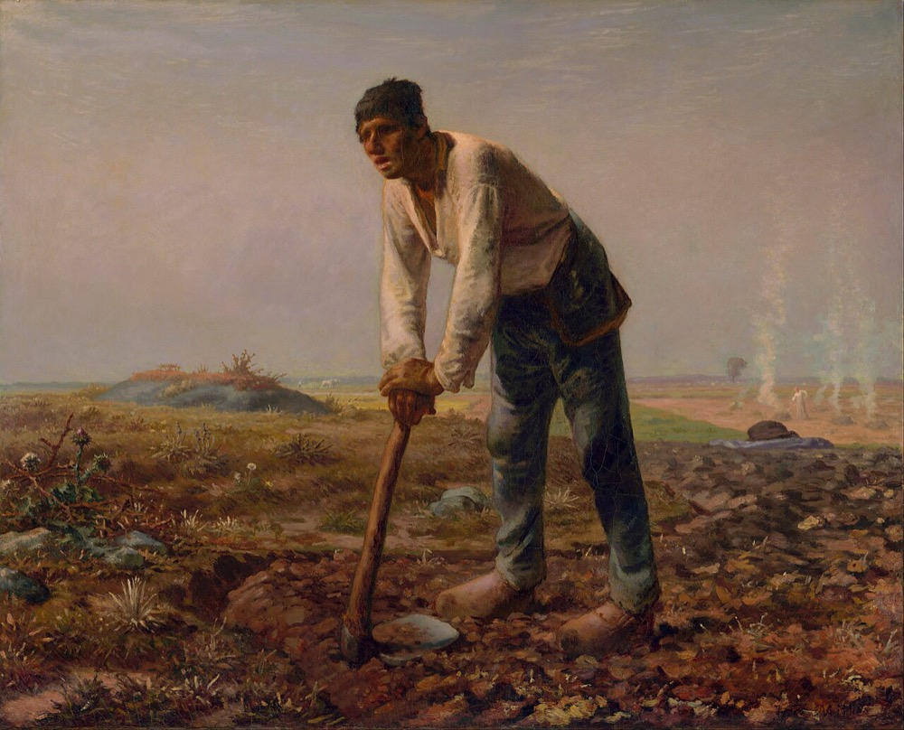

```{r}
#| label: setup
source(here::here("R/mapa.R"))
source(here::here("R/aula06.R"))

num <- function(x, d = 1) format(round(x, d), nsmall = d, decimal.mark = ",")
numm <- function(x, d = 1) sub(",", "{,}", num(x, d), fixed = TRUE)
pv <- function(p) format(p, decimal.mark = ",")

LL10 <- "https://doi.org/10.1016/B978-0-444-53868-0.50010-1"

md <- mite_dist()
set.seed(1); man  <- vegan::mantel(md$Dy, md$Dx, permutations = 999)
set.seed(1); mang <- vegan::mantel(md$Dy, md$Dg, permutations = 999)
set.seed(1); manp <- vegan::mantel.partial(md$Dy, md$Dx, md$Dg, permutations = 999)
mr   <- mrm(md$Dy, md$Dx, md$Dg, nperm = 999)
prot <- doubs_protest()
an   <- anuros()
anh  <- vegan::decostand(an$sp, "hellinger")
set.seed(1); perma <- vegan::adonis2(anh ~ grupo, data = data.frame(grupo = an$grupo),
                                     method = "euclidean", permutations = 999)
bd   <- vegan::betadisper(stats::dist(anh), an$grupo)
set.seed(1); bdt <- vegan::permutest(bd, permutations = 999)
```

::: {.meme}
{fig-alt="Pintura O homem com a enxada, de Jean-François Millet: um camponês exausto apoia o corpo na enxada, num campo pedregoso. Legenda: eu não aguento mais! Última aula de teoria." height="540px"}

[Eu não aguento mais!]{.meme-topo} [Calma: esta é a última aula teórica]{.meme-base}
:::

::: {.ref}
Jean-François Millet, *O homem com a enxada* (1860–1862), domínio público,
via Wikimedia Commons.
:::

## Hoje

1. Teste de Mantel e Mantel parcial
2. Regressão múltipla de matrizes de distância (MRM) e GDM
3. Análise de Procrustes e PROTEST
4. PERMANOVA
5. Dispersão multivariada: `betadisper` (PERMDISP)

Leitura: [Legendre & Legendre (2012), cap. 10, p. 597–612](`r LL10`).

::: {.nota}
As figuras foram geradas em R, com os ácaros de `vegan::mite`, os peixes do
rio Doubs (`ade4`), os anuros de da Silva et al. (2017), da aula prática, ou
dados simulados. O código está em
[`R/aula06.R`](https://github.com/diogoprov/multidimensionais/tree/main/R).
:::

## Onde estamos

```{r}
#| fig-alt: "Mapa dos métodos multidimensionais, com os testes entre matrizes e entre grupos, tema da Aula 6, destacados."
#| fig-height: 5.6
#| out-height: 590px
mapa_plot("Testes")
```

# 1. Teste de Mantel {.secao}

[Testes]{.familia .testes}

## Teste de Mantel

:::: {.columns}
::: {.column width="55%"}
```{r}
#| fig-alt: "Esquema do teste de Mantel: a matriz de composição Y vira a matriz de distâncias DY (Bray-Curtis), a matriz ambiental X vira DX (distância euclidiana das variáveis padronizadas), e a estatística rM é a correlação de Pearson entre os vetores das duas matrizes."
#| fig-width: 6.6
#| fig-height: 5
#| out-height: 520px
fig_mantel_esquema()
```
:::
::: {.column width="45%"}
- Cada matriz de distâncias é **desdobrada** num vetor.
- A estatística de Mantel ($r_M$) é a correlação de Pearson entre os dois
  vetores (o produto cruzado padronizado).
- A significância vem de permutações: as linhas e colunas de uma das
  matrizes são embaralhadas juntas, e o $r_M$ é recalculado.
:::
::::

::: {.ref}
[Legendre & Legendre (2012), seção 10.5](`r LL10`).
:::

## Um exemplo: ácaros e ambiente

```{r}
#| fig-alt: "Dois gráficos. À esquerda, as distâncias de composição dos ácaros contra as distâncias ambientais, para todos os pares de parcelas, com uma reta de tendência positiva e rM igual a 0,433. À direita, o histograma dos rM de 999 permutações, centrado em zero, com o valor observado, 0,433, muito à direita da distribuição."
#| fig-height: 4.6
#| out-height: 445px
fig_mantel_dispersao(md, man$statistic) + fig_mantel_nula(man)
```

$r_M = `r numm(man$statistic, 3)`$, $p = `r pv(man$signif)`$ (999 permutações): parcelas com
ambiente parecido têm composição parecida.

::: {.ref}
Ácaros de `vegan::mite`: Bray-Curtis × densidade do substrato e conteúdo de
água (padronizados).
:::

## Mantel parcial

- Relaciona duas matrizes de distâncias **controlando uma terceira**.
- Mesma lógica da RDA parcial (Aula 5), mas com matrizes de distâncias.
- A ordem das matrizes importa.
- Útil, por exemplo, para relacionar a distância genética à ambiental,
  controlando a distância geográfica.

::: {.definicao}
Ácaros: composição × ambiente, controlando a distância geográfica:
$r_M = `r numm(manp$statistic, 3)`$, $p = `r pv(manp$signif)`$ (sem controlar:
$`r numm(man$statistic, 3)`$).
:::

::: {.ref}
[Legendre (2000)](https://doi.org/10.1080/00949650008812035) *J. Stat. Comput. Simul.*
67: 37–73.
:::

## Vantagens e desvantagens

:::: {.columns}
::: {.column width="50%"}
**Vantagens**

- Aceita qualquer coeficiente de distância.
- Qualquer tipo de dado pode virar uma matriz de distâncias, inclusive
  misturas de tipos.
- Permite usar mais de uma matriz (testes parciais).
:::
::: {.column width="50%"}
**Desvantagens**

- É preciso transformar os dados brutos (uma matriz retangular) em
  distâncias, com perda de informação.
- A interpretação vale para o espaço das distâncias, não para os dados.
- Perde a informação das observações individuais.
- Baixo poder (alto erro do tipo II).
:::
::::

## R² do Mantel não é o R² da RDA {.medio}

:::: {.columns}
::: {.column width="50%"}
Na regressão múltipla e na RDA:

$$R^2 = \frac{SS(\hat{\mathbf{Y}})}{SS(\mathbf{Y})}$$

O denominador é a variação dos **dados**:

$$SS(\mathbf{Y}) = \sum_i \sum_j (y_{ij} - \bar{y}_j)^2 = \frac{1}{n} \sum_{h<i} D_{hi}^2$$
:::
::: {.column width="50%"}
No Mantel, $R^2_M = r_M^2$, e o denominador é a variação das
**distâncias**:

$$SS(\mathbf{D}) = \sum_{h<i} (D_{hi} - \bar{D})^2$$

::: {.definicao}
As duas estatísticas não se reduzem uma à outra: a variação das distâncias
não informa sobre a variação dos dados. Exemplo de Legendre: quatro locais
que diferem todos por uma espécie têm $SS(\mathbf{Y}) > 0$, mas todas as
distâncias iguais, e $SS(\mathbf{D}) = 0$.
:::
:::
::::

::: {.ref}
Baseado em slides de P. Legendre.
:::

## O Mantel serve para análises espaciais? {.medio}

- O Mantel supõe que a relação entre as distâncias é **linear e
  homocedástica** no gráfico D–D, o que raramente vale para dados espaciais
  estruturados.
- Em simulações, o poder do Mantel é **sempre menor** que o da análise
  canônica (RDA); a variação espacial é, no máximo, mal captada pela
  regressão de distâncias em distâncias geográficas.
- A RDA com **MEMs** (Aula 5) é muito mais poderosa e dá mais que um *p*:
  triplots, mapas dos valores ajustados em várias escalas.

::: {.definicao}
Conclusão: o Mantel deve ser usado só para perguntas formuladas em termos de
**relações entre distâncias**. Perguntas sobre os dados brutos devem ser
respondidas com os dados brutos.
:::

::: {.ref}
[Legendre, Fortin & Borcard (2015)](https://doi.org/10.1111/2041-210X.12425)
*Methods Ecol. Evol.* 6: 1239–1247; [Legendre & Fortin (2010)](https://doi.org/10.1111/j.1755-0998.2010.02866.x);
[Legendre, Borcard & Peres-Neto (2005)](https://doi.org/10.1890/05-0549). Baseado em slides de P. Legendre.
:::

## Mantel com distâncias geográficas

:::: {.columns}
::: {.column width="50%"}
Nos ácaros, a composição também se relaciona com a distância geográfica:
$r_M = `r numm(mang$statistic, 3)`$, $p = `r pv(mang$signif)`$.

Mas a permutação comum supõe que os locais são trocáveis, e a estrutura
espacial viola isso.

::: {.definicao}
Alternativa: gerar modelos nulos **restritos espacialmente**, que preservam
a autocorrelação na permutação; assim se estima e se corrige o viés do $r_M$.
:::
:::
::: {.column width="50%"}
```{r}
#| fig-alt: "Distância de composição dos ácaros contra a distância geográfica entre as parcelas, com uma reta de tendência positiva."
#| fig-width: 5.8
#| fig-height: 4.8
#| out-height: 480px
fig_mantel_dispersao(md, mang$statistic, x = "Dg", xlab = "Distância geográfica (m)")
```
:::
::::

::: {.ref}
[Crabot et al. (2019)](https://doi.org/10.1111/2041-210X.13141) *Methods Ecol. Evol.* 10: 532–540.
:::

# 2. Regressão de matrizes e GDM {.secao}

[Testes]{.familia .testes}

## Regressão múltipla de matrizes de distâncias (MRM)

:::: {.columns}
::: {.column width="50%"}
- Muito parecida com o Mantel, mas em vez de correlação calcula uma
  **regressão** entre os vetores das matrizes.
- Permite várias matrizes preditoras: requer uma resposta e preditoras.
- Fornece $R^2$, testado por permutação dos objetos da matriz resposta.
:::
::: {.column width="50%"}
Ácaros: $D_Y \sim D_{\text{ambiente}} + D_{\text{geografia}}$

::: {.tabela-grande}
| Termo | Coeficiente |
|---|---:|
| Ambiente | `r num(mr$coef[1], 4)` |
| Geografia | `r num(mr$coef[2], 4)` |
| $R^2$ | `r num(mr$r2, 3)` |
| $p$ | `r pv(mr$p)` |
:::
:::
::::

::: {.ref}
[Lichstein (2007)](https://doi.org/10.1007/s11258-006-9126-3) *Plant Ecol.* 188: 117–131;
[Legendre & Legendre (2012), Fig. 10.22](`r LL10`). MRM calculada com a função
`mrm()` em `R/aula06.R`.
:::

## Generalized Dissimilarity Modelling (GDM)

:::: {.columns}
::: {.column width="42%"}
- Extensão da MRM.
- Acomoda relações **não lineares**.
- Bom desempenho com dissimilaridades que **saturam** (locais sem espécies
  em comum têm todos dissimilaridade 1).
- Aplicações em modelagem de comunidades e mapeamento da diversidade beta.
:::
::: {.column width="58%"}
```{r}
#| fig-alt: "Dissimilaridade de Bray-Curtis contra a distância ambiental entre locais de uma coenoclina simulada. Os pontos sobem e saturam em 1. A reta da regressão linear (MRM), tracejada, não acompanha a saturação; uma curva que satura, como a do GDM, descreve bem os pontos."
#| fig-width: 6.6
#| fig-height: 5
#| out-height: 500px
fig_gdm()
```
:::
::::

::: {.ref}
[Ferrier (2002)](https://doi.org/10.1080/10635150252899806) *Syst. Biol.* 51: 331–363;
[Ferrier et al. (2007)](https://doi.org/10.1111/j.1472-4642.2007.00341.x) *Divers. Distrib.*
13: 252–264. Dados simulados, inspirados na Fig. 1 de Ferrier et al. (2007).
:::

# 3. Análise de Procrustes {.secao}

[Testes]{.familia .testes}

## Por que "Procrustes"?

- Na mitologia grega, Procrustes era um bandido que convidava os viajantes a
  dormir numa cama de ferro: se fossem altos demais, cortava-lhes as pernas;
  se fossem baixos, esticava-os até caberem.
- Em português, *procrusto* quer dizer "o esticador". Teseu acabou dando a
  ele o mesmo tratamento.

::: {.definicao}
A análise de Procrustes "estica", gira e desloca uma configuração de pontos
até ela se ajustar o máximo possível a outra.
:::

## Os passos da superposição {.medio}

```{r}
#| fig-alt: "Quatro painéis com dois triângulos, ABC e abc. Nos dados originais, os triângulos têm posição, tamanho e orientação diferentes. Na translação, os dois são centrados na origem. No escalonamento, ficam com o mesmo tamanho. Na rotação, abc é girado até quase coincidir com ABC."
#| fig-width: 12
#| fig-height: 3.6
#| out-height: 320px
fig_procrustes_passos()
```

$$\mathbf{Z} = \frac{1}{CS}\,(\mathbf{Y} - \bar{\mathbf{Y}})\,\mathbf{H}$$

translação (centrar: $\mathbf{Y} - \bar{\mathbf{Y}}$), escalonamento (dividir pelo
tamanho do centroide, $CS$) e rotação ($\mathbf{H}$), minimizando a soma dos quadrados
das distâncias entre os pontos correspondentes.

::: {.ref}
Baseado em slides de M. Collyer.
:::

## Concordância entre duas matrizes

:::: {.columns}
::: {.column width="45%"}
A estatística $m^2$ mede o grau de **concordância** entre duas configurações
(por exemplo, peixes e artrópodes nos mesmos locais):

$$m^2_{12} = \text{tr}(\mathbf{Y}_1\mathbf{Y}_1') - \frac{[\text{tr}(\mathbf{W})]^2}{\text{tr}(\mathbf{Y}_2\mathbf{Y}_2')}$$

**PROTEST**: o $m^2$ é testado por permutação. A estatística de
correlação de Procrustes é $r = \sqrt{1 - m^2}$.
:::
::: {.column width="55%"}
```{r}
#| fig-alt: "Superposição de Procrustes dos 29 locais do Doubs: pontos na PCA ambiental e setas até a posição de cada local na PCA dos peixes, rotacionada. A maioria das setas é curta: as duas ordenações concordam."
#| fig-width: 6.4
#| fig-height: 5.2
#| out-height: 520px
fig_protest(prot)
```
:::
::::

::: {.ref}
[Jackson (1995)](https://doi.org/10.1080/11956860.1995.11682297) *Écoscience* 2: 297–303.
Doubs: PCA ambiental × PCA dos peixes (Hellinger): $r$ = `r num(prot$t0, 3)`,
$m^2$ = `r num(prot$ss, 3)`, $p$ = `r pv(prot$signif)`.
:::

## Vantagens do Procrustes/PROTEST

- Mais poderoso (menor erro do tipo II) do que o Mantel para detectar
  concordância.
- Não perde a informação sobre as observações individuais: o Mantel reduz os
  dados a distâncias.
- Mostra **onde** as matrizes concordam ou não (os resíduos de cada objeto,
  o comprimento das setas).
- Permite comparar ordenações, testar a concordância entre conjuntos de dados
  e servir de "semente" para agrupamentos.

::: {.tabela-grande}
| | Mantel | Procrustes |
|---|---|---|
| Compara | matrizes de distâncias | configurações de objetos |
| Resultado por objeto | não | sim (resíduos) |
| Poder | menor | maior |
:::

::: {.ref}
[Peres-Neto & Jackson (2001)](https://doi.org/10.1007/s004420100720) *Oecologia* 129: 169–178.
:::

# 4. PERMANOVA {.secao}

[Testes]{.familia .testes}

## PERMANOVA

> "A test of the general multivariate hypothesis of differences in the
> composition and/or relative abundances of organisms of different species
> (variables) in samples from different groups or treatments."

- Aplicável a **múltiplas variáveis resposta** (não independentes) medidas em
  um ou mais fatores.
- Usa qualquer medida de distância e testa por permutação: dispensa a
  multinormalidade da MANOVA clássica.

::: {.ref}
[Anderson (2001)](https://doi.org/10.1111/j.1442-9993.2001.01070.pp.x) *Austral Ecol.*
26: 32–46.
:::

## Como funciona {.medio}

:::: {.columns}
::: {.column width="45%"}
1. Transforme os dados, se apropriado (por exemplo, Hellinger).
2. Calcule a matriz de distâncias.
3. Particione a soma de quadrados:

$$SS_T = \frac{1}{N}\sum_{i<j} d_{ij}^2 \qquad SS_W = \frac{1}{n}\sum_{i<j} d_{ij}^2\,\varepsilon_{ij}$$

($\varepsilon_{ij} = 1$ se $i$ e $j$ estão no mesmo grupo; 0, caso contrário)

$$SS_A = SS_T - SS_W \qquad F = \frac{SS_A / (a - 1)}{SS_W / (N - a)}$$
:::
::: {.column width="55%"}
```{r}
#| fig-alt: "Matriz de distâncias entre nove localidades de anuros, ordenada pelos grupos. As células dentro do grupo Campo estão em verde, dentro do grupo Coleção em azul, e as distâncias entre grupos em cinza; a intensidade indica o tamanho da distância."
#| fig-width: 6.4
#| fig-height: 5.6
#| out-height: 540px
fig_permanova_matriz(an)
```
:::
::::

::: {.ref}
$a$ = número de grupos; $N$ = número de observações; $n$ = observações por grupo.
Anuros de campo e de coleções ([da Silva et al. 2017](https://doi.org/10.2994/SAJH-D-16-00051.1)
*S. Am. J. Herpetol.* 12: 99–106).
:::

## Um exemplo: campo × coleções

:::: {.columns}
::: {.column width="58%"}
A composição de anuros registrada em campo difere da registrada em coleções
científicas?

::: {.tabela-grande}
```{r}
pt <- as.data.frame(perma)
knitr::kable(data.frame(Fonte = c("Grupo", "Resíduo", "Total"), gl = pt$Df,
                        SQ = num(pt$SumOfSqs, 3), R2 = num(pt$R2, 3),
                        F = c(num(pt$F[1], 2), "", ""),
                        p = c(pv(pt$`Pr(>F)`[1]), "", "")),
             col.names = c("Fonte", "gl", "SQ", "R²", "F", "p"), align = "lccccc")
```
:::
:::
::: {.column width="42%"}
::: {.codigo-compacto}
```{r}
#| echo: true
#| eval: false
anuros.h <- decostand(anuros[, -28], "hellinger")
adonis2(anuros.h ~ grupo, method = "euclidean",
        permutations = 999)
```
:::

::: {.fragment .definicao}
$p$ = `r pv(perma[["Pr(>F)"]][1])`: os grupos diferem. Mas diferem na
**posição** ou na **dispersão**?
:::
:::
::::

## Posição × dispersão

```{r}
#| fig-alt: "Quatro painéis com dois grupos simulados de pontos e seus centroides. No primeiro, mesma posição e mesma dispersão. No segundo, centroides afastados. No terceiro, mesmo centroide, mas um grupo muito mais espalhado. No quarto, centroides e dispersões diferentes."
#| fig-width: 12
#| fig-height: 3.6
#| out-height: 380px
fig_posicao_dispersao()
```

- Mudança na **posição**: "houve uma mudança fundamental na estrutura da
  comunidade?"
- Mudança na **dispersão**: "a estrutura da comunidade ficou mais ou menos
  variável?"

## Cuidado com a heterogeneidade das dispersões

- A PERMANOVA testa diferenças entre os **centroides**, mas é sensível a
  diferenças de dispersão, sobretudo em desenhos desbalanceados.
- ANOSIM e Mantel testam se as amostras do mesmo grupo são mais parecidas
  entre si do que com as de outros grupos: não distinguem se a diferença é de
  posição, de dispersão ou de forma.
- Em desenhos balanceados, a PERMANOVA é mais robusta que ANOSIM e Mantel.

::: {.definicao}
Por isso, teste sempre a homogeneidade das dispersões (`betadisper`,
PERMDISP) junto com a PERMANOVA.
:::

::: {.ref}
[Anderson & Walsh (2013)](https://doi.org/10.1890/12-2010.1) *Ecol. Monogr.* 83: 557–574.
:::

# 5. Dispersão multivariada {.secao}

[Testes]{.familia .testes}

## betadisper (PERMDISP) {.medio}

:::: {.columns}
::: {.column width="50%"}
- Calcula a distância de cada observação ao **centroide do seu grupo**
  (no espaço da PCoA).
- Compara essas distâncias entre os grupos com uma ANOVA testada por
  permutação.
- É também uma medida de **diversidade beta** dentro de cada grupo.

::: {.definicao}
Anuros: F = `r num(bdt$tab$F[1], 2)`, $p$ = `r pv(bdt$tab[["Pr(>F)"]][1])`. As
coleções são mais heterogêneas: parte da diferença que a PERMANOVA detectou
pode ser de dispersão, e não de posição.
:::
:::
::: {.column width="50%"}
```{r}
#| fig-alt: "Distâncias de cada localidade ao centroide do seu grupo. As localidades de campo ficam todas perto do centroide, por volta de 0,55; as coleções ficam mais longe, entre 0,68 e 0,94."
#| fig-width: 5.6
#| fig-height: 5
#| out-height: 455px
fig_betadisper(bd)
```
:::
::::

::: {.ref}
[Anderson (2006)](https://doi.org/10.1111/j.1541-0420.2005.00440.x) *Biometrics* 62: 245–253.
:::

## Para continuar estudando

> — Diogo, preciso confessar: não gostei nada da disciplina, você é um
> péssimo professor.
>
> — Tudo bem, jovem. Aqui tem o link para o curso com o Legendre, com
> material e vídeos.

[Curso de ecologia numérica de P. Legendre (Trieste, 2016)](http://adn.biol.umontreal.ca/~numericalecology/Trieste16/)

::: {.definicao}
Obrigado pela paciência e perseverança! Dúvidas? Querem compartilhar o
desespero? diogo.provete@ufms.br
:::
