```{r}
#| label: setup
source(here::here("R/mapa.R"))
source(here::here("R/aula07.R"))

num <- function(x, d = 1) format(round(x, d), nsmall = d, decimal.mark = ",")
pv  <- function(p) format(p, decimal.mark = ",")

md <- suppressWarnings(modelos_aula7())
```

## Hoje

1. Por que métodos baseados em modelos?
2. Agrupamento: arquétipos de espécies
3. Ordenação: GLLVM, CQO e cópulas
4. Inferência: GLMs multivariados (`mvabund`)
5. Modelos conjuntos de distribuição de espécies (JSDM)

Leitura: [Warton et al. (2015) *Trends Ecol. Evol.*](https://doi.org/10.1016/j.tree.2015.09.007);
[Ovaskainen & Abrego (2020)](https://doi.org/10.1017/9781108591720).

::: {.nota}
As figuras foram geradas em R, com as aranhas caçadoras de `mvabund::spider`,
os ácaros de `vegan::mite` ou dados simulados, e ajustes de `mvabund`, `gllvm`
e `ecoCopula`. O código está em
[`R/aula07.R`](https://github.com/diogoprov/multidimensionais/tree/main/R).
:::

## Onde estamos

```{r}
#| fig-alt: "Mapa dos métodos multidimensionais, com os métodos baseados em modelos, tema da Aula 7, destacados: eles partem da matriz de dados sem passar por uma medida de distância."
#| fig-height: 5.6
#| out-height: 590px
mapa_plot("Modelos")
```

## Tipos de métodos baseados em modelos

```{r}
#| fig-alt: "Diagrama: os métodos baseados em modelos se dividem em quatro famílias. Agrupamento: arquétipos de espécies (SAMs), pacote ecomix. Ordenação: CQO e GLLVM, pacotes gllvm e boral, e cópulas, pacote ecoCopula. Inferência: GLMs multivariados, pacote mvabund. Modelos conjuntos de distribuição de espécies: Hmsc e sjSDM."
#| fig-width: 12
#| fig-height: 5
#| out-height: 500px
fig_mapa_modelos()
```

# 1. Por que métodos baseados em modelos? {.secao}

[Modelos]{.familia .modelos}

## Motivação {.medio}

:::: {.columns}
::: {.column width="50%"}
**Problemas dos métodos baseados em distância**

- Lidam mal com a **relação média-variância** da abundância.
- **Confundem posição e dispersão** multivariadas.
- Desempenho ruim com conjuntos grandes de dados: eDNA, microbioma,
  *metabarcoding*.
:::
::: {.column width="50%"}
**A alternativa**

- **GLMs multivariados**: um modelo para cada espécie, com a distribuição
  adequada (Poisson, binomial negativa, binomial).
- Reamostragem para gerar a estatística do teste.
- Testa o efeito das covariáveis em **cada espécie**.
- Permite **prever** com os coeficientes do modelo.
:::
::::

::: {.ref}
[Warton, Wright & Wang (2012)](https://doi.org/10.1111/j.2041-210X.2011.00127.x) *Methods Ecol. Evol.* 3: 89–101;
[Hartig et al. (2024)](https://doi.org/10.1016/j.tree.2023.09.017) *Trends Ecol. Evol.* 39: 280–293.
:::

## A relação média-variância {.medio}

:::: {.columns}
::: {.column width="55%"}
```{r}
#| fig-alt: "Variância contra média da abundância das espécies de ácaros, em escala logarítmica. Os pontos sobem numa reta bem mais inclinada que a linha tracejada da Poisson, em que a variância é igual à média."
#| fig-width: 7
#| fig-height: 5.6
#| out-height: 540px
fig_media_variancia()
```
:::
::: {.column width="45%"}
- Espécies abundantes variam muito mais que as raras: a variância cresce
  **mais rápido que a média** (na Poisson, variância = média).
- Os métodos baseados em distância focam nas espécies de **maior variância**,
  as mais abundantes.
- E ignoram os zeros e a distribuição de abundância das espécies (SAD).
:::
::::

::: {.ref}
Ácaros de `vegan::mite`. [Warton, Wright & Wang (2012)](https://doi.org/10.1111/j.2041-210X.2011.00127.x).
:::

## Posição ou dispersão? {.medio}

:::: {.columns}
::: {.column width="55%"}
```{r}
#| fig-alt: "PCA de dois grupos simulados, A e B, que diferem só na média de quatro espécies. Os pontos de B se espalham muito mais que os de A ao longo do primeiro eixo; a dispersão média de B é o dobro da de A."
#| fig-width: 7
#| fig-height: 6
#| out-height: 540px
fig_posicao_dispersao_mv()
```
:::
::: {.column width="45%"}
- Os dois grupos diferem **só na posição**: a média de 4 espécies é 2,5 vezes
  maior em B.
- Como a variância cresce com a média, na distância euclidiana B parece
  **mais disperso**.
- A PERMANOVA e o `betadisper` (Aula 6) vão misturar as duas coisas.
:::
::::

::: {.ref}
Dados simulados (binomial negativa). Inspirado em
[Warton, Wright & Wang (2012)](https://doi.org/10.1111/j.2041-210X.2011.00127.x) e
[Paliy & Shankar (2016)](https://doi.org/10.1111/mec.13536) *Mol. Ecol.* 25: 1032–1057.
:::

## O debate {.medio}

:::: {.columns}
::: {.column width="50%"}
**Roberts (2017)**

- Os resultados de Warton et al. (2012) dependeriam de simulações com grandes
  diferenças de abundância entre locais.
- **Transformar** os dados (Hellinger, chord; Aula 2) resolveria o problema.
:::
::: {.column width="50%"}
**Warton & Hui (2017)**

- Transformações pelas linhas **não** resolvem.
- Mesmo sem diferença de abundância total entre locais (só de posição), os
  métodos baseados em distância confundem posição com dispersão.
:::
::::

::: {.ref}
[Roberts (2017)](https://doi.org/10.1111/2041-210X.12739) *Methods Ecol. Evol.* 8: 1398–1407;
[Warton & Hui (2017)](https://doi.org/10.1111/2041-210X.12843) *Methods Ecol. Evol.* 8: 1408–1414.
:::

## O que são métodos baseados em modelos?

**Métodos estatísticos paramétricos** que capturam as propriedades-chave dos
dados multivariados:

- **Abundância**: GLMs, com a distribuição adequada a contagens, presenças
  ou biomassa.
- **Variáveis correlacionadas**: reamostragem (`mvabund`), fatores aleatórios
  ou **variáveis latentes** (GLLVM, JSDM).

::: {.ref}
[Warton et al. (2015) *Plant Ecol.*](https://doi.org/10.1007/s11258-014-0366-3) 216: 669–682.
:::

## Vantagens {.medio}

- Controlam propriedades espúrias dos dados (a relação média-variância).
- **Diagnóstico** do modelo: resíduos.
- Seleção de modelos e inferência: AIC/BIC, verossimilhança, intervalos de
  confiança. O AIC escolhe também o número de grupos ou de variáveis latentes.
- Rapidez com conjuntos grandes de dados.
- Usam uma distribuição de probabilidade que **modela o processo que gerou os
  dados**.
- Controlam diferenças de esforço amostral entre locais (`offset`).

::: {.ref}
[Warton et al. (2015) *Plant Ecol.*](https://doi.org/10.1007/s11258-014-0366-3);
[Hui et al. (2015)](https://doi.org/10.1111/2041-210X.12236) *Methods Ecol. Evol.* 6: 399–411.
:::

## Diagnóstico: os resíduos

```{r}
#| fig-alt: "Dois gráficos de resíduos de Dunn-Smyth contra o preditor linear, para as 12 espécies de aranhas. No modelo de Poisson, os resíduos se abrem em leque e chegam a mais de 4. No binomial negativo, ficam em torno de zero, sem padrão."
#| fig-width: 12
#| fig-height: 4.6
#| out-height: 430px
fig_residuos_po_nb(md)
```

Com a distribuição errada (Poisson), os resíduos se abrem em leque: a
variância cresce mais que a média. A binomial negativa acomoda essa relação.

::: {.ref}
Aranhas caçadoras de `mvabund::spider`, `manyglm()` com as 6 variáveis
ambientais. Resíduos de Dunn-Smyth, como em [Wang et al. (2012)](https://doi.org/10.1111/j.2041-210X.2012.00190.x).
:::

## Problemas dos métodos baseados em distância

- Não fazem **previsões**, porque não são modelos estatísticos formais.
- As transformações (como a de Hellinger) não dão conta de distribuições muito
  assimétricas: muitos zeros e forte dominância.
- Os dados novos (eDNA, sensores, imagens) são grandes, com milhares de
  espécies e muitos zeros: pedem modelos escaláveis.

::: {.ref}
[Warton et al. (2015) *Plant Ecol.*](https://doi.org/10.1007/s11258-014-0366-3);
[Hartig et al. (2024)](https://doi.org/10.1016/j.tree.2023.09.017) *Trends Ecol. Evol.* 39: 280–293.
:::

# 2. Agrupamento {.secao}

[Modelos]{.familia .modelos}

## Arquétipos de espécies (SAMs) {.medio}

:::: {.columns}
::: {.column width="58%"}
```{r}
#| fig-alt: "Curvas de resposta de 15 espécies simuladas ao longo de um gradiente, em três cores: cada grupo de cinco espécies segue uma de três curvas grossas, os arquétipos. O arquétipo 1 diminui, o 2 tem um pico no meio e o 3 aumenta ao longo do gradiente."
#| fig-width: 7.4
#| fig-height: 5.4
#| out-height: 530px
fig_arquetipos()
```
:::
::: {.column width="42%"}
- Agrupa as **espécies** pela sua **resposta** às variáveis ambientais: um
  modelo de mistura de regressões.
- O AIC/BIC escolhe o número de arquétipos.
- Útil para encontrar descontinuidades em eco ou biorregiões.
- Pacote `ecomix`.
:::
::::

::: {.ref}
[Dunstan, Foster & Darnell (2011)](https://doi.org/10.1016/j.ecolmodel.2010.11.030) *Ecol. Model.* 222: 955–963;
[Hui et al. (2013)](https://doi.org/10.1890/12-1322.1) *Ecology* 94: 1913–1919. Dados simulados.
:::

## Biorregiões de anuros {.medio}

:::: {.columns}
::: {.column width="40%"}
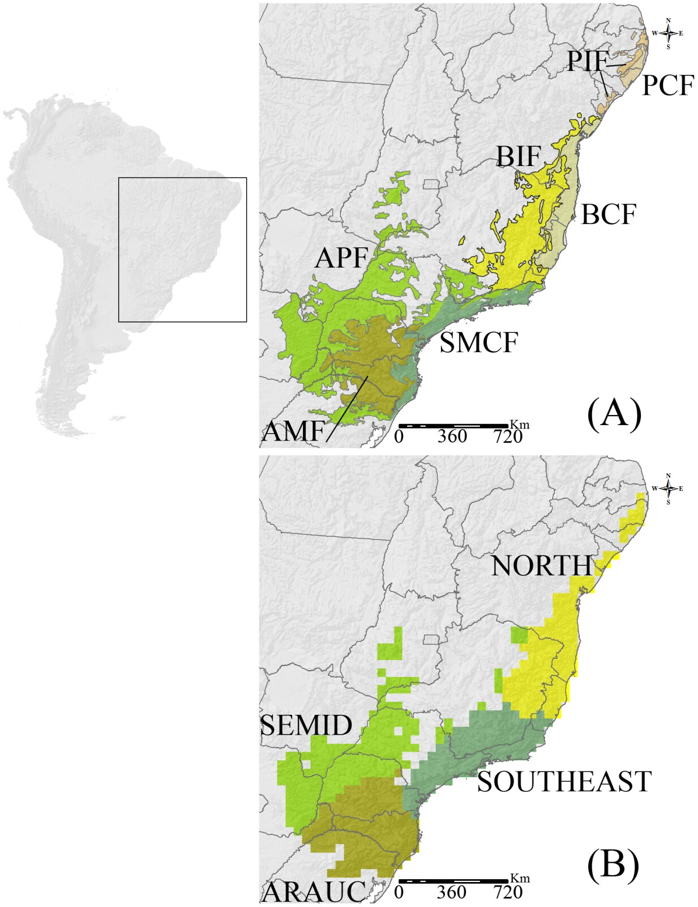{height="520px" fig-alt="Dois mapas da Mata Atlântica divididos em biorregiões de anuros, com siglas para cada região, ao longo da costa do Brasil."}
:::
::: {.column width="60%"}
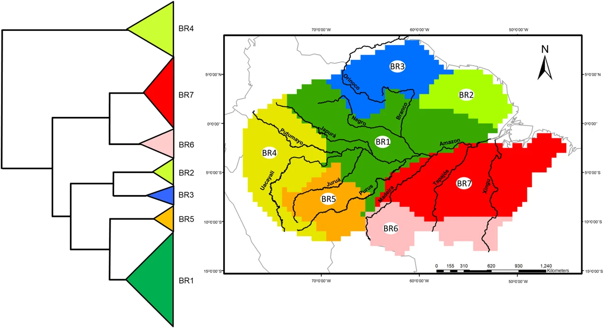{height="300px" fig-alt="Mapa do Brasil dividido em regiões biogeográficas de anuros, cada uma de uma cor, ao lado do dendrograma de agrupamento que as define."}

- Mata Atlântica: biorregiões ligadas ao clima e à topografia (à esquerda).
- Brasil: rios, clima e topografia delimitam as regiões (acima).
- Os dois agrupam os locais (como na Aula 3); um SAM agruparia as espécies
  pela resposta ao ambiente.
:::
::::

::: {.ref}
Figuras de [Vasconcelos et al. (2014)](https://doi.org/10.1371/journal.pone.0104130) *PLoS ONE* 9: e104130
e de [Godinho & da Silva (2018)](https://doi.org/10.1038/s41598-018-21879-9) *Sci. Rep.* 8: 3427, ambas CC BY 4.0.
:::

## Três estratégias para regionalizar

```{r}
#| fig-alt: "Três colunas. Agrupar, depois prever: agrupamento dos locais e depois um modelo dos grupos em função do ambiente. Prever, depois agrupar: um modelo de distribuição por espécie e depois o agrupamento das previsões. Um passo só: agrupar as espécies (SAMs) ou os locais (RCPs) pela resposta ao ambiente, com o melhor desempenho."
#| fig-width: 12
#| fig-height: 4
#| out-height: 380px
fig_estrategias_regionalizacao()
```

::: {.definicao}
Métodos que analisam explicitamente a resposta das espécies ao ambiente para
achar os grupos funcionam melhor do que agrupar e depois prever, ou prever e
depois agrupar.
:::

::: {.ref}
Adaptado de [Hill et al. (2020)](https://doi.org/10.1111/2041-210X.13447) *Methods Ecol. Evol.* 11: 1258–1272.
:::

# 3. Ordenação {.secao}

[Modelos]{.familia .modelos}

## CQO e REO {.medio}

:::: {.columns}
::: {.column width="50%"}
**Ordenação quadrática restrita (CQO)**

- Baseada em modelos aditivos generalizados vetoriais (VGAM): não se limita
  à família exponencial.
- Supõe resposta **unimodal** das espécies aos gradientes.
- Como no nMDS, o número de dimensões é escolhido de antemão.
:::
::: {.column width="50%"}
**Ordenação de efeitos aleatórios (REO)**

- Estima ao mesmo tempo os parâmetros das espécies e dos locais.
- Também supõe respostas unimodais.
- Só duas dimensões.
:::
::::

::: {.ref}
[Yee (2004)](https://doi.org/10.1890/03-0078) *Ecol. Monogr.* 74: 685–701;
[Walker & Jackson (2011)](https://doi.org/10.1890/11-0886.1) *Ecol. Monogr.* 81: 635–663.
:::

## GLLVM: o modelo

$$\large g(\mu_{ij}) = \underbrace{\beta_{0j}}_{\text{intercepto da espécie}} + \underbrace{\color{#527238}{\mathbf{x}_i'\boldsymbol\beta_j}}_{\text{resposta ao ambiente}} + \underbrace{\color{#8c3b5e}{\mathbf{u}_i'\boldsymbol\lambda_j}}_{\text{variáveis latentes}}$$

- $\mu_{ij}$: abundância esperada da espécie $j$ no local $i$; $g$, a função de
  ligação (log para contagens).
- $\mathbf{u}_i$: os escores do local nas **variáveis latentes**, gradientes não
  medidos; $\boldsymbol\lambda_j$: as cargas da espécie.
- Sem $\mathbf{x}$, é uma **ordenação irrestrita** baseada em modelos; com $\mathbf{x}$,
  as cargas dão a **correlação residual** entre as espécies:
  $\boldsymbol\Sigma = \boldsymbol\Lambda\boldsymbol\Lambda'$.

::: {.ref}
[Hui et al. (2015)](https://doi.org/10.1111/2041-210X.12236); [Warton et al. (2015) *TREE*](https://doi.org/10.1016/j.tree.2015.09.007);
[Niku et al. (2019)](https://doi.org/10.1111/2041-210X.13303) *Methods Ecol. Evol.* 10: 2173–2182.
:::

## Ordenação baseada em modelos {.medio}

:::: {.columns}
::: {.column width="55%"}
```{r}
#| fig-alt: "Ordenação das aranhas nas duas variáveis latentes de um GLLVM binomial negativo: os 28 locais em cinza, numerados, e as 12 espécies em vinho, em itálico. Os locais se separam em grupos ao longo dos dois eixos."
#| fig-width: 6.6
#| fig-height: 6
#| out-height: 560px
fig_gllvm_ordenacao(md$g0)
```
:::
::: {.column width="45%"}
- GLLVM binomial negativo com duas variáveis latentes, sem preditoras.
- Locais e espécies no mesmo gráfico, como num biplot.
- `gllvm` (verossimilhança, rápido) ou `boral` (bayesiano, via JAGS).

```r
gllvm(Y, family = "negative.binomial",
      num.lv = 2)
```
:::
::::

::: {.ref}
Aranhas de `mvabund::spider`. [Niku et al. (2019)](https://doi.org/10.1111/2041-210X.13303);
[Hui (2016)](https://doi.org/10.1111/2041-210X.12514) *Methods Ecol. Evol.* 7: 744–750.
:::

## Correlação entre espécies

```{r}
#| fig-alt: "Duas matrizes de correlação entre as 12 espécies de aranhas. Sem preditoras, há blocos de correlações positivas e negativas fortes. Com as seis preditoras ambientais, as correlações negativas somem e resta uma correlação positiva parecida entre quase todos os pares."
#| fig-width: 12
#| fig-height: 5.6
#| out-height: 470px
fig_cor_total_residual(md)
```

O ambiente explica os blocos de correlações positivas e negativas. Resta uma
correlação positiva comum: um efeito de local (abundância total), que some com
um efeito aleatório de local. Correlação residual **não** é prova de interação.

## Partição de variância

```{r}
#| fig-alt: "Barras horizontais, uma por espécie de aranha, com a proporção da variância explicada por cada variável ambiental e pela variável latente. A resposta muda entre espécies: em algumas domina o solo seco, em outras as herbáceas, o folhiço ou a reflexão."
#| fig-width: 10.5
#| fig-height: 5.4
#| out-height: 500px
fig_particao_gllvm(md)
```

Quanto da variação de cada espécie vem de cada preditora e das variáveis
latentes (`gllvm::VP()`), como na partição do HMSC.

## Larguras de nicho diferentes {.medio}

```{r}
#| fig-alt: "Dois painéis com curvas de resposta unimodais de quatro espécies ao longo de uma variável latente. À esquerda, todas têm a mesma largura. À direita, as larguras são diferentes: uma espécie tem nicho estreito, outra largo."
#| fig-width: 12
#| fig-height: 4.4
#| out-height: 400px
fig_larguras_nicho()
```

- O GLLVM **quadrático** relaxa o pressuposto de larguras de nicho iguais, que
  a CQO e o GLLVM linear fazem.
- Dá as curvas de resposta e a largura do nicho de cada espécie.

::: {.ref}
[van der Veen et al. (2021)](https://doi.org/10.1111/2041-210X.13595) *Methods Ecol. Evol.* 12: 1288–1300.
:::

## Ordenação com larguras de nicho {.medio}

:::: {.columns}
::: {.column width="60%"}
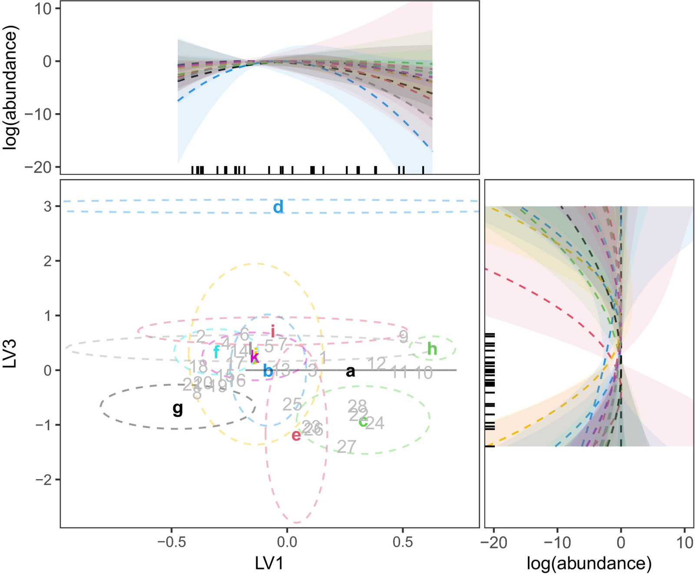{height="540px" fig-alt="Ordenação de um GLLVM quadrático das aranhas nas duas primeiras variáveis latentes: os ótimos das espécies como letras, cada um com uma elipse de largura do nicho, e as curvas de resposta quadráticas com bandas de confiança nas margens."}
:::
::: {.column width="40%"}
- Cada letra é o **ótimo** de uma espécie; a elipse, a **precisão** do nicho.
- Elipses grandes = curvas de resposta estreitas.
- Nas margens, as curvas quadráticas de cada espécie, com intervalos de
  confiança de 95%.
:::
::::

::: {.ref}
Figura de [van der Veen et al. (2021)](https://doi.org/10.1111/2041-210X.13595) *Methods Ecol. Evol.* 12: 1288–1300, CC BY 4.0.
Aranhas caçadoras.
:::

## Ordenação concorrente {.medio}

:::: {.columns}
::: {.column width="55%"}
```{r}
#| fig-alt: "Ordenação concorrente das aranhas: locais e espécies nas duas variáveis latentes, com setas verdes das seis variáveis ambientais. O solo seco e as herbáceas apontam para cima, o folhiço para a direita e a reflexão para baixo à esquerda."
#| fig-width: 6.6
#| fig-height: 6
#| out-height: 560px
fig_gllvm_concorrente(md$gc)
```
:::
::: {.column width="45%"}
- As variáveis latentes são explicadas **em parte** pelas preditoras e em
  parte por gradientes não medidos.
- Junta a ordenação restrita (como a RDA, Aula 5) e a irrestrita num só
  modelo.

```r
gllvm(Y, X, num.lv.c = 2,
      lv.formula = ~ soil.dry + moss + ...)
```
:::
::::

::: {.ref}
[van der Veen et al. (2023)](https://doi.org/10.1111/2041-210X.14035) *Methods Ecol. Evol.* 14: 683–695.
:::

## Comparando ordenações

- db-RDA e `mvabund` foram melhores que a CCA e a CQO.
- t-SNE foi melhor que o nMDS, e os dois foram melhores que REO e `boral` para
  representar locais e espécies.
- `boral` é muito mais lento que as cópulas.

::: {.ref}
[Jupke & Schäfer (2020)](https://doi.org/10.1002/ece3.6059) *Ecol. Evol.* 10: 2417–2435.
:::

## Cópulas

```{r}
#| fig-alt: "Dois painéis. À esquerda, 400 pontos de uma normal bivariada com correlação 0,6. À direita, as mesmas observações transformadas em contagens: a espécie 1 com distribuição binomial negativa e a espécie 2 com binomial negativa inflada de zeros; o tamanho dos pontos indica quantos pares têm aquelas contagens."
#| fig-width: 11
#| fig-height: 5
#| out-height: 450px
fig_copula()
```

A cópula **acopla** duas variáveis quaisquer pelas funções de distribuição
acumulada: cada espécie tem a sua distribuição, e a correlação fica no espaço
da cópula.

::: {.ref}
[Popovic, Hui & Warton (2018)](https://doi.org/10.1016/j.jmva.2017.12.002) *J. Multivar. Anal.* 165: 86–100;
[Anderson et al. (2019)](https://doi.org/10.1002/ece3.4948) *Ecol. Evol.* 9: 3276–3294. Dados simulados.
:::

## Cópulas na prática

:::: {.columns}
::: {.column width="55%"}
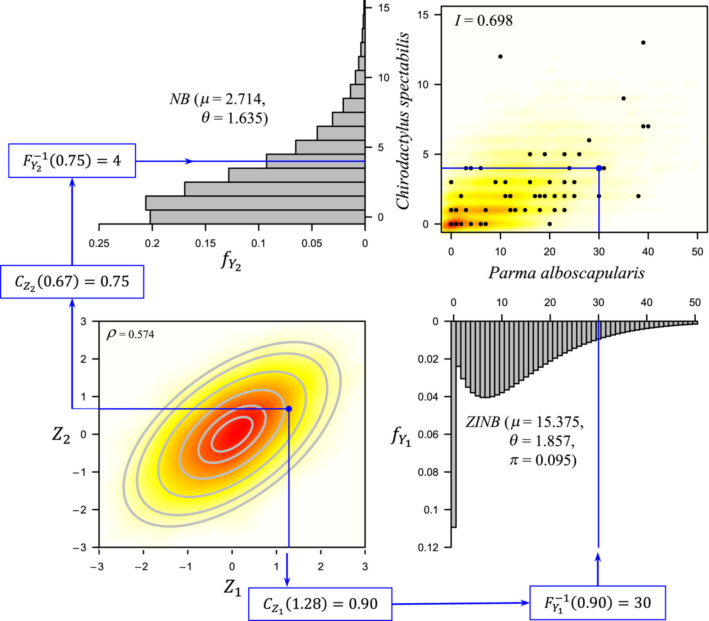{height="540px" fig-alt="Modelo de cópula gaussiana bivariada para duas espécies de peixes: no centro, a densidade da normal bivariada; nas margens, as distribuições discretas das contagens de cada espécie, uma binomial negativa e outra binomial negativa inflada de zeros, e as setas que levam um ponto da cópula a um par de contagens."}
:::
::: {.column width="45%"}
- Duas espécies de peixes, cada uma com a sua distribuição: binomial negativa
  e binomial negativa inflada de zeros.
- As duas são combinadas pela cópula para dar a distribuição **conjunta**.
- Permite calcular um índice de **associação interespecífica** (*I*).
:::
::::

::: {.ref}
Figura de [Anderson et al. (2019)](https://doi.org/10.1002/ece3.4948) *Ecol. Evol.* 9: 3276–3294, CC BY 4.0.
:::

## Um caminho para analisar comunidades com cópulas

:::: {.columns}
::: {.column width="50%"}
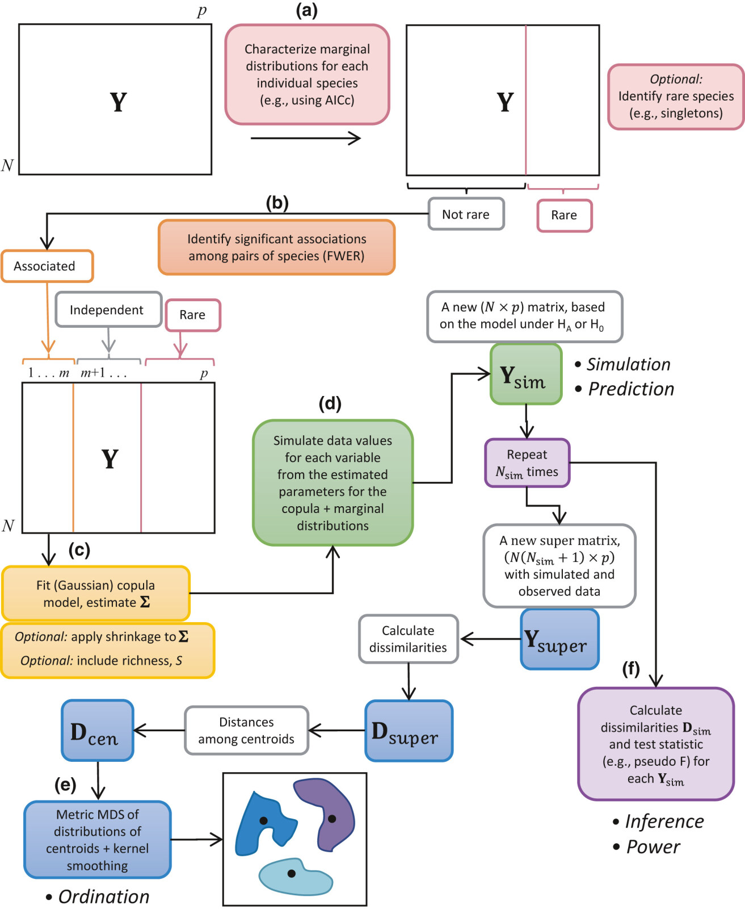{height="520px" fig-alt="Fluxograma em seis etapas para analisar comunidades com cópulas: caracterizar a distribuição marginal de cada espécie, identificar as associações a modelar, ajustar a cópula, simular dados sob o modelo, visualizar as dissimilaridades por ordenação e calcular o poder dos testes."}
:::
::: {.column width="50%"}
1. Caracterizar a distribuição marginal de cada espécie.
2. Identificar as associações a modelar.
3. Ajustar a cópula.
4. Simular dados sob o modelo, para previsões sob hipóteses nulas ou
   alternativas.
5. Visualizar as dissimilaridades (ordenação).
6. Calcular o poder dos testes.
:::
::::

::: {.ref}
Figura de [Anderson et al. (2019)](https://doi.org/10.1002/ece3.4948), CC BY 4.0.
:::

## Correlações estimadas pela cópula {.medio}

:::: {.columns}
::: {.column width="55%"}
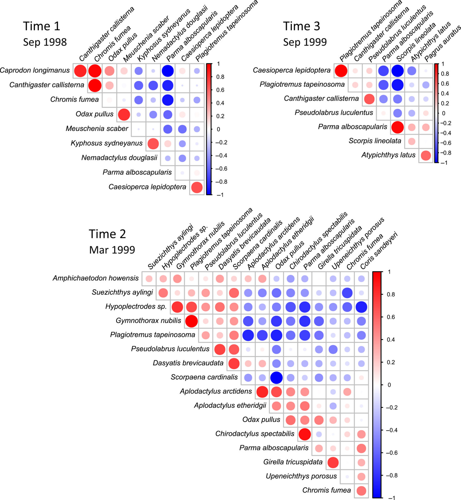{height="550px" fig-alt="Mapas de calor das correlações estimadas pela cópula entre espécies de peixes das ilhas Poor Knights, em três datas de amostragem, com correlações positivas em azul e negativas em vermelho."}
:::
::: {.column width="45%"}
- Também estima a **estrutura de correlação** entre as espécies.
- As correlações são estimadas separadamente da relação com as variáveis,
  diferente das abordagens com variáveis latentes (`gllvm`, `boral`).
- Aqui, peixes em três datas: as associações mudam no tempo.
:::
::::

::: {.ref}
Figura de [Anderson et al. (2019)](https://doi.org/10.1002/ece3.4948), CC BY 4.0.
:::

## Ordenação rápida com cópulas {.medio}

:::: {.columns}
::: {.column width="55%"}
```{r}
#| fig-alt: "Ordenação das aranhas com cópulas: os 28 locais e as 12 espécies nos dois primeiros fatores."
#| fig-width: 6.6
#| fig-height: 6
#| out-height: 560px
fig_cord(md)
```
:::
::: {.column width="45%"}
- Cada espécie é modelada separadamente (um GLM), e as correlações entre
  elas são estimadas **à parte**, na cópula.
- Diferente do GLLVM, em que as variáveis latentes entram no mesmo modelo.
- Muito mais rápida que o `boral`.

```r
m0 <- manyglm(Y ~ 1,
  family = "negative.binomial")
cord(m0)
```
:::
::::

::: {.ref}
[Popovic, Hui & Warton (2022)](https://doi.org/10.1111/2041-210X.13733) *Methods Ecol. Evol.* 13: 194–202.
:::

## Duas estratégias para a correlação entre espécies

:::: {.columns}
::: {.column width="50%"}
**`mvabund`**

- GLM para cada espécie em função do ambiente.
- A correlação entre espécies entra pelas **GEE** e pela reamostragem, sem
  ser modelada.
:::
::: {.column width="50%"}
**GLLVM**

- Inclui **variáveis latentes aleatórias** como preditoras no GLM.
- A correlação entre espécies é modelada pelas cargas.
:::
::::

::: {.ref}
[Warton et al. (2015) *TREE*](https://doi.org/10.1016/j.tree.2015.09.007) 30: 766–779.
:::

# 4. Inferência {.secao}

[Modelos]{.familia .modelos}

## `mvabund`: GLMs multivariados {.medio}

- Um GLM para cada espécie (`manyglm`), com a distribuição adequada.
- A correlação entre as espécies é tratada por **reamostragem** dos resíduos
  (*PIT-trap*): um *bootstrap* "livre de modelo", adaptado a dados discretos
  e com muitas variáveis.
- Bom poder com dados multivariados cheios de zeros.

```r
m <- manyglm(mvabund(Y) ~ soil.dry + bare.sand + fallen.leaves +
             moss + herb.layer + reflection,
             data = X, family = "negative.binomial")
anova(m, nBoot = 999, p.uni = "adjusted")
```

::: {.ref}
[Wang et al. (2012)](https://doi.org/10.1111/j.2041-210X.2012.00190.x) *Methods Ecol. Evol.* 3: 471–474;
[Warton, Thibaut & Wang (2017)](https://doi.org/10.1371/journal.pone.0181790) *PLoS ONE* 12: e0181790.
:::

## Resíduos PIT {.medio}

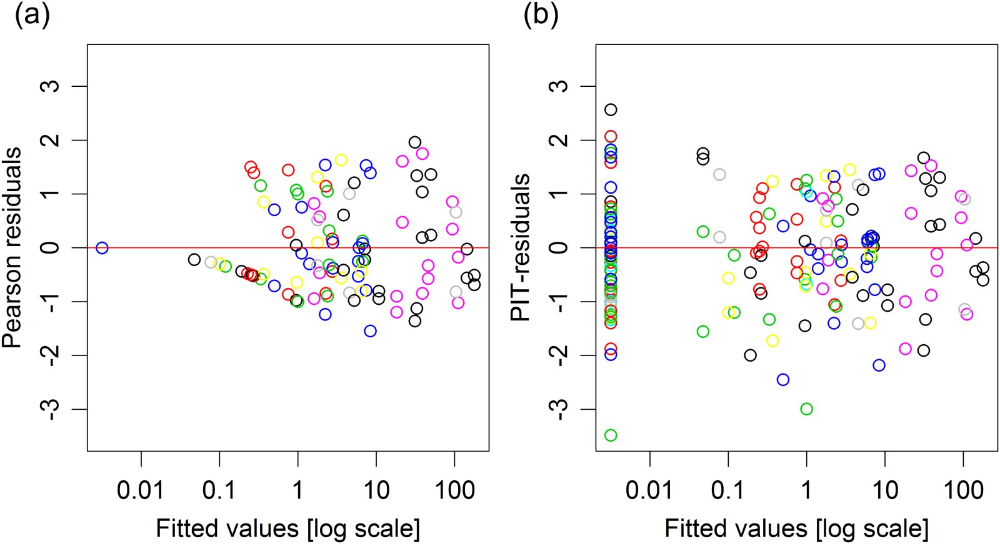{fig-align="center" height="330px" fig-alt="Dois gráficos de resíduos contra os valores ajustados, em escala log, para dados de contagem. À esquerda, os resíduos de Pearson formam faixas e se acumulam em valores baixos. À direita, os resíduos PIT se espalham de forma homogênea em torno de zero."}

- Com dados discretos, os resíduos de Pearson formam **faixas** (a) e não
  servem para reamostrar.
- Os resíduos **PIT** (*probability integral transform*, os de Dunn-Smyth)
  são contínuos e bem comportados (b): o *PIT-trap* reamostra esses resíduos.

::: {.ref}
Figura de [Warton, Thibaut & Wang (2017)](https://doi.org/10.1371/journal.pone.0181790) *PLoS ONE* 12: e0181790, CC BY 4.0.
:::

## O teste multivariado {.medio}

:::: {.columns}
::: {.column width="55%"}
::: {.tabela-grande}
```{r}
tb <- md$av$table[-1, ]
knitr::kable(data.frame(Preditora = unname(nomes_amb[rownames(tb)]),
                        Desvio = num(tb$Dev, 1),
                        p = pv(tb[["Pr(>Dev)"]])),
             align = "lrr")
```
:::
:::
::: {.column width="45%"}
- O desvio é a soma das **razões de verossimilhança** das 12 espécies.
- O *p* vem de 999 reamostragens *PIT-trap*.
- Os testes são sequenciais (tipo I): a ordem das preditoras importa.
:::
::::

::: {.ref}
Aranhas de `mvabund::spider`, binomial negativa, variáveis padronizadas.
:::

## Quais espécies respondem?

```{r}
#| fig-alt: "Seis painéis, um por variável ambiental, com barras da razão de verossimilhança de cada uma das 12 espécies de aranhas; em vinho, as espécies com p ajustado menor que 0,05. O solo seco e o folhiço afetam muitas espécies; as herbáceas afetam duas; areia nua, musgo e reflexão não afetam nenhuma isoladamente."
#| fig-width: 13
#| fig-height: 5.4
#| out-height: 500px
fig_lr_especies(md)
```

Os testes univariados (`p.uni = "adjusted"`) mostram **quais espécies** são
responsáveis pelo efeito, como as espécies indicadoras (Aula 3).

## Vantagens do `mvabund`

- Permite incluir o efeito do local explicitamente (`offset`, efeito de
  linha), controlando a abundância total na composição de espécies.
- Separa o efeito sobre a **composição** do efeito sobre a abundância total
  (`composition = TRUE`).
- Testa qualquer delineamento de GLM: fatores, interações, covariáveis.

::: {.ref}
[Wang et al. (2012)](https://doi.org/10.1111/j.2041-210X.2012.00190.x);
[Warton, Thibaut & Wang (2017)](https://doi.org/10.1371/journal.pone.0181790).
:::

# 5. Modelos conjuntos de distribuição de espécies {.secao}

[Modelos]{.familia .modelos}

## Por que *joint*? {.medio}

- Um modelo para cada espécie, mas **ajustados juntos**: testam o efeito das
  covariáveis na abundância ou na incidência de cada uma.
- Partição da variação entre preditoras e componentes aleatórios.
- Fatores aleatórios para efeitos de local, espaço e tempo.
- As associações residuais entre espécies, pelas variáveis latentes.

::: {.ref}
[Warton et al. (2015) *TREE*](https://doi.org/10.1016/j.tree.2015.09.007);
[Ovaskainen & Abrego (2020)](https://doi.org/10.1017/9781108591720) *Joint Species Distribution Modelling*,
Cambridge University Press.
:::

## Os dados de um JSDM

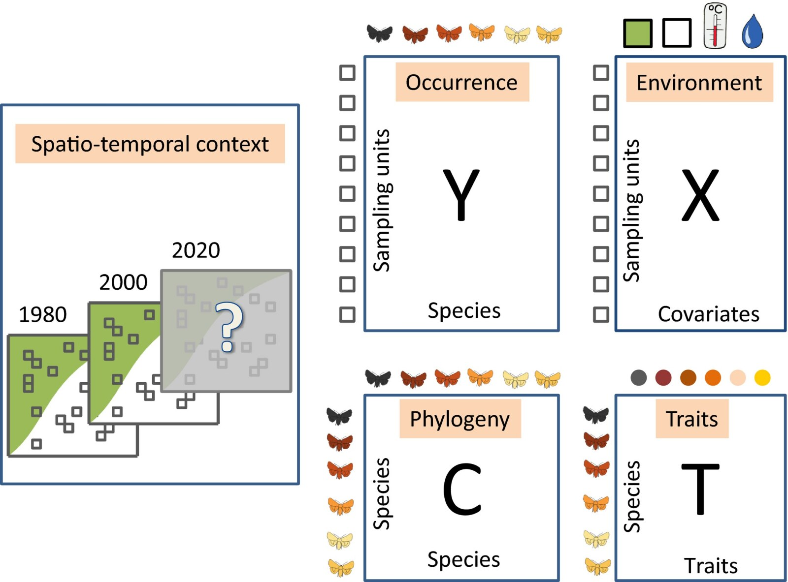{fig-align="center" height="480px" fig-alt="Esquema dos dados de comunidades: a matriz Y de ocorrências das espécies nas unidades amostrais, a matriz X das covariáveis ambientais, a matriz T dos atributos das espécies, a matriz C das correlações filogenéticas e o contexto espaço-temporal das amostras."}

**Y**: ocorrências; **X**: ambiente; **T**: atributos; **C**: filogenia; e o
contexto espaço-temporal.

::: {.ref}
Figura de [Ovaskainen et al. (2017)](https://doi.org/10.1111/ele.12757) *Ecol. Lett.* 20: 561–576, CC BY 4.0.
:::

## O modelo HMSC {.medio}

:::: {.columns}
::: {.column width="58%"}
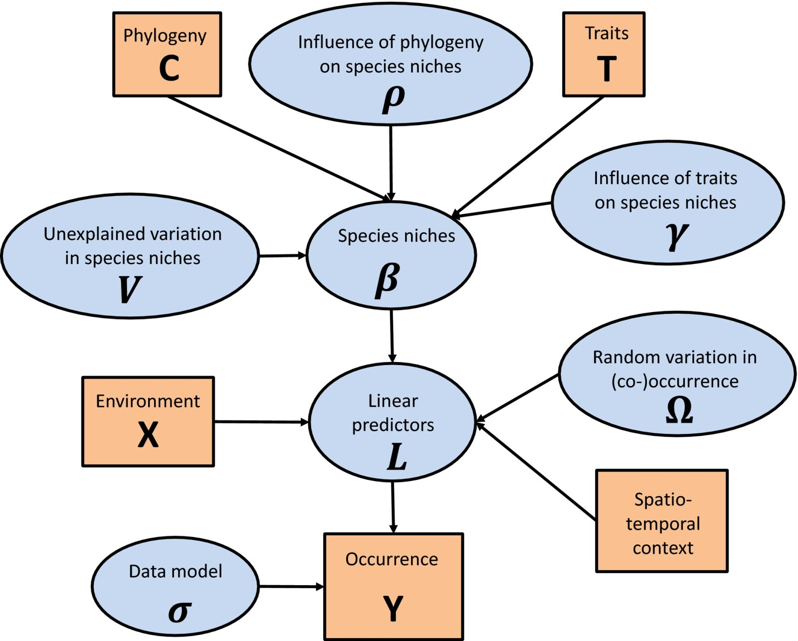{height="540px" fig-alt="Grafo acíclico dirigido do HMSC: em laranja, os dados (ambiente X, atributos T, filogenia C, contexto espaço-temporal e ocorrência Y); em azul, os parâmetros (nichos das espécies beta, influência dos atributos gama e da filogenia rô, variação aleatória ômega, preditores lineares L e o modelo dos dados sigma)."}
:::
::: {.column width="42%"}
- Dados em laranja; parâmetros estimados (bayesianos) em azul.
- Os atributos (**T**) e a filogenia (**C**) informam os nichos das espécies
  (**β**).
- O contexto espaço-temporal entra pelos efeitos aleatórios (**Ω**): as
  associações residuais.
:::
::::

::: {.ref}
Figura de [Ovaskainen et al. (2017)](https://doi.org/10.1111/ele.12757), CC BY 4.0.
[Tikhonov et al. (2020)](https://doi.org/10.1111/2041-210X.13345) *Methods Ecol. Evol.* 11: 442–447 (pacote `Hmsc`).
:::

## Um exemplo de HMSC {.medio}

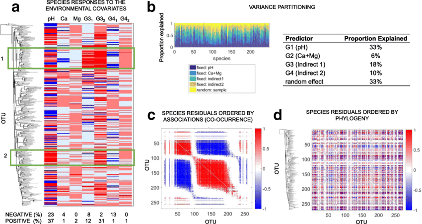{fig-align="center" height="380px" fig-alt="Quatro painéis de um HMSC para comunidades de procariotos ao longo de um gradiente de pH: as respostas das espécies às covariáveis ambientais, a partição de variância entre os preditores, e as associações residuais entre espécies, ordenadas por agrupamento, com blocos de associações positivas e negativas."}

Comunidades de procariotos ao longo de um gradiente de pH: respostas das
espécies ao ambiente (a), partição de variância (b) e associações residuais
entre as espécies (c, d).

::: {.ref}
Figura de [Lammel et al. (2018)](https://doi.org/10.1186/s40168-018-0482-8) *Microbiome* 6: 106, CC BY 4.0.
:::

## JSDMs na prática {.medio}

:::: {.columns}
::: {.column width="62%"}
- `Hmsc` (bayesiano): o mais completo, com atributos, filogenia, espaço e
  tempo ([Tikhonov et al. 2020](https://doi.org/10.1111/2041-210X.13345)).
- `sjSDM`: eficiente com conjuntos grandes de dados; troca as variáveis
  latentes por uma aproximação de Monte Carlo. Particiona a variação de cada
  espécie entre ambiente, espaço e associações (à direita).
- Comparações: [Wilkinson et al. (2019)](https://doi.org/10.1111/2041-210X.13106),
  [Norberg et al. (2019)](https://doi.org/10.1002/ecm.1370) e
  [Zurell, Zimmermann & Gross (2020)](https://doi.org/10.1111/jbi.13608).
:::
::: {.column width="38%"}
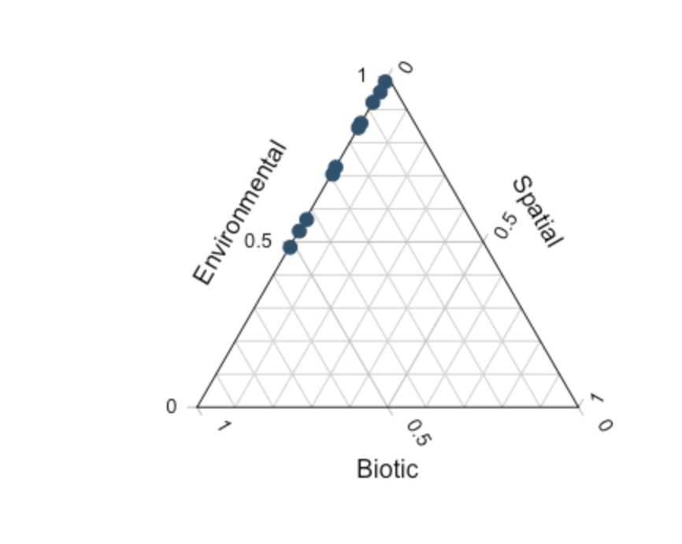{height="380px" fig-alt="Diagrama ternário com os vértices ambiental, espacial e biótico; os pontos das espécies se alinham perto do lado entre o ambiental e o biótico."}
:::
::::

::: {.ref}
Figura de [Pichler & Hartig (2021)](https://doi.org/10.1111/2041-210X.13687) *Methods Ecol. Evol.* 12: 2159–2173, CC BY 4.0;
[Wilkinson et al. (2019)](https://doi.org/10.1111/2041-210X.13106); [Norberg et al. (2019)](https://doi.org/10.1002/ecm.1370);
[Zurell et al. (2020)](https://doi.org/10.1111/jbi.13608).
:::

## O que os dados observacionais revelam? {.medio}

:::: {.columns}
::: {.column width="55%"}
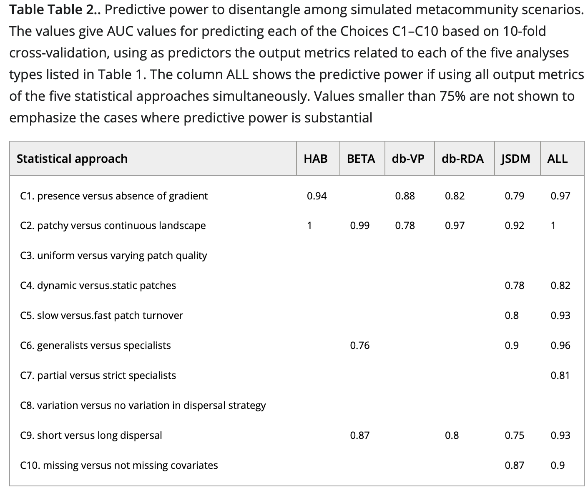{height="540px" fig-alt="Tabela do poder preditivo de cinco abordagens estatísticas para distinguir dez cenários de metacomunidades simulados: análise de hábitat, diversidade beta, partição de variância, db-RDA e JSDM. A coluna dos JSDMs tem os valores mais altos na maioria dos cenários."}
:::
::: {.column width="45%"}
- Simulação de **10 cenários** de metacomunidades (gradientes, dispersão,
  especialistas e generalistas, covariáveis ausentes).
- Os **JSDMs** foram os que melhor capturaram os processos que geraram as
  comunidades, melhor que a diversidade beta, a partição de variância e a
  db-RDA.
:::
::::

::: {.ref}
Tabela de [Ovaskainen, Rybicki & Abrego (2019)](https://doi.org/10.1111/ecog.04444) *Ecography* 42: 1877–1886, CC BY 3.0.
:::

## JSDM e metacomunidades

- Com o HMSC, dá para investigar a contribuição de cada **espécie** e de cada
  **local** para os padrões em escala de metacomunidade: a "estrutura interna"
  da metacomunidade.
- Os locais e as espécies diferem no quanto respondem ao ambiente, ao espaço
  e às associações.

::: {.ref}
[Leibold et al. (2022)](https://doi.org/10.1111/oik.08618) *Oikos* 2022: e08618.
:::

## Co-ocorrência não é interação {.medio}

- A covariância dos resíduos dá a **co-distribuição**, não a interação.
- Abordagens correlativas não substituem estudos mecanísticos: combine JSDMs
  com experimentos e atributos.
- Desenho amostral, variáveis incluídas e escala são essenciais para inferir
  relações entre espécies; a competidora inferior pode já ter sido excluída.
- A correlação residual mistura interações, ambiente não medido e erros do
  modelo.

::: {.ref}
[Blanchet, Cazelles & Gravel (2020)](https://doi.org/10.1111/ele.13525) *Ecol. Lett.* 23: 1050–1063;
[Dormann et al. (2018)](https://doi.org/10.1111/geb.12759) *Glob. Ecol. Biogeogr.* 27: 1004–1016;
[Poggiato et al. (2021)](https://doi.org/10.1016/j.tree.2021.01.002) *Trends Ecol. Evol.* 36: 391–401.
:::

## Os JSDMs detectam interações? {.medio}

:::: {.columns}
::: {.column width="45%"}
- Detectam bem competição e facilitação/mutualismo, mas não relações
  predador-presa.
- O valor da correlação não reflete a força da interação: depende da
  prevalência das espécies.
- E depende da **escala espacial**: as matrizes de associação mudam com o
  tamanho do grão (colunas) e com o período (linhas).
:::
::: {.column width="55%"}
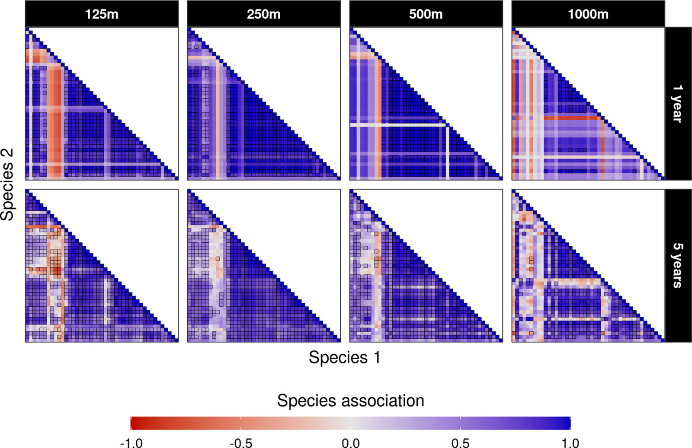{height="380px" fig-alt="Oito matrizes de associação entre espécies estimadas por JSDMs, em quatro tamanhos de grão, de 125 a 1000 metros, e dois períodos de amostragem; o padrão de associações positivas e negativas muda com a escala."}
:::
::::

::: {.ref}
[Zurell, Pollock & Thuiller (2018)](https://doi.org/10.1111/ecog.03315) *Ecography* 41: 1812–1819;
figura de [König et al. (2021)](https://doi.org/10.1111/jbi.14106) *J. Biogeogr.* 48: 1541–1551, CC BY-NC 4.0.
:::

## Associação direta ou indireta?

```{r}
#| fig-alt: "Duas redes com três espécies, A, M e B. Na correlação, as três estão ligadas, inclusive A e B, com 0,68. Na correlação parcial, A e B não estão mais ligadas (0,01): a associação entre elas passava pela espécie mediadora M."
#| fig-width: 11
#| fig-height: 4.4
#| out-height: 400px
fig_mediadora()
```

A correlação entre A e B vem toda da espécie **mediadora** M. A correlação
**parcial**, condicionada às outras espécies, separa associações diretas de
indiretas (modelos gráficos).

::: {.ref}
[Popovic et al. (2019)](https://doi.org/10.1111/2041-210X.13247) *Methods Ecol. Evol.* 10: 1571–1583. Dados simulados.
:::

## Associações diretas entre as aranhas {.medio}

:::: {.columns}
::: {.column width="55%"}
```{r}
#| fig-alt: "Rede das 12 espécies de aranhas em círculo, com as associações diretas estimadas por um modelo gráfico com cópulas, depois de controlar o ambiente. As linhas azuis são associações positivas, mais grossas quanto mais fortes; algumas espécies ficam isoladas."
#| fig-width: 6.6
#| fig-height: 6.2
#| out-height: 560px
fig_rede_aranhas(md)
```
:::
::: {.column width="45%"}
- Modelo gráfico com cópulas (`ecoCopula::cgr`), depois de controlar as 6
  variáveis ambientais.
- Cada linha é uma **correlação parcial**: associação direta, descontadas as
  outras espécies.
- Funciona com abundância, biomassa, proporção e dados ordinais.

```r
cgr(manyglm(Y ~ ., data = X,
  family = "negative.binomial"))
```
:::
::::

::: {.ref}
Aranhas de `mvabund::spider`. [Popovic et al. (2019)](https://doi.org/10.1111/2041-210X.13247).
:::

## Para continuar estudando

- [Warton et al. (2015) *TREE*](https://doi.org/10.1016/j.tree.2015.09.007): a visão geral.
- [Warton (2022) *Eco-Stats: Data Analysis in Ecology*](https://doi.org/10.1007/978-3-030-88443-7): o livro, dos GLMs aos métodos multivariados baseados em modelos.
- [Ovaskainen & Abrego (2020)](https://doi.org/10.1017/9781108591720): o livro dos JSDMs, com o `Hmsc`.
- [Niku et al. (2019)](https://doi.org/10.1111/2041-210X.13303) e [van der Veen et al. (2023)](https://doi.org/10.1111/2041-210X.14035): `gllvm` e a ordenação concorrente.
- [Poggiato et al. (2021)](https://doi.org/10.1016/j.tree.2021.01.002): como interpretar um JSDM.
- [Hartig et al. (2024)](https://doi.org/10.1016/j.tree.2023.09.017): os dados novos de comunidades e para onde vão os métodos.
